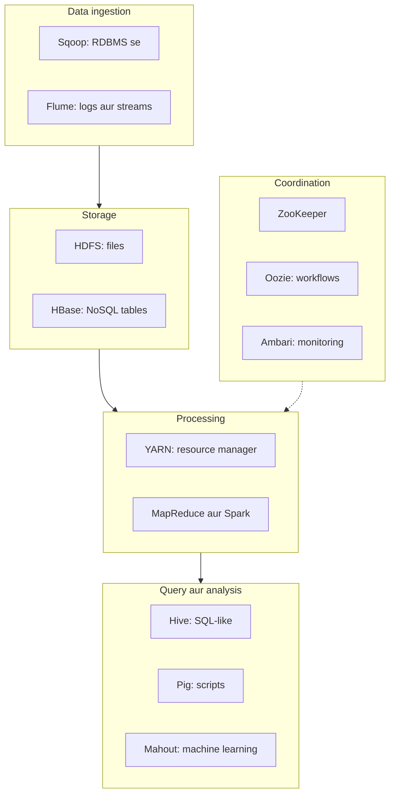

**In simple words:** **Hadoop ecosystem** un tools ka family hai jo Hadoop ke core (HDFS, YARN aur MapReduce) ke around bane hain. Core data store aur process karta hai, lekin raw MapReduce Java mein likhna mushkil hai, aur real project ko loading, querying, coordination aur scheduling bhi chahiye. Har tool ek aisi gap bharta hai. <Cite id="hadoop-ecosystem-gfg-hadoop-ecosystem" /> <Cite id="hadoop-ecosystem-av-hadoop-ecosystem" />

<Cite id="hadoop-ecosystem-gfg-hadoop-ecosystem" loc="diagram" />

**Components detail mein**

1. **HDFS (storage).** Bahut bade files ko blocks (default 128 MB) mein rakhta hai, har block 3 machines par copy hota hai. NameNode metadata rakhta hai aur DataNodes blocks.
2. **YARN (resource management).** Cluster ki CPU aur memory applications mein baantta hai, to kai jobs ek saath chal sakte hain.
3. **MapReduce (batch processing).** Programmer map aur reduce function likhta hai; framework kaam split karta hai, key ke hisaab se shuffle karta hai aur fail hue tasks dobara chalata hai.
4. **Hive (query).** Analysts HDFS ke data par SQL-like HiveQL likh sakte hain; har query cluster par jobs mein badal jaati hai. <Cite id="hadoop-ecosystem-apache-hive" />
5. **Pig (scripting).** Data-flow language (Pig Latin) jisme load, filter, group aur join steps likhte hain, lambe Java code ki jagah.
6. **HBase (NoSQL database).** HDFS par column-oriented database, Bigtable jaisa, single rows ke fast read aur write ke liye. <Cite id="hadoop-ecosystem-apache-hbase" />
7. **Spark (fast engine).** Data memory mein rakhta hai, isliye iterative jobs, machine learning aur streaming ke liye achha hai. <Cite id="hadoop-ecosystem-apache-spark" />
8. **Mahout (machine learning).** Scalable algorithms jaise recommendation aur clustering.
9. **Sqoop (ingestion).** Relational databases aur HDFS ke beech bulk copy.
10. **Flume (ingestion).** Server logs jaisa streaming data HDFS mein collect karta hai.
11. **ZooKeeper (coordination).** Configuration, naming, locks aur leader election ke liye ek service. <Cite id="hadoop-ecosystem-apache-zookeeper" />
12. **Oozie (scheduling).** Jobs ki chain (workflow) sahi order mein chalata hai.
13. **Ambari (management).** Cluster set up aur monitor karne ka web tool.

**Example flow.** Sqoop customer tables aur Flume web logs HDFS mein load karta hai. Hive ya Pig YARN se unhe clean aur summarise karta hai. Spark model train karta hai. Oozie poori chain har raat chalata hai.

**Conclusion:** core storage aur processing deta hai, aur ecosystem tools loading, querying, analysis aur management jodte hain, to ek cluster par poori big-data pipeline chal sakti hai. Kuch tools (jaise Sqoop) ab Apache ne retire kar diye hain, lekin exam mein classic list hi puchte hain. <Cite id="hadoop-ecosystem-apache-hadoop" />

Exam mein English mein likho: "The Hadoop ecosystem is the set of tools built around HDFS, YARN and MapReduce for ingestion, storage, processing, querying and coordination."
