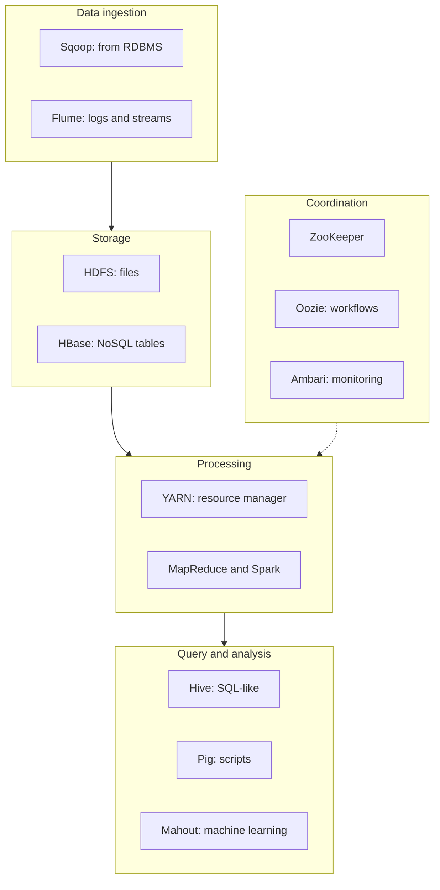

**In simple words:** the **Hadoop ecosystem** is the family of tools built around Hadoop's core (HDFS, YARN and MapReduce). The core stores and processes data, but writing raw MapReduce in Java is hard, and a real project also needs loading, querying, coordination and scheduling. Each tool fills one such gap. <Cite id="hadoop-ecosystem-gfg-hadoop-ecosystem" /> <Cite id="hadoop-ecosystem-av-hadoop-ecosystem" />

<Cite id="hadoop-ecosystem-gfg-hadoop-ecosystem" loc="diagram" />

**The components in detail**

1. **HDFS (storage).** Stores very large files as blocks (128 MB by default), each copied to three machines. A NameNode keeps the metadata and DataNodes keep the blocks.
2. **YARN (resource management).** Shares the cluster's CPU and memory between applications, so many jobs can run together.
3. **MapReduce (batch processing).** The programmer writes a map and a reduce function; the framework splits the work, shuffles by key and re-runs failed tasks.
4. **Hive (query).** Lets analysts write SQL-like HiveQL on data in HDFS; each query is turned into jobs on the cluster. <Cite id="hadoop-ecosystem-apache-hive" />
5. **Pig (scripting).** A data-flow language (Pig Latin) for load, filter, group and join steps instead of long Java code.
6. **HBase (NoSQL database).** A column-oriented database on HDFS, modelled on Bigtable, for fast reads and writes of single rows. <Cite id="hadoop-ecosystem-apache-hbase" />
7. **Spark (fast engine).** Keeps data in memory, so it is good for iterative jobs, machine learning and streaming. <Cite id="hadoop-ecosystem-apache-spark" />
8. **Mahout (machine learning).** Scalable algorithms such as recommendation and clustering.
9. **Sqoop (ingestion).** Bulk copy between relational databases and HDFS.
10. **Flume (ingestion).** Collects streaming data such as server logs into HDFS.
11. **ZooKeeper (coordination).** One service for configuration, naming, locks and leader election. <Cite id="hadoop-ecosystem-apache-zookeeper" />
12. **Oozie (scheduling).** Runs a chain of jobs (a workflow) in the right order.
13. **Ambari (management).** A web tool to set up and monitor the cluster.

**Example flow.** Sqoop loads customer tables and Flume loads web logs into HDFS. Hive or Pig cleans and summarises them using YARN. Spark trains a model. Oozie runs the whole chain every night.

**Conclusion:** the core gives storage and processing, and the ecosystem tools add loading, querying, analysis and management, so one cluster can run a complete big-data pipeline. Some tools (for example Sqoop) have since been retired by Apache, but exams still ask the classic list. <Cite id="hadoop-ecosystem-apache-hadoop" />
