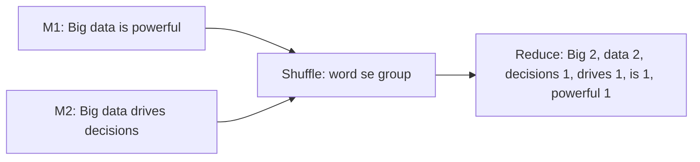

**In simple words:** word count MapReduce ka "hello world" hai. **Map** function har word ke liye `(word, 1)` emit karta hai. Framework same words ko group karta hai (shuffle and sort). **Reduce** function har word ke 1s ko add karta hai. <Cite id="mapreduce-gfg-wordcount" /> <Cite id="hadoop-ecosystem-dean2004" />

**Pseudo code**

```
map(key, value):            // key = line offset, value = text ki ek line
    for each word w in value:
        emit(w, 1)

reduce(key, values):        // key = ek word, values = 1s ki list (ya partial counts)
    sum = 0
    for each v in values:
        sum = sum + v
    emit(key, sum)
```

<Cite id="hadoop-ecosystem-apache-mr-tutorial" />

<Sum>

<Given>

Document: "Big data is powerful. Big data drives decisions." Maan lo punctuation hata diya gaya hai, words case sensitive hain, aur har sentence apne alag map task mein jaata hai.

</Given>

<Find>

map output, shuffle groups aur final word counts.

</Find>

<Steps>

1. **Map.** Har word ke liye ek `(word, 1)` pair. *Reason: map har word dekhne par 1 emit karta hai.*

   | Map task | Input | Map output |
   |---|---|---|
   | M1 | Big data is powerful | (Big,1) (data,1) (is,1) (powerful,1) |
   | M2 | Big data drives decisions | (Big,1) (data,1) (drives,1) (decisions,1) |

2. **Shuffle and sort.** Saare pairs collect karo, key se group karo aur keys sort karo. *Reason: ek word ki saari values ek hi reducer tak pahunchni chahiye.*

   | Key | Grouped values |
   |---|---|
   | Big | [1, 1] |
   | data | [1, 1] |
   | decisions | [1] |
   | drives | [1] |
   | is | [1] |
   | powerful | [1] |

3. **Reduce.** Har key ki values add karo.

</Steps>

<Answer>

(Big, 2), (data, 2), (decisions, 1), (drives, 1), (is, 1), (powerful, 1).

</Answer>

<Box kind="verify">

Document mein 8 words hain, aur counts ka sum $2 + 2 + 1 + 1 + 1 + 1 = 8$ hai, to koi word gum nahi hua. Aankh se dekho to sirf "Big" aur "data" do baar aaye hain. Agar "Big" aur "big" ko ek word maante (lower-case karke), to yahan result same rehta, kyunki dono baar capital hai.

</Box>

</Sum>




<Cite id="mapreduce-av" loc="diagram" />

**Optional combiner.** Yahan reduce ek sum hai, to wahi code har mapper par combiner ki tarah chal sakta hai aur pairs ko local add kar sakta hai. Is document mein kuch nahi badalta, kyunki ek sentence ke andar koi word repeat nahi hota, lekin bade text par bahut network traffic bachata hai.

**Conclusion:** programmer sirf map aur reduce likhta hai; splitting, shuffle, sorting aur failure handling framework karta hai.

Exam mein English mein likho: "Map emits (word, 1) for every word; reduce adds the values of each word."
