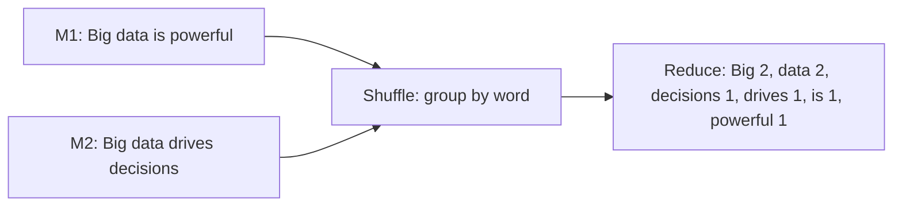

**In simple words:** word count is the "hello world" of MapReduce. The **map** function emits `(word, 1)` for every word. The framework groups equal words (shuffle and sort). The **reduce** function adds the 1s of each word. <Cite id="mapreduce-gfg-wordcount" /> <Cite id="hadoop-ecosystem-dean2004" />

**Pseudo code**

```
map(key, value):            // key = line offset, value = one line of text
    for each word w in value:
        emit(w, 1)

reduce(key, values):        // key = a word, values = list of 1s (or partial counts)
    sum = 0
    for each v in values:
        sum = sum + v
    emit(key, sum)
```

<Cite id="hadoop-ecosystem-apache-mr-tutorial" />

<Sum>

<Given>

Document: "Big data is powerful. Big data drives decisions." Assume punctuation is removed, words are case sensitive, and each sentence goes to its own map task.

</Given>

<Find>

the map output, the shuffle groups and the final word counts.

</Find>

<Steps>

1. **Map.** One `(word, 1)` pair for each word. *Reason: map emits a 1 for every word it sees.*

   | Map task | Input | Map output |
   |---|---|---|
   | M1 | Big data is powerful | (Big,1) (data,1) (is,1) (powerful,1) |
   | M2 | Big data drives decisions | (Big,1) (data,1) (drives,1) (decisions,1) |

2. **Shuffle and sort.** Collect all pairs, group by key and sort the keys. *Reason: all values of one word must reach the same reducer.*

   | Key | Grouped values |
   |---|---|
   | Big | [1, 1] |
   | data | [1, 1] |
   | decisions | [1] |
   | drives | [1] |
   | is | [1] |
   | powerful | [1] |

3. **Reduce.** Add the values of each key.

</Steps>

<Answer>

(Big, 2), (data, 2), (decisions, 1), (drives, 1), (is, 1), (powerful, 1).

</Answer>

<Box kind="verify">

The document has 8 words, and the counts add to $2 + 2 + 1 + 1 + 1 + 1 = 8$, so no word was lost. Only "Big" and "data" appear twice, as seen by eye. If "Big" and "big" were treated as one word (lower-casing), the result would be the same here, because both occurrences are capitalised.

</Box>

</Sum>




<Cite id="mapreduce-av" loc="diagram" />

**Optional combiner.** The reduce here is a sum, so the same code can run as a combiner on each mapper to add pairs locally. With this document it changes nothing, since no word repeats inside one sentence, but on large text it saves much network traffic.

**Conclusion:** the programmer writes only map and reduce; the framework does the splitting, shuffle, sorting and failure handling.
