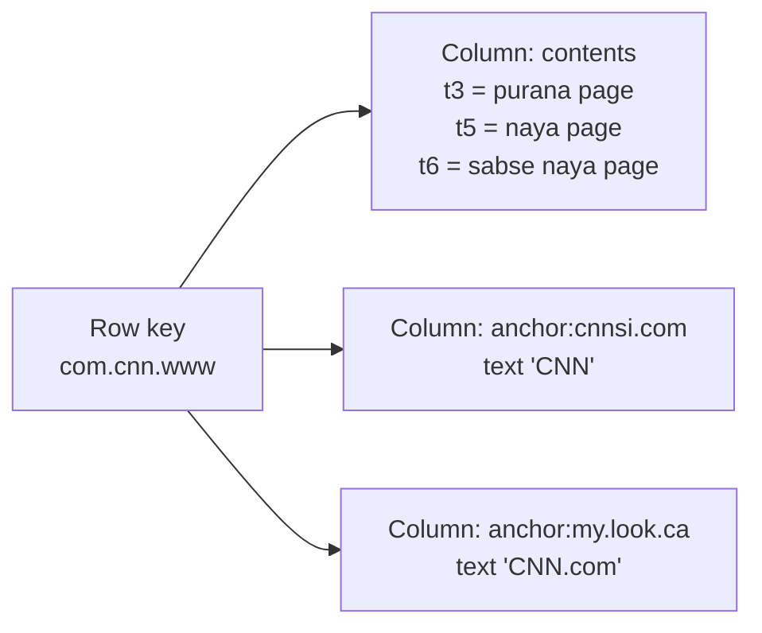
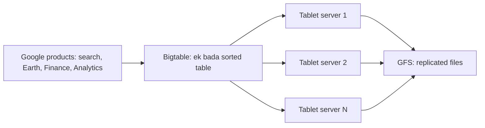

**In simple words:** Google ko bahut saare products ke liye web jitna bada structured data store aur serve karna tha. Ek bade server par ek relational database petabytes tak scale nahi kar sakta tha aur bahut mehenga tha. To Google ne **Bigtable** banaya, ek NoSQL store jo data hazaron sasti machines par failata hai. Ye NoSQL se business problem ko faster, cheaper aur zyada effectively solve karne ka standard case study hai. <Cite id="nosql-intro-bigtable" /> <Cite id="nosql-intro-wiki-bigtable" />

**Problem.** Web indexing, Google Earth, Google Finance aur Analytics sabko bahut alag-alag size ka data store karna tha, chhote URLs se lekar satellite images tak. Kuch ko users ko fast serve karna tha, kuch ko bulk processing. RDBMS itna scale nahi kar sakta tha. <Cite id="nosql-intro-bigtable" />

**Business drivers.** McCreary aur Kelly ke batae NoSQL ke chaar drivers: <Cite id="big-data-intro-nosql" />

| Driver | Bigtable case mein |
| --- | --- |
| Volume | Web pages, maps aur images ke petabytes, jo ek server mein nahi aate. |
| Velocity | Live products se har second bahut saare reads aur writes. |
| Variability | Har product ko alag columns chahiye; data ek fixed table mein nahi aata. |
| Agility | Teams ko naya data aur products jaldi jodne hain, har baar schema redesign kiye bina. |

**Isne problem kaise solve ki**

1. **Data model.** Ek bada sorted table, sparse map jo **row key, column key aur timestamp** se index hota hai. Khali cells ka koi cost nahi, aur purane versions timestamp se rehte hain.
2. **Scale out.** Table row ranges (tablets) mein kata jaata hai jo bahut saari commodity servers par failte hain. Zyada load ke liye bas aur machines jodo.
3. **Reliable storage.** Files Google File System par rehti hain, to machine fail hone par data nahi jaata. Lock service (Chubby) master chunti hai.

<Cite id="nosql-intro-bigtable" loc="diagram" /> <Cite id="nosql-intro-wiki-bigtable" loc="diagram" />

**Findings (results)**

| Fayda | Finding |
| --- | --- |
| Faster | Petabyte size par bhi single-row reads aur writes fast rehte hain, kyunki har machine ke paas chhota hissa hota hai. |
| Cheaper | Ye ek bahut mehengi machine ki jagah commodity servers ke cluster par chalta hai, aur machines jodne se capacity badhti hai. |
| More effective | August 2006 tak sixty se zyada Google projects ise use kar rahe the; users ko performance aur high availability pasand aayi; clients data layout control karte hain. |

Isne open-source stores HBase aur Cassandra ko bhi inspire kiya. <Cite id="nosql-intro-bigtable" /> <Cite id="nosql-intro-hbase" />

**Conclusion:** jab volume, velocity, variability aur agility badhte hain, to Bigtable jaisa scale-out NoSQL store speed, cost aur fit mein single relational server se behtar hai. <Cite id="nosql-intro-gfg-intro" />

Exam mein English mein likho: "Bigtable is a distributed, sparse, sorted map indexed by row key, column key and timestamp that scales over commodity servers."
