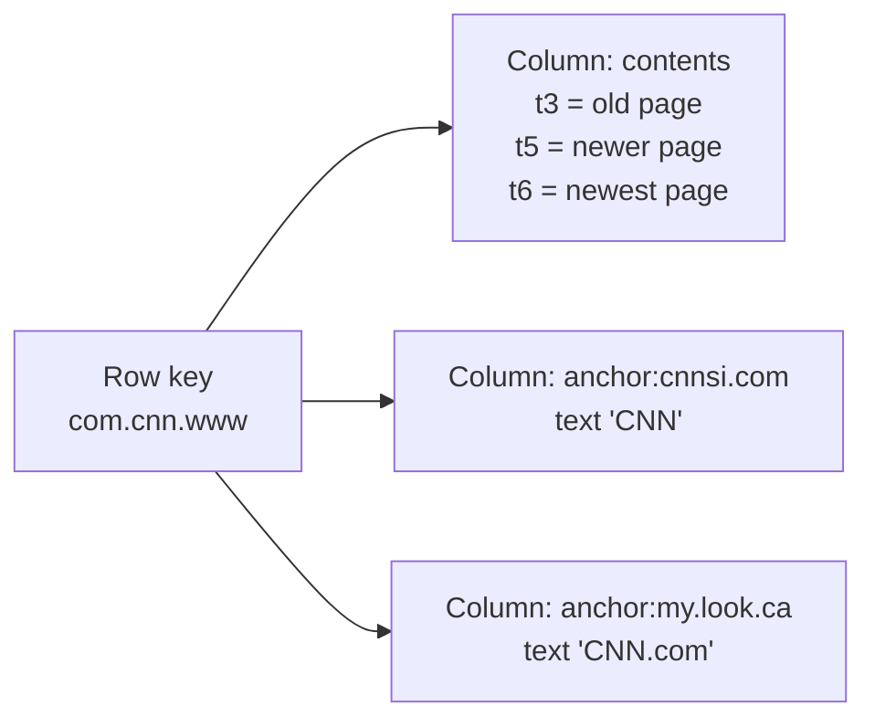
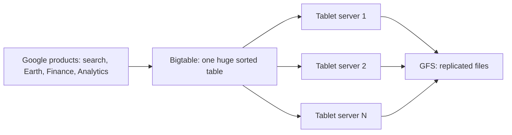

**In simple words:** Google had to store and serve a web-sized amount of structured data for many products. One relational database on one big server could not scale to petabytes and was too costly. So Google built **Bigtable**, a NoSQL store that spreads data over thousands of cheap machines. It is the standard case study of NoSQL solving a business problem faster, cheaper and more effectively. <Cite id="nosql-intro-bigtable" /> <Cite id="nosql-intro-wiki-bigtable" />

**The problem.** Web indexing, Google Earth, Google Finance and Analytics all needed to store data of very different sizes, from small URLs to satellite images. Some needed fast serving to users, others bulk processing. An RDBMS could not scale to this. <Cite id="nosql-intro-bigtable" />

**Business drivers.** The four drivers of NoSQL named by McCreary and Kelly: <Cite id="big-data-intro-nosql" />

| Driver | In the Bigtable case |
| --- | --- |
| Volume | Petabytes of web pages, maps and images, far more than one server can hold. |
| Velocity | Very many reads and writes per second from live products. |
| Variability | Each product needs different columns; the data does not fit one fixed table. |
| Agility | Teams must add new data and products quickly, without redesigning a schema each time. |

**How it solved the problem**

1. **Data model.** One big sorted table, a sparse map indexed by **row key, column key and timestamp**. Empty cells cost nothing, and old versions are kept by timestamp.
2. **Scale out.** The table is cut into row ranges (tablets) spread over many commodity servers. To handle more load, add more machines.
3. **Reliable storage.** Files are kept on the Google File System, so a failed machine does not lose data. A lock service (Chubby) elects the master.

<Cite id="nosql-intro-bigtable" loc="diagram" /> <Cite id="nosql-intro-wiki-bigtable" loc="diagram" />

**Findings (results)**

| Gain | Finding |
| --- | --- |
| Faster | Single-row reads and writes stay fast at petabyte size, because each machine holds only a small part. |
| Cheaper | It runs on clusters of commodity servers instead of one very costly machine, and capacity grows by adding machines. |
| More effective | By August 2006 more than sixty Google projects used it; users liked its performance and high availability; clients control the data layout. |

It also inspired the open-source stores HBase and Cassandra. <Cite id="nosql-intro-bigtable" /> <Cite id="nosql-intro-hbase" />

**Conclusion:** when volume, velocity, variability and agility grow, a scale-out NoSQL store such as Bigtable beats a single relational server on speed, cost and fit. <Cite id="nosql-intro-gfg-intro" />
