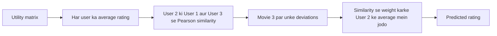

**In simple words:** ye **user-user collaborative filtering** hai. User 2 Movie 3 ko kya rating dega ye guess karne ke liye hum dekhte hain ki kin dusre users ka taste User 2 jaisa hai, aur unki Movie 3 ki ratings use karte hain. **Pearson correlation** batata hai do users kitne milte-julte hain: +1 matlab rating ka pattern same, 0 matlab koi link nahi, -1 matlab ulta taste. Ye ratings **minus har user ka apna average** par kaam karta hai, isliye easy marker aur strict marker ko bhi compare kar sakte hain. <Cite id="recommendation-systems-mmds-slides" /> <Cite id="recommendation-systems-wiki-pearson" /> <Cite id="recommendation-systems-google-cf" />

**Formulas.** $\bar r_a$ user $a$ ka average rating ho, aur sums un movies $i$ par chalte hain jo user $a$ aur $b$ dono ne rate ki hain:

$$
\text{sim}(a, b) = \frac{\sum_i (r_{a,i} - \bar r_a)(r_{b,i} - \bar r_b)}{\sqrt{\sum_i (r_{a,i} - \bar r_a)^2}\; \sqrt{\sum_i (r_{b,i} - \bar r_b)^2}}
$$

$$
\hat r_{a,p} = \bar r_a + \frac{\sum_b \text{sim}(a, b)\,(r_{b,p} - \bar r_b)}{\sum_b |\text{sim}(a, b)|}
$$

Dusra formula user ke apne average se shuru hota hai aur movie $p$ par neighbours ke **deviations** similarity se weight karke jodta hai. Negative similarity wala user prediction ko ulti taraf dhakelta hai.

<Sum>

<Given>

| Users | Movie 1 | Movie 2 | Movie 3 | Movie 4 | Movie 5 |
| --- | --- | --- | --- | --- | --- |
| User 1 | 2 | 3 | 2 | 1 | 1 |
| User 2 | 3 | 4 | ? | 4 | 3 |
| User 3 | 4 | 3 | 4 | 3 | 3 |

</Given>

<Find>

User 2 ka Movie 3 ke liye predicted rating.

</Find>

<Steps>

1. **Averages** (har user ne jo saari ratings di unka). User 1: $(2+3+2+1+1)/5 = 9/5 = 1.8$. User 2: $(3+4+4+3)/4 = 14/4 = 3.5$. User 3: $(4+3+4+3+3)/5 = 17/5 = 3.4$. *Reason: Pearson har user ke apne average se deviations par kaam karta hai.*
2. **Common movies.** User 2 ne Movie 3 rate nahi ki, to similarity Movies 1, 2, 4 aur 5 se nikalte hain, jo baaki dono users ne bhi rate ki hain.
3. In movies par **deviations** (rating minus apna average):

   | Movie | User 2 ($-3.5$) | User 1 ($-1.8$) | User 3 ($-3.4$) |
   |---|---|---|---|
   | 1 | $-0.5$ | $+0.2$ | $+0.6$ |
   | 2 | $+0.5$ | $+1.2$ | $-0.4$ |
   | 4 | $+0.5$ | $-0.8$ | $-0.4$ |
   | 5 | $-0.5$ | $-0.8$ | $-0.4$ |

4. **User 2 aur User 1 ki similarity.** Numerator: $(-0.5)(0.2) + (0.5)(1.2) + (0.5)(-0.8) + (-0.5)(-0.8) = -0.1 + 0.6 - 0.4 + 0.4 = 0.5$. Lengths: User 2 $= \sqrt{0.25 \times 4} = 1$; User 1 $= \sqrt{0.04 + 1.44 + 0.64 + 0.64} = \sqrt{2.76} = 1.661$. To $\text{sim}(2,1) = 0.5 / (1 \times 1.661) = 0.301$.
5. **User 2 aur User 3 ki similarity.** Numerator: $(-0.5)(0.6) + (0.5)(-0.4) + (0.5)(-0.4) + (-0.5)(-0.4) = -0.3 - 0.2 - 0.2 + 0.2 = -0.5$. User 3 ki length $= \sqrt{0.36 + 0.16 + 0.16 + 0.16} = \sqrt{0.84} = 0.917$. To $\text{sim}(2,3) = -0.5 / (1 \times 0.917) = -0.545$.
6. **Movie 3 par deviations.** User 1: $2 - 1.8 = +0.2$. User 3: $4 - 3.4 = +0.6$.
7. **Prediction.**

   $$
   \hat r = 3.5 + \frac{0.301 \times 0.2 + (-0.545) \times 0.6}{0.301 + 0.545} = 3.5 + \frac{0.0602 - 0.3273}{0.846} = 3.5 - 0.316 = 3.18
   $$

</Steps>

<Answer>

User 2 ka Movie 3 ke liye predicted rating $\approx 3.2$ (3.18).

</Answer>

<Box kind="verify">

Check 1: har user ke rate kiye movies par deviations ka sum zero hota hai, User 2 ke liye: $-0.5 + 0.5 + 0.5 - 0.5 = 0$. Check 2 (sign): User 3 User 2 se ulta hai ($\text{sim} < 0$) aur usne Movie 3 apne average se upar (+0.6) rate ki, to User 2 apne average 3.5 se neeche dhakela jaata hai; answer 3.18, 3.5 se neeche hai, jaisa hona chahiye. Check 3: weights $0.301/0.846 = 0.356$ aur $0.545/0.846 = 0.644$ hain, to $3.5 + 0.356 \times 0.2 - 0.644 \times 0.6 = 3.5 + 0.071 - 0.387 = 3.18$. Agar averages sirf common movies par lein (User 1 ka 1.75 aur User 3 ka 3.25), result 3.09 aata hai, lagbhag same. Agar sirf positive similarity wala User 1 use karein, prediction $3.5 + 0.2 = 3.7$ hai. Likho ki tum kaunsa version use kar rahe ho.

</Box>

</Sum>

| Collaborative filtering ke advantages | Disadvantages |
|---|---|
| Item features nahi chahiye | Naye users aur movies ke liye cold start |
| Surprising items dhoondh sakta hai | Rating matrix sparse hota hai |
| Zyada users aane par behtar hota hai | Lakhon users tak scale karna mushkil |

<Cite id="recommendation-systems-wiki-cf" /> <Cite id="recommendation-systems-av" />

**Conclusion:** Pearson correlation dikhata hai ki User 2, User 1 jaisa hai (0.30) aur User 3 se ulta (-0.55); Movie 3 par unki opinions jodne se predicted rating lagbhag 3.2 aati hai.

Exam mein English mein likho: "Predicted rating = user's average + similarity-weighted deviations of the neighbours from their own averages."
