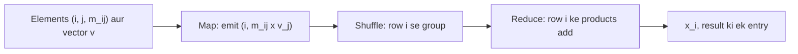

**In simple words:** $x = M v$ mein entry $x_i = \sum_j m_{ij} v_j$ hai: row $i$ ke har number ko usi column ki vector entry se multiply karo, aur add karo. MapReduce mein **map** step har ek multiplication $m_{ij} \cdot v_j$ karta hai aur use row number $i$ ka label deta hai. **Reduce** step wo saare products add karta hai jinka row number same hai. Hum maante hain ki vector $v$ itna chhota hai ki har map task ki memory mein aa jaata hai. <Cite id="hadoop-ecosystem-mmds" loc="§2.3.1" /> <Cite id="mapreduce-algorithms-wiki-matmul" />

**Pseudo code**

```text
map(i, j, m_ij):            // matrix ka ek element; vector v memory mein loaded hai
    emit(i, m_ij * v[j])

reduce(i, products):        // i = row number, products = row i ki saari values
    sum = 0
    for each p in products:
        sum = sum + p
    emit(i, sum)
```

Matrix triples $(i, j, m_{ij})$ ki tarah store hota hai, to bahut bade ya sparse matrix ko ek jagah rakhna nahi padta.

<Sum>

<Given>

$M = \begin{bmatrix} 1 & 2 & 3 \\ 4 & 5 & 6 \\ 7 & 8 & 9 \end{bmatrix}$ aur $V = \begin{bmatrix} 1 \\ 2 \\ 3 \end{bmatrix}$, yani $v_1 = 1$, $v_2 = 2$, $v_3 = 3$.

</Given>

<Find>

map, shuffle aur reduce se $X = M \times V$.

</Find>

<Steps>

1. **Input.** 9 elements $(i, j, m_{ij})$: $(1,1,1), (1,2,2), (1,3,3), (2,1,4), (2,2,5), (2,3,6), (3,1,7), (3,2,8), (3,3,9)$.
2. **Map.** Har element ke liye $(i, m_{ij} \times v_j)$ emit karo. *Reason: key row number hai, kyunki ek row ke saare products saath jodne hain.*

   | Input $(i, j, m_{ij})$ | Calculation | Map output |
   |---|---|---|
   | (1,1,1) | $1 \times 1$ | (1, 1) |
   | (1,2,2) | $2 \times 2$ | (1, 4) |
   | (1,3,3) | $3 \times 3$ | (1, 9) |
   | (2,1,4) | $4 \times 1$ | (2, 4) |
   | (2,2,5) | $5 \times 2$ | (2, 10) |
   | (2,3,6) | $6 \times 3$ | (2, 18) |
   | (3,1,7) | $7 \times 1$ | (3, 7) |
   | (3,2,8) | $8 \times 2$ | (3, 16) |
   | (3,3,9) | $9 \times 3$ | (3, 27) |

3. **Shuffle and sort.** Key se group karo. *Reason: ek reducer ko ek row ke saare products dikhne chahiye.*

   | Key (row) | Grouped values |
   |---|---|
   | 1 | [1, 4, 9] |
   | 2 | [4, 10, 18] |
   | 3 | [7, 16, 27] |

4. **Reduce.** Har key ki values add karo: row 1 $= 1 + 4 + 9 = 14$; row 2 $= 4 + 10 + 18 = 32$; row 3 $= 7 + 16 + 27 = 50$.

</Steps>

<Answer>

$X = \begin{bmatrix} 14 \\ 32 \\ 50 \end{bmatrix}$, yani (1, 14), (2, 32), (3, 50).

</Answer>

<Box kind="verify">

Check 1 (seedha multiplication): row 1 $= 1\cdot1 + 2\cdot2 + 3\cdot3 = 14$, row 2 $= 4 + 10 + 18 = 32$, row 3 $= 7 + 16 + 27 = 50$. Check 2 (column sums): $M$ ke column sums 12, 15, 18 hain, aur $12 \cdot 1 + 15 \cdot 2 + 18 \cdot 3 = 12 + 30 + 54 = 96$, jo $14 + 32 + 50 = 96$ ke barabar hai.

</Box>

</Sum>




**Agar vector memory mein nahi aata,** to matrix ko vertical stripes mein aur vector ko matching pieces mein kaato. Tab map task vector ka sirf ek piece load karta hai; keys aur reduce wahi rehte hain. Har mapper par row ke products add karne wala combiner network traffic kam karta hai. <Cite id="hadoop-ecosystem-mmds" loc="§2.3.1" />

**Conclusion:** map multiply karta hai, reduce add karta hai, aur row number key hai. Yahan $M \times V = (14, 32, 50)^T$.

Exam mein English mein likho: "Map emits (i, m_ij x v_j); reduce sums the values of each row i."
