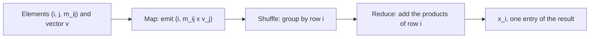

**In simple words:** in $x = M v$, the entry $x_i = \sum_j m_{ij} v_j$: multiply each number of row $i$ by the vector entry in the same column, and add. In MapReduce, the **map** step does every single multiplication $m_{ij} \cdot v_j$ and labels it with its row number $i$. The **reduce** step adds all the products that carry the same row number. We assume the vector $v$ is small enough to sit in the memory of every map task. <Cite id="hadoop-ecosystem-mmds" loc="§2.3.1" /> <Cite id="mapreduce-algorithms-wiki-matmul" />

**Pseudo code**

```text
map(i, j, m_ij):            // one matrix element; vector v is loaded in memory
    emit(i, m_ij * v[j])

reduce(i, products):        // i = row number, products = all values for row i
    sum = 0
    for each p in products:
        sum = sum + p
    emit(i, sum)
```

The matrix is stored as triples $(i, j, m_{ij})$, so a very large or sparse matrix never needs to be held in one place.

<Sum>

<Given>

$M = \begin{bmatrix} 1 & 2 & 3 \\ 4 & 5 & 6 \\ 7 & 8 & 9 \end{bmatrix}$ and $V = \begin{bmatrix} 1 \\ 2 \\ 3 \end{bmatrix}$, so $v_1 = 1$, $v_2 = 2$, $v_3 = 3$.

</Given>

<Find>

$X = M \times V$ using map, shuffle and reduce.

</Find>

<Steps>

1. **Input.** The 9 elements $(i, j, m_{ij})$: $(1,1,1), (1,2,2), (1,3,3), (2,1,4), (2,2,5), (2,3,6), (3,1,7), (3,2,8), (3,3,9)$.
2. **Map.** For each element emit $(i, m_{ij} \times v_j)$. *Reason: the key is the row number, because all products of one row must be added together.*

   | Input $(i, j, m_{ij})$ | Calculation | Map output |
   |---|---|---|
   | (1,1,1) | $1 \times 1$ | (1, 1) |
   | (1,2,2) | $2 \times 2$ | (1, 4) |
   | (1,3,3) | $3 \times 3$ | (1, 9) |
   | (2,1,4) | $4 \times 1$ | (2, 4) |
   | (2,2,5) | $5 \times 2$ | (2, 10) |
   | (2,3,6) | $6 \times 3$ | (2, 18) |
   | (3,1,7) | $7 \times 1$ | (3, 7) |
   | (3,2,8) | $8 \times 2$ | (3, 16) |
   | (3,3,9) | $9 \times 3$ | (3, 27) |

3. **Shuffle and sort.** Group by key. *Reason: one reducer must see all products of a row.*

   | Key (row) | Grouped values |
   |---|---|
   | 1 | [1, 4, 9] |
   | 2 | [4, 10, 18] |
   | 3 | [7, 16, 27] |

4. **Reduce.** Add the values of each key: row 1 $= 1 + 4 + 9 = 14$; row 2 $= 4 + 10 + 18 = 32$; row 3 $= 7 + 16 + 27 = 50$.

</Steps>

<Answer>

$X = \begin{bmatrix} 14 \\ 32 \\ 50 \end{bmatrix}$, that is (1, 14), (2, 32), (3, 50).

</Answer>

<Box kind="verify">

Check 1 (direct multiplication): row 1 $= 1\cdot1 + 2\cdot2 + 3\cdot3 = 14$, row 2 $= 4 + 10 + 18 = 32$, row 3 $= 7 + 16 + 27 = 50$. Check 2 (column sums): the column sums of $M$ are 12, 15, 18, and $12 \cdot 1 + 15 \cdot 2 + 18 \cdot 3 = 12 + 30 + 54 = 96$, which equals $14 + 32 + 50 = 96$.

</Box>

</Sum>




**If the vector does not fit in memory,** cut the matrix into vertical stripes and the vector into matching pieces. A map task then loads only one piece of the vector; keys and reduce stay the same. A combiner that adds the products of a row on each mapper reduces network traffic. <Cite id="hadoop-ecosystem-mmds" loc="§2.3.1" />

**Conclusion:** map multiplies, reduce adds, and the row number is the key. Here $M \times V = (14, 32, 50)^T$.
