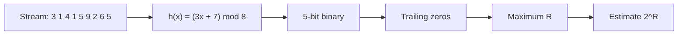

**In simple words:** **Flajolet-Martin (FM) algorithm** stream ke **distinct** elements ki sankhya bahut kam memory se estimate karta hai. Har element ko hash karke binary number banao, uske **trailing zeros** (right end ke zeros) gino, aur sabse bada count $R$ yaad rakho. Estimate $2^R$ hai. Jis hash ke end mein $r$ zeros hon uski chance $1/2^r$ hoti hai, to $R$ zeros dikhne ka matlab hai lagbhag $2^R$ alag elements. Repeats ka hash same aata hai, isliye $R$ nahi badalta. <Cite id="stream-counting-fm1985" /> <Cite id="stream-counting-mmds-home" loc="§4.4" /> <Cite id="stream-counting-gfg-fm" />

**Question par note.** "for some a and b" shabd is question ke purane version ka bacha hua hissa hai. Yahan $a = 3$ aur $b = 7$ diye hain, to kuch unknown nahi hai. 5-bit width sirf hash value 0 ke liye matter karti hai, jo `00000` ban jaati hai.

<Cite id="stream-counting-gfg-fm" loc="diagram" />

<Sum>

<Given>

Stream 3, 1, 4, 1, 5, 9, 2, 6, 5. Hash $h(x) = (3x + 7) \bmod 8$, 5-bit binary number ki tarah likha hua.

</Given>

<Find>

distinct elements ki sankhya ka Flajolet-Martin estimate.

</Find>

<Steps>

1. **Har element ko hash karo aur 5 bits mein likho.** *Reason: FM hash ke bit pattern par kaam karta hai.*

   | $x$ | $3x + 7$ | $h(x) = (3x+7) \bmod 8$ | 5-bit binary | Trailing zeros $r$ |
   |---|---|---|---|---|
   | 3 | 16 | 0 | 00000 | 5 (saare bits 0 hain) |
   | 1 | 10 | 2 | 00010 | 1 |
   | 4 | 19 | 3 | 00011 | 0 |
   | 1 | 10 | 2 | 00010 | 1 |
   | 5 | 22 | 6 | 00110 | 1 |
   | 9 | 34 | 2 | 00010 | 1 |
   | 2 | 13 | 5 | 00101 | 0 |
   | 6 | 25 | 1 | 00001 | 0 |
   | 5 | 22 | 6 | 00110 | 1 |

2. **Maximum tail length.** Hash 0 `00000` hai, jisme saare 5 bits zero hain, to ye 5 trailing zeros gine jaate hain. Ye sabse bada hai, to $R = 5$.
3. **Estimate.** $2^R = 2^5 = 32$.

</Steps>

<Answer>

$R = 5$, to FM estimate $2^5 = 32$ distinct elements hai. Stream mein asal mein 7 distinct elements hain (3, 1, 4, 5, 9, 2, 6). Agar all-zero hash ko skip karein (batakar liya gaya choice), to sabse bada tail $R = 1$ hai aur estimate $2^1 = 2$.

</Answer>

<Box kind="verify">

Hashing check: $3 \times 3 + 7 = 16 = 2 \times 8$, to $16 \bmod 8 = 0$. $3 \times 1 + 7 = 10$, $10 - 8 = 2$. $3 \times 4 + 7 = 19$, $19 - 16 = 3$. $3 \times 5 + 7 = 22$, $22 - 16 = 6$. $3 \times 9 + 7 = 34$, $34 - 32 = 2$. $3 \times 2 + 7 = 13$, $13 - 8 = 5$. $3 \times 6 + 7 = 25$, $25 - 24 = 1$. Repeats (1 aur 5) ne wahi hashes (2 aur 6) diye, to $R$ nahi badla. Estimates 32 aur 2 dono asli count 7 se door hain, kyunki 9 elements ki stream par ek hash function sirf rough guess deta hai, aur ye hash sirf 0 se 7 tak ki 8 values deta hai. Real use mein kai hashes ka average (group averages ka median) lete hain.

</Box>

</Sum>

**Conclusion:** pehla element 3, hash 0 deta hai aur sabse lamba tail banata hai, isliye FM $2^5 = 32$ distinct elements estimate karta hai (agar wo hash ignore karein to lagbhag 2), jabki asli count 7 hai. Ek hash ke saath FM sirf rough estimator hai. <Cite id="stream-counting-wiki-fm" />

Exam mein English mein likho: "The all-zero hash 00000 has 5 trailing zeros, so R = 5 and the estimate is 2^5 = 32."
