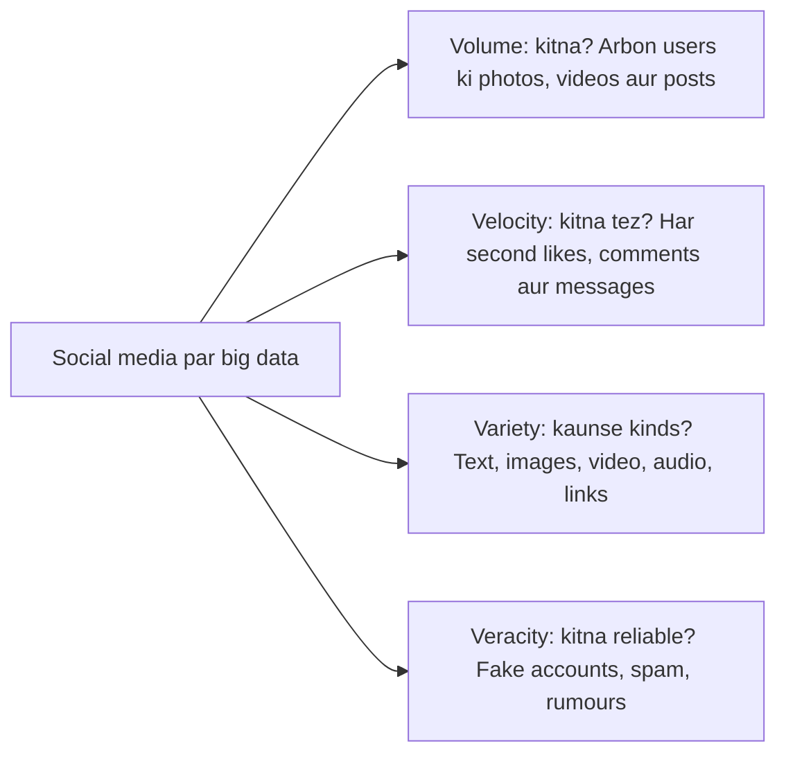

**In simple words:** big data wo data hai jo itna bada, itna tez ya itna messy hai ki ek normal computer aur normal database use store ya process nahi kar sakta. Ise "V"s se describe karte hain. Chaar main characteristics hain **Volume, Velocity, Variety aur Veracity**. Social media websites (Facebook, Instagram, X, YouTube) mein ye chaaron saaf dikhte hain. <Cite id="big-data-intro-ibm" /> <Cite id="big-data-intro-gfg" />

<Cite id="big-data-intro-gfg" loc="diagram" />

**1. Volume (kitna).** Data bahut bada hai: terabytes se petabytes.

*Social media par:* lakhon users roz text, photos aur videos post karte hain, aur har post, like aur comment store hota hai. Ye ek disk ya ek server mein nahi aata, isliye HDFS jaisa distributed storage chahiye.

**2. Velocity (kitna tez).** Data tezi se aata hai aur aksar aate hi handle karna padta hai.

*Social media par:* posts, likes, comments aur messages har second aate hain, aur feeds, trending lists aur notifications turant update hone chahiye. Isme stream processing chahiye, sirf raat ke batch jobs nahi.

**3. Variety (kitne kinds).** Data kai forms mein aata hai: structured (tables), semi-structured (JSON, logs) aur unstructured (text, images, video).

*Social media par:* text aur emoji, photos, video, audio, links, location tags, aur friend graph (kaun kisko follow karta hai). Ek fixed table mein ye sab nahi aata, isliye NoSQL stores aur flexible tools use hote hain.

**4. Veracity (kitna bharosemand).** Data aksar incomplete, noisy, duplicate ya jhootha hota hai, to results galat ho sakte hain.

*Social media par:* fake accounts, bots, spam aur rumours ki wajah se har post sach nahi hoti. Decisions ke liye use karne se pehle data clean aur check karna padta hai.

| V | Sawal | Social media example | Kya chahiye |
|---|---|---|---|
| Volume | Kitna? | Arbon photos aur videos | Distributed storage (HDFS) |
| Velocity | Kitna tez? | Har second likes aur messages | Stream processing |
| Variety | Kaunse kinds? | Text, image, video, friend graph | NoSQL, flexible formats |
| Veracity | Kitna reliable? | Fake accounts aur spam | Cleaning aur checking |

Kuch books paanchwa V, **Value**, jodti hain: site ko data se kya milta hai, jaise recommendations, targeted ads aur harmful content ki pehchaan. <Cite id="big-data-intro-wiki" /> <Cite id="big-data-intro-av" />

**Conclusion:** chaar Vs batate hain ki social media data ek relational database se handle nahi hota aur Hadoop, NoSQL aur stream systems chahiye.

Exam mein English mein likho: "The four Vs of big data are Volume, Velocity, Variety and Veracity."
