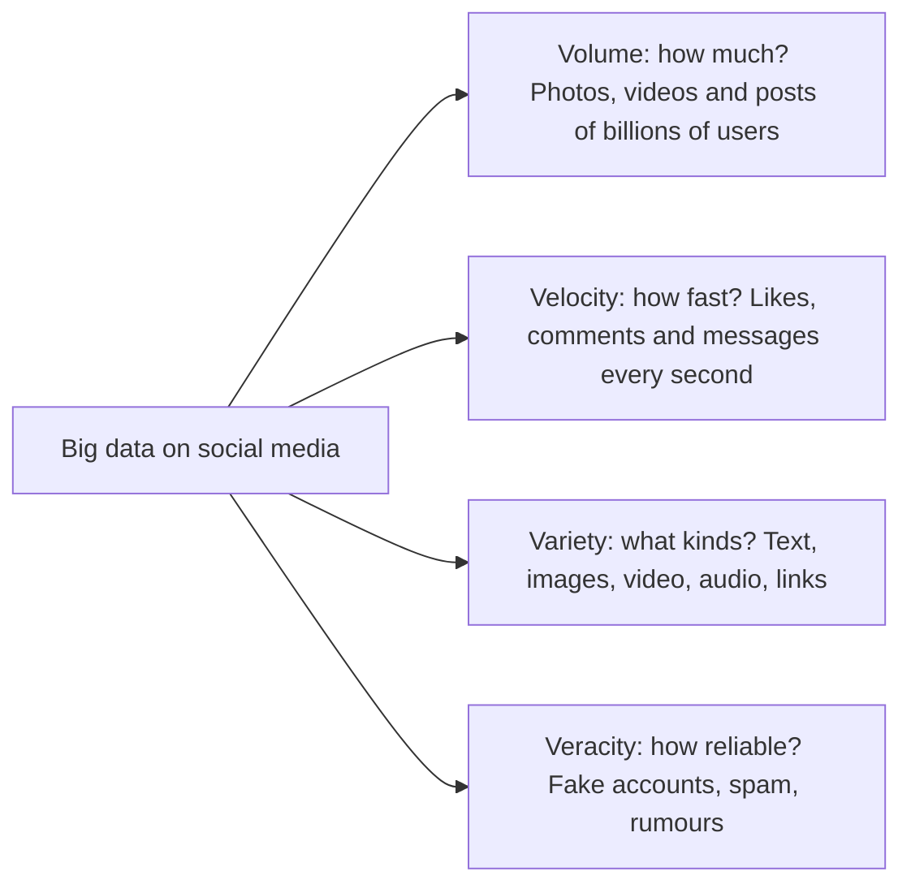

**In simple words:** big data is data so large, so fast or so messy that one normal computer and a normal database cannot store or process it. It is described by the "V"s. The four main characteristics are **Volume, Velocity, Variety and Veracity**. Social media websites (Facebook, Instagram, X, YouTube) show all four clearly. <Cite id="big-data-intro-ibm" /> <Cite id="big-data-intro-gfg" />

<Cite id="big-data-intro-gfg" loc="diagram" />

**1. Volume (how much).** The amount of data is huge: terabytes to petabytes.

*On social media:* millions of users post text, photos and videos every day, and every post, like and comment is stored. One disk or one server cannot hold this, so it needs distributed storage such as HDFS.

**2. Velocity (how fast).** Data arrives quickly and often must be handled as it arrives.

*On social media:* posts, likes, comments and messages arrive every second, and feeds, trending lists and notifications must update at once. This needs stream processing, not only nightly batch jobs.

**3. Variety (how many kinds).** Data comes in many forms: structured (tables), semi-structured (JSON, logs) and unstructured (text, images, video).

*On social media:* text and emoji, photos, video, audio, links, location tags, and the friend graph itself (who follows whom). One fixed table cannot hold all of this, so NoSQL stores and flexible tools are used.

**4. Veracity (how trustworthy).** Data is often incomplete, noisy, duplicated or false, so results can be wrong.

*On social media:* fake accounts, bots, spam and rumours mean not every post is true. Data must be cleaned and checked before it is used for decisions.

| V | Question | Social media example | What it needs |
|---|---|---|---|
| Volume | How much? | Billions of photos and videos | Distributed storage (HDFS) |
| Velocity | How fast? | Likes and messages every second | Stream processing |
| Variety | What kinds? | Text, image, video, friend graph | NoSQL, flexible formats |
| Veracity | How reliable? | Fake accounts and spam | Cleaning and checking |

Some books add a fifth V, **Value**: what the site gains from the data, such as recommendations, targeted ads and detecting harmful content. <Cite id="big-data-intro-wiki" /> <Cite id="big-data-intro-av" />

**Conclusion:** the four Vs explain why social media data cannot be handled by one relational database and needs Hadoop, NoSQL and stream systems.
