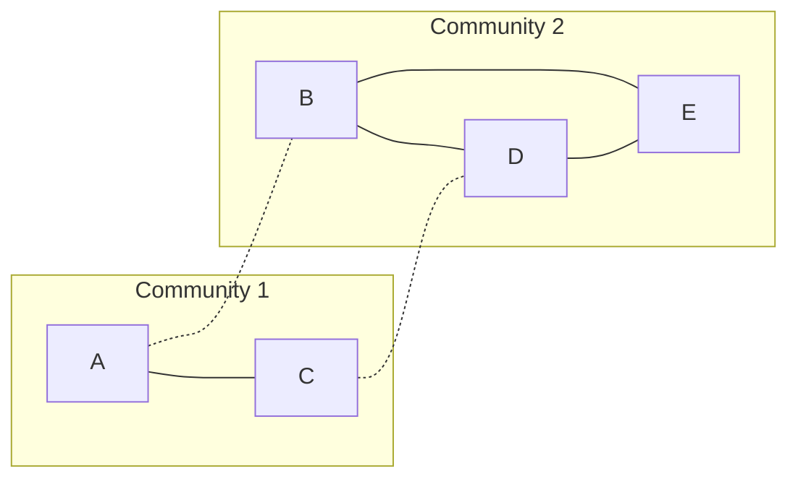

**In simple words:** Girvan-Newman algorithm un edges ko hata kar communities dhoondhta hai jo groups ke beech **bridge** ka kaam karte hain. Bridge bahut saare shortest paths par hota hai, to uski **edge betweenness** zyada hoti hai. Sabse zyada betweenness wala edge baar-baar hatate hain jab tak graph alag tukdon mein na toot jaaye, aur har tukda ek community hai. <Cite id="social-network-graphs-girvan-newman2002" /> <Cite id="social-network-graphs-mmds-book" loc="§10.2" />

**Steps**

1. Nodes ki har pair ke liye shortest path(s) dhoondho. Kai ho to ek unit credit unme barabar baant do.
2. Edge ki **betweenness** = saari pairs se mile credit ka total.
3. Sabse zyada betweenness wala edge hata do.
4. Bache edges ke liye dobara compute karo aur graph tootne tak repeat karo. <Cite id="social-network-graphs-gfg-girvan-newman" />

<Sum>

<Given>

5 nodes aur 6 edges ka undirected graph: A-B, A-C, B-D, B-E, C-D, D-E. (A, B aur C se juda hai; B, A, D, E se; C, A aur D se; D, B, C, E se; E, B aur D se.)

</Given>

<Find>

Girvan-Newman se communities, har round ki edge betweenness ke saath.

</Find>

<Steps>

1. **Round 1: 10 node pairs ke shortest paths.** *Reason: edge betweenness inhi paths se define hoti hai.*

   | Pair | Shortest path(s) | Credit |
   | --- | --- | --- |
   | A-B | A-B | AB 1 |
   | A-C | A-C | AC 1 |
   | A-D | A-B-D and A-C-D | AB, BD, AC, CD 0.5 each |
   | A-E | A-B-E | AB 1, BE 1 |
   | B-C | B-A-C and B-D-C | AB, AC, BD, CD 0.5 each |
   | B-D | B-D | BD 1 |
   | B-E | B-E | BE 1 |
   | C-D | C-D | CD 1 |
   | C-E | C-D-E | CD 1, DE 1 |
   | D-E | D-E | DE 1 |

2. **Har edge ke credits jodo.**

   | Edge | Betweenness |
   | --- | --- |
   | AB | $1 + 0.5 + 1 + 0.5 = 3$ |
   | AC | $1 + 0.5 + 0.5 = 2$ |
   | BD | $0.5 + 0.5 + 1 = 2$ |
   | BE | $1 + 1 = 2$ |
   | CD | $0.5 + 0.5 + 1 + 1 = 3$ |
   | DE | $1 + 1 = 2$ |

3. **Sabse zyada wala hatao.** AB aur CD dono 3 par tie hain. AB hata do. *Reason: tie kisi bhi tarah tod sakte hain; dono choices ka final split same aata hai, jaisa step 6 dikhata hai.*
4. **Round 2: dobara compute karo** bache edges AC, BD, BE, CD, DE par. Ab A, C se latka hai, aur B, D, E ek triangle banate hain.

   | Edge | Betweenness | Why |
   | --- | --- | --- |
   | CD | 6 | 2 nodes A, C iske through 3 nodes B, D, E tak pahunchte hain |
   | AC | 4 | A se C, D, B, E tak |
   | BD | 3 | B-D, B-A aur B-C paths |
   | DE | 3 | D-E, A-E aur C-E |
   | BE | 1 | sirf B-E |

5. **CD hata do** (sabse zyada, 6). *Reason: ab wahi do groups ke beech ka akela link hai.*
6. **Graph toot jaata hai:** \{A, C\} aur \{B, D, E\}. *Reason: unke beech koi edge nahi bacha.* Agar AB ki jagah pehle CD hataate, to round 2 mein AB ki value sabse zyada 6 hoti, aur use hatane par wahi do tukde bachte.

</Steps>

<Answer>

do communities: \{A, C\} aur \{B, D, E\}.

</Answer>

<Box kind="verify">

Check 1: round-1 betweenness values ka sum $3 + 2 + 2 + 2 + 3 + 2 = 14$ hai, jo saare shortest-path lengths ke sum ke barabar hai: $1 + 1 + 2 + 2 + 2 + 1 + 1 + 1 + 2 + 1 = 14$. Check 2: round-2 values ka sum $6 + 4 + 3 + 3 + 1 = 17$ hai, aur AB hatane ke baad path lengths ka sum bhi 17 hai. Check 3 (modularity): $m = 6$ edges ke saath, \{A, C\} mein 1 edge aur degree total 4; \{B, D, E\} mein 3 edges aur degree total 8. $Q = (1/6 - (4/12)^2) + (3/6 - (8/12)^2) = 1/18 + 1/18 = 1/9 \approx 0.11$, jo positive hai, to split poore graph ko jaisa ka waisa chhodne se behtar hai ($Q = 0$). <Cite id="social-network-graphs-wiki-modularity" />

</Box>

</Sum>

<Cite id="social-network-graphs-wiki-girvan-newman" loc="diagram" />

**Conclusion:** bridge edges AB aur CD sabse zyada shortest paths carry karte hain, isliye Girvan-Newman unhe hata deta hai aur communities \{A, C\} aur \{B, D, E\} saamne aati hain.

Exam mein English mein likho: "Girvan-Newman repeatedly removes the edge with the highest betweenness until the graph splits into communities."
