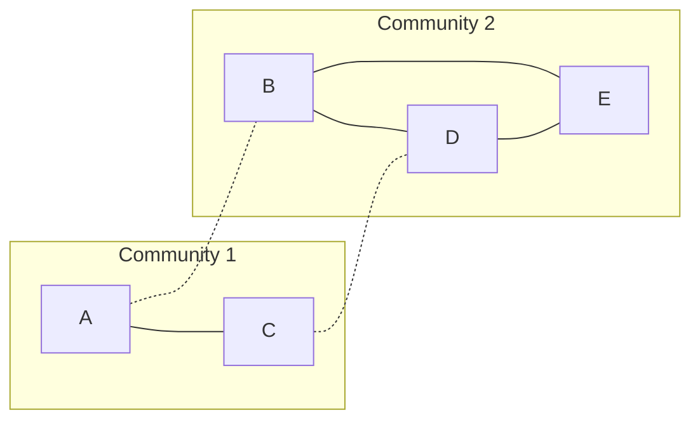

**In simple words:** the Girvan-Newman algorithm finds communities by removing the edges that act as **bridges** between groups. A bridge lies on many shortest paths, so it has a high **edge betweenness**. We remove the edge with the highest betweenness again and again until the graph falls into separate pieces, and each piece is a community. <Cite id="social-network-graphs-girvan-newman2002" /> <Cite id="social-network-graphs-mmds-book" loc="§10.2" />

**Steps**

1. For every pair of nodes find the shortest path(s). If there are several, split one unit of credit equally among them.
2. The **betweenness of an edge** is the total credit it receives over all pairs.
3. Remove the edge with the highest betweenness.
4. Recompute for the remaining edges and repeat until the graph splits. <Cite id="social-network-graphs-gfg-girvan-newman" />

<Sum>

<Given>

Undirected graph with 5 nodes and 6 edges: A-B, A-C, B-D, B-E, C-D, D-E. (A is joined to B and C; B to A, D, E; C to A and D; D to B, C, E; E to B and D.)

</Given>

<Find>

the communities, using Girvan-Newman, with the edge betweenness at each round.

</Find>

<Steps>

1. **Round 1: shortest paths for the 10 node pairs.** *Reason: edge betweenness is defined by these paths.*

   | Pair | Shortest path(s) | Credit |
   | --- | --- | --- |
   | A-B | A-B | AB 1 |
   | A-C | A-C | AC 1 |
   | A-D | A-B-D and A-C-D | AB, BD, AC, CD 0.5 each |
   | A-E | A-B-E | AB 1, BE 1 |
   | B-C | B-A-C and B-D-C | AB, AC, BD, CD 0.5 each |
   | B-D | B-D | BD 1 |
   | B-E | B-E | BE 1 |
   | C-D | C-D | CD 1 |
   | C-E | C-D-E | CD 1, DE 1 |
   | D-E | D-E | DE 1 |

2. **Add the credits of each edge.**

   | Edge | Betweenness |
   | --- | --- |
   | AB | $1 + 0.5 + 1 + 0.5 = 3$ |
   | AC | $1 + 0.5 + 0.5 = 2$ |
   | BD | $0.5 + 0.5 + 1 = 2$ |
   | BE | $1 + 1 = 2$ |
   | CD | $0.5 + 0.5 + 1 + 1 = 3$ |
   | DE | $1 + 1 = 2$ |

3. **Remove the highest.** AB and CD tie at 3. Remove AB. *Reason: the tie can be broken either way; both choices give the same final split, as step 6 shows.*
4. **Round 2: recompute** on the remaining edges AC, BD, BE, CD, DE. Now A hangs from C, and B, D, E form a triangle.

   | Edge | Betweenness | Why |
   | --- | --- | --- |
   | CD | 6 | the 2 nodes A, C reach the 3 nodes B, D, E through it |
   | AC | 4 | A to each of C, D, B, E |
   | BD | 3 | B-D, B-A and B-C paths |
   | DE | 3 | D-E, A-E and C-E |
   | BE | 1 | B-E only |

5. **Remove CD** (the highest, 6). *Reason: it is now the only link between the two groups.*
6. **The graph splits** into \{A, C\} and \{B, D, E\}. *Reason: no edge is left between them.* If CD had been removed first instead of AB, round 2 would give AB the highest value 6, and removing it leaves the same two pieces.

</Steps>

<Answer>

two communities: \{A, C\} and \{B, D, E\}.

</Answer>

<Box kind="verify">

Check 1: the round-1 betweenness values add to $3 + 2 + 2 + 2 + 3 + 2 = 14$, which equals the sum of all shortest-path lengths: $1 + 1 + 2 + 2 + 2 + 1 + 1 + 1 + 2 + 1 = 14$. Check 2: the round-2 values add to $6 + 4 + 3 + 3 + 1 = 17$, and the path lengths after removing AB add to 17 too. Check 3 (modularity): with $m = 6$ edges, \{A, C\} has 1 edge and degree total 4; \{B, D, E\} has 3 edges and degree total 8. $Q = (1/6 - (4/12)^2) + (3/6 - (8/12)^2) = 1/18 + 1/18 = 1/9 \approx 0.11$, which is positive, so the split is better than leaving the graph whole ($Q = 0$). <Cite id="social-network-graphs-wiki-modularity" />

</Box>

</Sum>

<Cite id="social-network-graphs-wiki-girvan-newman" loc="diagram" />

**Conclusion:** the bridge edges AB and CD carry the most shortest paths, so Girvan-Newman removes them and reveals the communities \{A, C\} and \{B, D, E\}.
