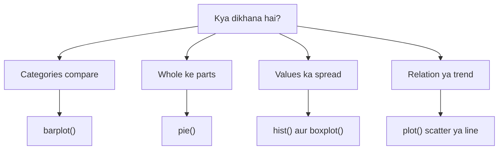

**In simple words:** data visualization data ko charts mein dikhata hai taaki patterns, trends aur odd values ek nazar mein dikh jaayein. R mein common charts ke liye built-in (base) functions hain, aur zyada polished charts ke liye `ggplot2` package. Sahi chart is baat par depend karta hai ki tum kya dikhana chahte ho: compare, distribution, ya relationship. Ye topic CSE (AI&ML) syllabus mein nahi hai, lekin paper mein puchha gaya hai. <Cite id="pyq-2024-05-ce-ibm-dataviz" /> <Cite id="pyq-2024-05-ce-gfg-dataviz" />



**1. Bar chart: `barplot()`.** Categories ke beech values compare karta hai. Har bar ki height value hai.

```r
sales <- c(Q1 = 120, Q2 = 150, Q3 = 90, Q4 = 180)
barplot(sales, main = "Sales per quarter", xlab = "Quarter",
        ylab = "Units sold", col = "steelblue")
```

Chaar bars dikhte hain; Q4 sabse lamba (180) aur Q3 sabse chhota (90).

**2. Pie chart: `pie()`.** Whole ke parts dikhata hai. Paas-paas ke slices compare karna mushkil hai, isliye sirf kam categories ke liye use karo.

```r
pie(sales, main = "Share of sales by quarter")
```

Total 540 hai, to slices 22.2% (Q1), 27.8% (Q2), 16.7% (Q3) aur 33.3% (Q4) hain.

**3. Histogram: `hist()`.** Numeric values ka spread dikhata hai. Values ko ranges (bins) mein group karte hain aur har bar batata hai ki range mein kitni values aayi.

```r
marks <- c(35, 42, 48, 50, 52, 55, 58, 60, 61, 63,
           65, 67, 70, 72, 75, 78, 82, 90)
hist(marks, breaks = c(30, 50, 70, 90), main = "Marks of 18 students",
     xlab = "Marks", col = "lightgreen")
```

Ranges 30 se 50, 50 se 70 aur 70 se 90 ke bars ki heights 4, 9 aur 5 hain (bin apna upper end include karta hai).

**4. Box plot: `boxplot()`.** Ek box mein median, quartiles aur outliers dikhata hai.

```r
boxplot(marks, main = "Marks of 18 students", ylab = "Marks")
```

Box 52 se 72 tak hai, median line 62 par; whiskers 35 aur 90 tak jaate hain, aur koi point outlier ki tarah plot nahi hota.

**5. Scatter aur line plot: `plot()`.** Scatter plot do numeric variables ka relation dikhata hai. `type = "l"` ya `type = "o"` se points line se jud jaate hain, jo time ke saath trend ke liye theek hai.

```r
height <- c(150, 155, 160, 165, 170, 175)
weight <- c(50, 54, 57, 63, 66, 72)
plot(height, weight, main = "Height and weight", xlab = "Height (cm)",
     ylab = "Weight (kg)", pch = 19, col = "red")
plot(sales, type = "o", main = "Sales trend", xlab = "Quarter number",
     ylab = "Units sold")
```

Points left se right upar jaate hain, to height ke saath weight badhta hai (positive relation).

**6. `ggplot2` package.** Chart ko layers mein banata hai, looks par zyada control ke saath. Ek baar `install.packages("ggplot2")` se install karo. <Cite id="pyq-2024-05-ce-gfg-dataviz" />

```r
library(ggplot2)
df <- data.frame(height, weight)
ggplot(df, aes(x = height, y = weight)) + geom_point() +
  ggtitle("Height and weight")
```

Chart ko file mein save karne ke liye plot call ko `png("chart.png")` aur `dev.off()` ke beech rakho.

| Chart | R function | Kis kaam ke liye |
|---|---|---|
| Bar chart | `barplot()` | Categories compare karna |
| Pie chart | `pie()` | Whole ke parts (kam slices) |
| Histogram | `hist()` | Ek numeric variable ka distribution |
| Box plot | `boxplot()` | Median, spread aur outliers |
| Scatter / line | `plot()` | Do variables ka relation, time ke saath trend |
| Layered charts | `ggplot2` | Polished aur custom charts |

**Check.** 18 marks teen histogram bins mein $4 + 9 + 5 = 18$ baant jaate hain, aur pie percentages ka sum $22.2 + 27.8 + 16.7 + 33.3 = 100$ hai. Sorted marks mein 9th value 61 aur 10th value 63 hai, to median $(61 + 63)/2 = 62$. Code yahan run nahi kiya gaya, isliye charts ke descriptions code aur data padhkar likhe hain.

**Conclusion:** R `barplot()` se bar chart, `pie()` se pie chart, `hist()` se histogram, `boxplot()` se box plot aur `plot()` se scatter ya line plot banata hai; `ggplot2` layered, polished charts deta hai. <Cite id="pyq-2024-05-ce-wiki-dataviz" />

Exam mein English mein likho: "R provides barplot(), pie(), hist(), boxplot() and plot() for visualization, and ggplot2 for layered graphics."
