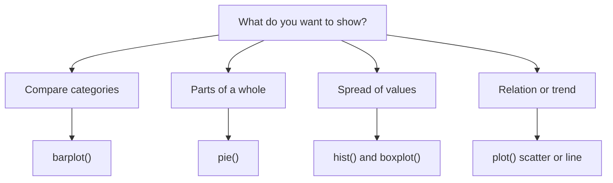

**In simple words:** data visualization shows data as charts so that patterns, trends and odd values can be seen at a glance. R has built-in (base) functions for the common charts, and the `ggplot2` package for more polished ones. The right chart depends on the question: compare, show a distribution, or show a relationship. This topic is not in the CSE (AI&ML) syllabus, but the paper asks it. <Cite id="pyq-2024-05-ce-ibm-dataviz" /> <Cite id="pyq-2024-05-ce-gfg-dataviz" />



**1. Bar chart: `barplot()`.** Compares values across categories. Each bar's height is the value.

```r
sales <- c(Q1 = 120, Q2 = 150, Q3 = 90, Q4 = 180)
barplot(sales, main = "Sales per quarter", xlab = "Quarter",
        ylab = "Units sold", col = "steelblue")
```

Shows four bars; Q4 is the tallest (180) and Q3 the shortest (90).

**2. Pie chart: `pie()`.** Shows parts of a whole. It is hard to compare close slices, so use it only for a few categories.

```r
pie(sales, main = "Share of sales by quarter")
```

The total is 540, so the slices are 22.2% (Q1), 27.8% (Q2), 16.7% (Q3) and 33.3% (Q4).

**3. Histogram: `hist()`.** Shows how numeric values are spread. The values are grouped into ranges (bins) and each bar shows how many values fall in a range.

```r
marks <- c(35, 42, 48, 50, 52, 55, 58, 60, 61, 63,
           65, 67, 70, 72, 75, 78, 82, 90)
hist(marks, breaks = c(30, 50, 70, 90), main = "Marks of 18 students",
     xlab = "Marks", col = "lightgreen")
```

The bars have heights 4, 9 and 5 for the ranges 30 to 50, 50 to 70 and 70 to 90 (a bin includes its upper end).

**4. Box plot: `boxplot()`.** Shows the median, the quartiles and outliers in one box.

```r
boxplot(marks, main = "Marks of 18 students", ylab = "Marks")
```

The box runs from 52 to 72 with the median line at 62; the whiskers reach 35 and 90, and no point is plotted as an outlier.

**5. Scatter and line plot: `plot()`.** A scatter plot shows the relation between two numeric variables. With `type = "l"` or `type = "o"` the points are joined into a line, which suits a trend over time.

```r
height <- c(150, 155, 160, 165, 170, 175)
weight <- c(50, 54, 57, 63, 66, 72)
plot(height, weight, main = "Height and weight", xlab = "Height (cm)",
     ylab = "Weight (kg)", pch = 19, col = "red")
plot(sales, type = "o", main = "Sales trend", xlab = "Quarter number",
     ylab = "Units sold")
```

The points rise from left to right, so weight grows with height (a positive relation).

**6. `ggplot2` package.** Builds a chart in layers, with more control over looks. Install it once with `install.packages("ggplot2")`. <Cite id="pyq-2024-05-ce-gfg-dataviz" />

```r
library(ggplot2)
df <- data.frame(height, weight)
ggplot(df, aes(x = height, y = weight)) + geom_point() +
  ggtitle("Height and weight")
```

To save a chart as a file, wrap the plot call in `png("chart.png")` and `dev.off()`.

| Chart | R function | Best for |
|---|---|---|
| Bar chart | `barplot()` | Comparing categories |
| Pie chart | `pie()` | Parts of a whole (few slices) |
| Histogram | `hist()` | Distribution of one numeric variable |
| Box plot | `boxplot()` | Median, spread and outliers |
| Scatter / line | `plot()` | Relation between two variables, trend over time |
| Layered charts | `ggplot2` | Polished and custom charts |

**Check.** The 18 marks split as $4 + 9 + 5 = 18$ across the three histogram bins, and the pie percentages add to $22.2 + 27.8 + 16.7 + 33.3 = 100$. The sorted marks have 9th value 61 and 10th value 63, so the median is $(61 + 63)/2 = 62$. The code was not run here, so the descriptions of the charts come from reading the code and data.

**Conclusion:** R draws bar charts with `barplot()`, pie charts with `pie()`, histograms with `hist()`, box plots with `boxplot()` and scatter or line plots with `plot()`; `ggplot2` adds layered, polished charts. <Cite id="pyq-2024-05-ce-wiki-dataviz" />
