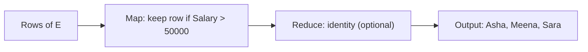

**In simple words:** selection (filtering) keeps only the rows that satisfy a condition, like `WHERE salary > 50000`. In MapReduce the map function tests each row on its own, so no reduce work is needed. <Cite id="hadoop-ecosystem-mmds" loc="§2.3.3" /> <Cite id="mapreduce-algorithms-wiki-relalg" />

**Dataset:** Employee table E(Id, Name, Salary), a large file spread over many HDFS blocks. Small sample:

| Id | Name | Salary |
|---|---|---|
| 101 | Asha | 52000 |
| 102 | Ravi | 38000 |
| 103 | Meena | 61000 |
| 104 | Kiran | 45000 |
| 105 | Sara | 70000 |

Condition C: Salary > 50000.

**Execution process:**

1. **Split.** The file is cut into splits and one map task takes one split.
2. **Map.** For each row $t$, test C. If true, emit $(t, t)$; if false, emit nothing. **Example:** Asha passes, Ravi is dropped.
3. **Reduce.** Identity: it writes the value as it is. Because each row is checked alone, the reduce step can be skipped and the job runs map-only.
4. **Output.** The surviving rows are written to HDFS.

```text
map(t):  if t.Salary > 50000: emit(t, t)
reduce(t, values): emit(t)       # identity, can be skipped
```

**Output:** (101, Asha, 52000), (103, Meena, 61000), (105, Sara, 70000). That is 3 of 5 rows; Ravi (38000) and Kiran (45000) were filtered out.



<Cite id="mapreduce-algorithms-gfg-relalg" loc="diagram" />

**Extend in the exam (add these to reach 10 marks):**

- **Why no reduce work.** Selection needs no grouping, so there is no shuffle and almost no network traffic. This makes it fast. <Cite id="mapreduce-algorithms-tp-relalg" />
- **Compound conditions.** C can be `Salary > 50000 AND Dept = 'CSE'`; map simply tests the whole condition.
- **Projection compared.** Projection keeps columns, and needs reduce to remove duplicates; selection keeps rows and does not.
- **Real use.** Hive turns `SELECT * FROM E WHERE Salary > 50000` into such a map-only job. Examples: picking error lines from logs, or one month of sales. <Cite id="web-bda-1-hive-tutorial" />

**Conclusion:** selection in MapReduce is a map-only filter: map emits a row only if the condition holds, and reduce is the identity.
