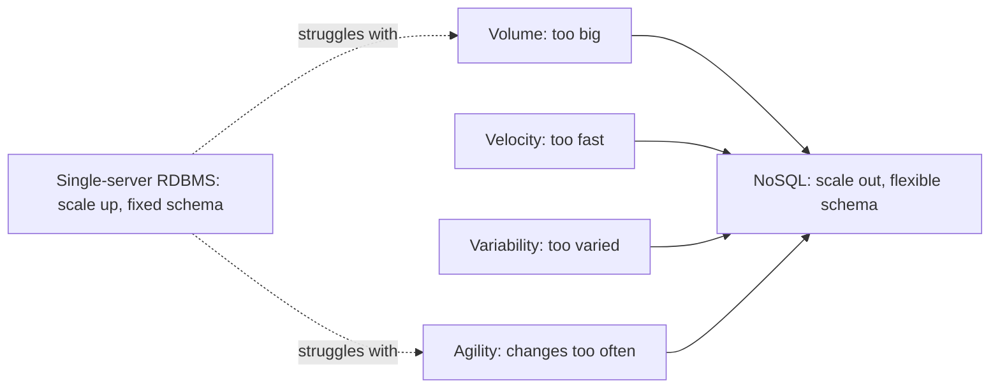

**In simple words:** an RDBMS keeps data in fixed tables on one big server, which is perfect for neat data like money and marks. When data became too big, too fast, too varied and too quickly changing, companies moved those workloads to NoSQL. <Cite id="big-data-intro-nosql" /> <Cite id="nosql-intro-ibm-nosql" />

**The four business drivers:**

1. **Volume.** Data grows to terabytes and beyond (clicks, sensors, posts). One server has a limit and a bigger one costs far more; NoSQL scales out over many cheap nodes. **Example:** a video site storing billions of view events.
2. **Velocity.** Very fast reads and writes and sudden bursts of users. Strict locks and joins slow an RDBMS; NoSQL answers simple key-based requests from many nodes at once. **Example:** a festival sale on a shopping site.
3. **Variability.** Data comes in many shapes and new fields appear often. An RDBMS needs one fixed column set, giving many NULLs and painful changes; NoSQL keeps each record with its own fields. **Example:** products with different attributes (a shirt has size, a phone has storage).
4. **Agility.** Teams must release features quickly and change the data layout often. NoSQL stores the object as it is (for example JSON), avoiding the object-relational mismatch. **Example:** adding a "wishlist" field without a schema migration.

| Driver | RDBMS struggles because | NoSQL answer |
|---|---|---|
| Volume | One server limit, costly to grow | Scale out on cheap nodes |
| Velocity | Locks and joins under heavy load | Key access, data spread over nodes |
| Variability | Rigid schema, NULL columns | Flexible schema |
| Agility | Schema changes slow releases | Store objects as documents |

<Cite id="nosql-intro-aws-nosql" />

<Cite id="nosql-intro-gfg-intro" loc="diagram" />

**Extend in the exam (add these to reach 10 marks):**

- **Business effect.** Cheaper hardware, faster launch of features, and sites that stay up in peak load.
- **Advantages and limits.** NoSQL gives scale-out, flexible schema and built-in replication; it often gives only eventual consistency and weak joins. <Cite id="nosql-intro-ibm-nosql" />
- **Specific workloads.** Social feeds, sessions, catalogues, logs and recommendations suit NoSQL; payments and ERP stay on RDBMS.
- **Polyglot persistence.** Many firms use both, each for the data it suits. <Cite id="nosql-intro-fowler-agg" />

**Conclusion:** volume and velocity are about size and speed, variability and agility are about change; together they push enterprises to adopt NoSQL for the right workloads, not to replace RDBMS everywhere.
