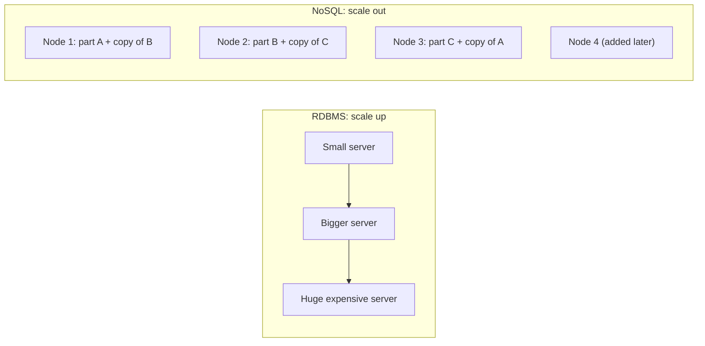

**In simple words:** a relational database usually grows by moving to a bigger single server (scale up). NoSQL grows by adding many cheap servers (scale out). This choice changes cost, speed and how a business plans for growth. <Cite id="nosql-intro-gfg-sqlvs" /> <Cite id="nosql-intro-aws-nosql" />

**Comparison of the two models:**

1. **Scale up (vertical).** Buy a bigger machine with more CPU, RAM and disk. **Example:** moving an orders database to a larger server. It is simple for the application, but there is a hardware limit and the cost rises steeply.
2. **Scale out (horizontal).** Add more ordinary machines to a cluster. **Example:** adding Node 4 when traffic doubles. NoSQL is built for this.
3. **Sharding.** Cut the data into parts (shards) and put each on a different node, so each node handles a share of reads and writes. <Cite id="nosql-intro-wiki-sharding" /> <Cite id="nosql-intro-mongo-shard" />
4. **Replication.** Keep copies of the data on several nodes. Reads can use any copy and a node failure does not lose data. <Cite id="nosql-intro-mongo-repl" />
5. **Cost.** One huge server is expensive and a single point of failure; many commodity nodes are cheaper and fail separately.
6. **Why relational finds it hard.** Relational databases can be sharded, but joins and ACID transactions across nodes are slow and complex. NoSQL keeps related data together and relaxes consistency, so it shards easily. <Cite id="big-data-intro-nosql" />

| Point | Relational (RDBMS) | NoSQL |
|---|---|---|
| Main model | Scale up | Scale out |
| Hardware | One costly high-end server | Many cheap commodity nodes |
| Sharding | Possible but hard (joins, transactions) | Built in |
| Failure | Single server is a risk | Replicas keep serving |
| Growth | Big, costly steps | Add a node at a time |
| Consistency | Strong (ACID) | Often eventual (BASE) |

<Cite id="nosql-intro-gfg-sqlvs" loc="diagram" />

**Extend in the exam (add these to reach 10 marks):**

- **Business decisions.** Scale up suits steady, modest growth and strict accuracy (banking). Scale out suits unpredictable growth (social media, e-commerce peaks) and avoids paying for peak capacity upfront.
- **System performance.** More nodes mean more parallel reads and writes and lower delay; the trade is weaker consistency.
- **Second example.** A news site adds 3 nodes before an election and removes them later.
- **Risks.** Scale out needs more operations skill, and some data may be briefly stale. <Cite id="nosql-intro-ibm-nosql" />

**Conclusion:** RDBMS scale-up is simple and consistent but limited and costly, while NoSQL scale-out grows cheaply and stays available, so the choice depends on the workload.
