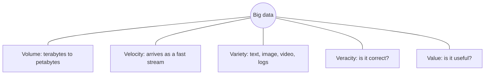

**In simple words:** the 5 V's are five features that describe big data: volume, velocity, variety, veracity and value. Each one makes processing harder or decides what the processing must achieve. <Cite id="big-data-intro-wiki" /> <Cite id="web-bda-1-nist-defs" />

1. **Volume (how much data).** Data runs from terabytes to petabytes. **Influence:** one machine cannot hold it, so data is split over many nodes and processed in parallel. **Example:** a social site stores every photo and video of millions of users.
2. **Velocity (how fast data arrives).** Data comes as a continuous stream. **Influence:** results are needed in seconds, so stream or real-time processing is used, not only slow batch jobs. **Example:** stock trades and live trending lists.
3. **Variety (how mixed the data is).** Structured, semi-structured and unstructured data arrive together. **Influence:** a fixed table cannot hold it, so flexible storage and "schema on read" are used. **Example:** a hospital has tables, doctor notes and X-ray images.
4. **Veracity (how trustworthy the data is).** Data can be noisy, duplicate or fake. **Influence:** it must be cleaned and checked first, or the result is wrong. **Example:** spam accounts and bots on a social site.
5. **Value (how useful the data is).** Data is worth only what we can learn from it. **Influence:** the processing must end in a useful result such as an alert or a recommendation. **Example:** a bank turns transaction data into fraud alerts. <Cite id="big-data-intro-ibm" /> <Cite id="big-data-intro-av" />

<Cite id="big-data-intro-gfg" loc="diagram" />

| V | Problem it creates | How processing responds |
|---|---|---|
| Volume | Too big for one machine | Distributed storage and parallel processing |
| Velocity | Data is old in minutes | Stream and real-time processing |
| Variety | Many formats | Flexible storage, schema on read |
| Veracity | Wrong data, wrong answers | Cleaning and validation |
| Value | Data alone is a cost | Analytics that give decisions |

**Extend in the exam (add these to reach 10 marks):**

- **Variability (extra V).** The meaning of data changes with context, for example the same word in different posts. <Cite id="big-data-intro-ibm" />
- **Types of data.** Structured (tables), semi-structured (JSON, XML, logs), unstructured (images, video).
- **Two case studies.** Stock exchange shows velocity, because a price a minute late is useless. A hospital shows variety. <Cite id="big-data-intro-tp" />
- **Advantages and challenges.** Better decisions and fraud detection, against storage cost, data quality and privacy. <Cite id="web-bda-1-gcloud-bigdata" />

**Conclusion:** the first three V's make big data hard to store and process, and veracity and value decide whether the result can be trusted and used.
