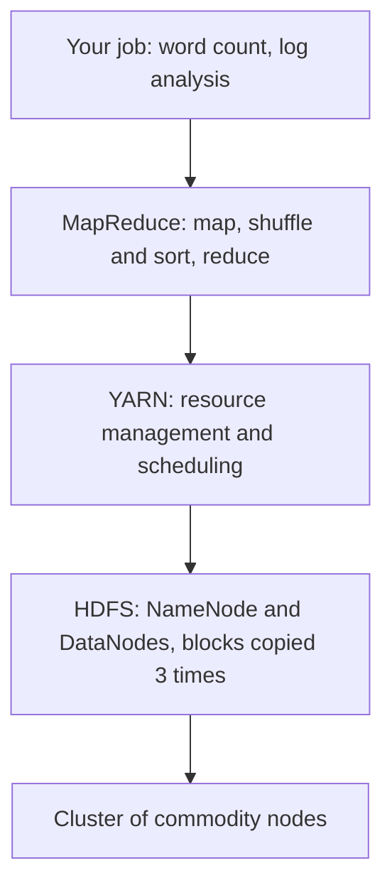

**In simple words:** Hadoop is a free framework that stores very large data on many ordinary computers and processes it in parallel. Its two core parts are **HDFS** for storage and **MapReduce** for processing. <Cite id="hadoop-ecosystem-apache-hadoop" /> <Cite id="hadoop-ecosystem-ibm-hadoop" />

**HDFS (Hadoop Distributed File System): the storage part.**

1. **Splits files into blocks.** A big file is cut into 128 MB blocks. **Example:** a 400 MB file becomes 4 blocks. <Cite id="hdfs-apache-design" />
2. **NameNode (master).** It keeps the metadata: file names and which DataNodes hold each block. It stores no data itself.
3. **DataNodes (slaves).** They store the blocks and send heartbeats and block reports to the NameNode.
4. **Replication.** Every block is copied to 3 nodes, so a failed node loses no data.

**MapReduce: the processing part.**

5. **Map.** Each map task reads one split and emits key-value pairs. **Example:** the line "to be" gives (to,1) and (be,1). <Cite id="hadoop-ecosystem-apache-mr-tutorial" loc="Overview" />
6. **Shuffle and sort.** Pairs with the same key are sent to the same reducer and sorted by key.
7. **Reduce.** It combines the values of each key. **Example:** (to,[1,1]) becomes (to,2). The result is written to HDFS.
8. **Data locality.** The program is sent to the node that holds the block, so big data is not moved over the network.

<Cite id="hadoop-ecosystem-gfg-hadoop-arch" loc="diagram" />

| Component | Master | Worker | Role |
|---|---|---|---|
| HDFS | NameNode | DataNode | Store and replicate data |
| MapReduce (on YARN) | ResourceManager, ApplicationMaster | NodeManager running tasks | Process data in parallel |

**Extend in the exam (add these to reach 10 marks):**

- **Other core modules.** YARN (ResourceManager, NodeManager) manages CPU and memory, and Hadoop Common holds shared libraries. <Cite id="hadoop-ecosystem-apache-yarn" />
- **Origin.** HDFS and MapReduce come from Google's GFS and MapReduce papers. <Cite id="hadoop-ecosystem-ghemawat2003" /> <Cite id="hadoop-ecosystem-dean2004" />
- **Advantages.** Scalable (add nodes), cheap (commodity hardware), fault tolerant (3 copies, failed tasks re-run) and flexible (any data type). <Cite id="hadoop-ecosystem-gfg-hadoop-intro" />
- **Limitation.** MapReduce is batch processing, so it is slow for real-time or small-data work.

**Conclusion:** HDFS stores the big data reliably and MapReduce processes it in parallel next to the data, which together solve the big data problem.
