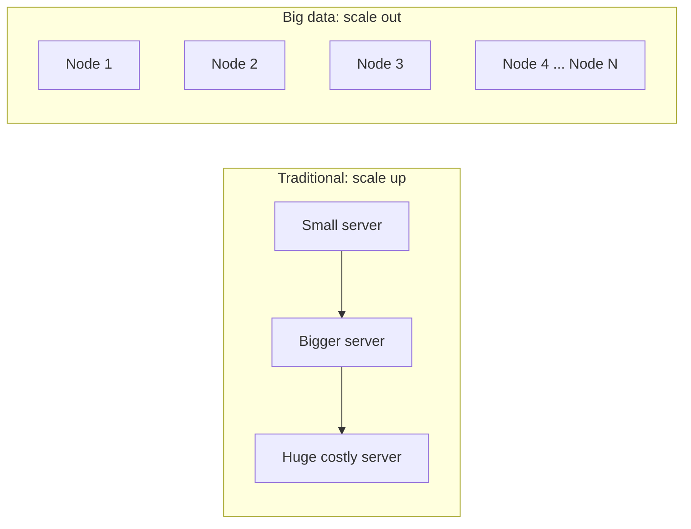

**In simple words:** traditional processing keeps structured data in tables on one server and queries it with SQL. Big data processing spreads huge, mixed data over a cluster of cheap machines and processes it in parallel. <Cite id="big-data-intro-wiki-rdbms" /> <Cite id="big-data-intro-tp" />

| Point | Traditional approach | Big data approach |
|---|---|---|
| Size | Megabytes to a few terabytes | Terabytes to petabytes and beyond |
| Data type | Mostly structured | Structured, semi-structured, unstructured |
| Schema | Fixed before storing (schema on write) | Flexible, applied on reading (schema on read) |
| Scaling | Scale up: a bigger, costlier server | Scale out: add cheap nodes |
| Processing | One machine, data moves to the program | Cluster, program moves to the data |
| Arrival | Mostly batch updates | Batch and real-time streams |
| Tools | RDBMS, SQL, data warehouse | Hadoop, Spark, NoSQL, Kafka |
| Failure | A server failure is serious | Node failure expected, handled by copies |
| Cost | Costly hardware and licences | Cheap hardware, often open source |

<Cite id="big-data-intro-oracle" /> <Cite id="big-data-intro-av" /> <Cite id="big-data-intro-mmds" />

<Cite id="big-data-intro-tp" loc="diagram" />

**Impact on modern business operations:**

1. **Faster, better decisions.** All data, not a small sample, is analysed. **Example:** a retailer plans stock from live sales of every store.
2. **Customer insight.** Logs, reviews and clicks are used along with tables. **Example:** personalised offers on an e-commerce site.
3. **Risk and fraud control.** Real-time streams catch fraud while it happens. **Example:** card payments checked in seconds.
4. **Lower cost.** Commodity hardware and open-source tools replace costly servers.
5. **New products.** Recommendations and predictive maintenance were not possible before. <Cite id="big-data-intro-ibm" />

**Extend in the exam (add these to reach 10 marks):**

- **RDBMS versus Hadoop.** RDBMS gives fast small transactions with updates and joins; Hadoop gives high-throughput batch analysis, write once read many. <Cite id="big-data-intro-hdfs" />
- **They work together.** A bank keeps account balances in an RDBMS and studies years of transactions for fraud on Hadoop.
- **Challenges of big data.** Data quality, skills, privacy and security rules.
- **Limitation of traditional systems.** They cannot hold unstructured data such as video or free text.

**Conclusion:** traditional systems suit small, structured, transactional data, while big data approaches let businesses use huge, varied data for faster and cheaper decisions; both are used together.
