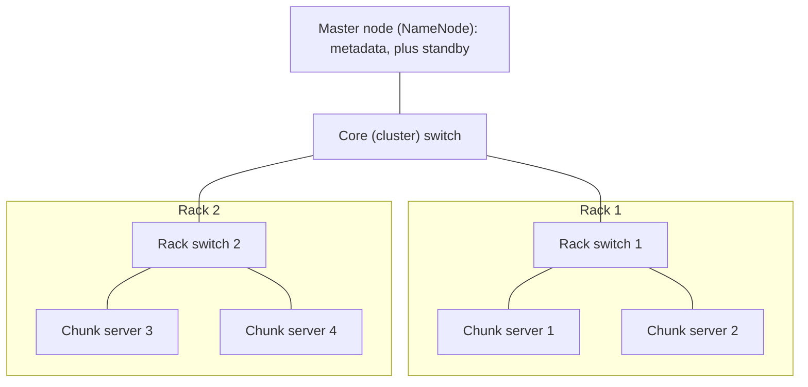

**In simple words:** a large enterprise cannot store its data on one machine, so it uses many cheap compute nodes grouped in racks and joined by switches. A distributed file system (DFS) runs on top and shows all these disks as one file system. <Cite id="hdfs-gfs-paper" /> <Cite id="hadoop-ecosystem-mmds" />

**Proposed design (an illustrative example, sizes are chosen for teaching):**

1. **Compute nodes.** Ordinary commodity servers, each with CPU, memory and disks. They both store data and run programs. **Example:** 200 nodes.
2. **Racks.** About 20 nodes sit in one rack. **Example:** 10 racks.
3. **Rack switch.** All nodes of a rack plug into one switch. Traffic inside a rack is fast. <Cite id="hdfs-apache-rack" />
4. **Cluster.** The racks are joined by a core (cluster) switch. Traffic between racks is slower, so it is kept low.
5. **Master node (NameNode).** One master keeps the metadata: file names, which chunks make a file and where each chunk is. A standby master is kept for failure. It never carries file data.
6. **Chunk servers (DataNodes).** Every other node stores chunks, which are big fixed-size pieces of files (128 MB in HDFS, 64 MB in GFS). Each chunk is copied 3 times, with copies on different racks. <Cite id="hdfs-apache-design" />
7. **Data flow.** The client asks the master only where the chunks are, then reads or writes directly with chunk servers.

<Cite id="hdfs-gfg" loc="diagram" />

**Justification of the design:**

| Design choice | Why |
|---|---|
| Many commodity nodes | Cheap, and capacity grows by adding nodes (scale out) |
| Big chunks, 3 copies on 2 racks | Data survives a node or whole rack failure |
| Rack switch plus core switch | Most traffic stays inside a rack, which is faster |
| One master, direct client to chunk server data flow | Master stays light and is not a bottleneck |
| Program sent to the node holding the chunk | Big data is not moved over the network |

<Cite id="hdfs-apache-design" /> <Cite id="hdfs-tp" />

**Extend in the exam (add these to reach 10 marks):**

- **Capacity example (illustrative).** 200 nodes with 10 TB each give 2000 TB raw. With 3 copies, usable space is about 667 TB.
- **Failure handling.** Chunk servers send heartbeats; when one is silent the master orders new copies on other nodes. If the master fails, the standby takes over.
- **Advantages.** Scalable, fault tolerant, low cost, high read speed since many disks read together.
- **Limitations.** Master memory limits the number of files, small files are wasteful, and racks need good networking. <Cite id="hdfs-wiki-gfs" />

**Conclusion:** racks of commodity nodes with rack and core switches, plus a master and many chunk servers, give a scalable and fault-tolerant system for an enterprise.
