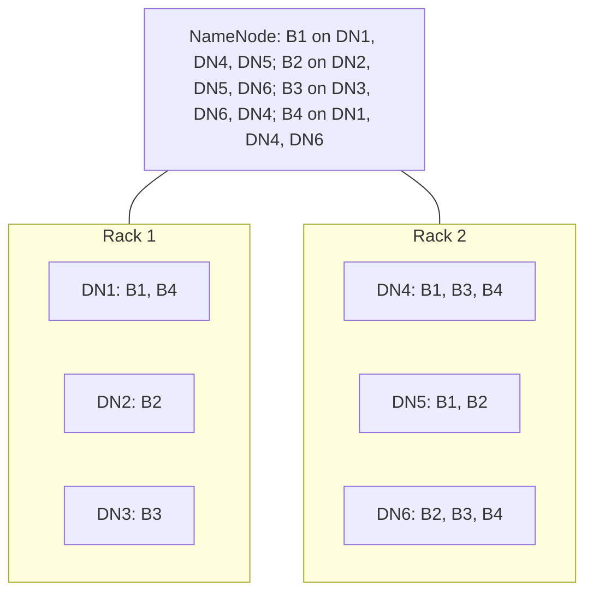

**In simple words:** a distributed file system cuts a big file into fixed-size blocks, spreads the blocks over many nodes and keeps several copies of each block. The NameNode remembers where everything is. <Cite id="hdfs-apache-design" /> <Cite id="hdfs-gfg" />

1. **Block distribution.** The file is split into blocks of 128 MB. The last block is only as big as the data left. <Cite id="hdfs-ibm" />
2. **NameNode (master).** It stores metadata: which blocks make the file and which DataNodes hold each block.
3. **DataNodes (slaves).** They store the blocks on their disks and send heartbeats and block reports.
4. **Replication factor 3.** Every block is stored on 3 different DataNodes.
5. **Rack-aware placement.** Copy 1 goes to a node in the writer's rack, copy 2 to a node in a different rack, and copy 3 to another node in that second rack. One whole rack can fail and the data is still safe. <Cite id="hdfs-apache-rack" />

**Example: a 400 MB file.**

- Blocks: $128 + 128 + 128 + 16 = 400$ MB, so 4 blocks (B1, B2, B3 of 128 MB and B4 of 16 MB).
- Copies: $4 \times 3 = 12$ block copies.
- Disk used: $3 \times 400 = 1200$ MB (B4 takes only 16 MB per copy, not 128 MB).

<Cite id="hdfs-tp" loc="diagram" />

| Block | Size | Rack 1 copy | Rack 2 copies |
|---|---|---|---|
| B1 | 128 MB | DN1 | DN4, DN5 |
| B2 | 128 MB | DN2 | DN5, DN6 |
| B3 | 128 MB | DN3 | DN6, DN4 |
| B4 | 16 MB | DN1 | DN4, DN6 |

This placement is one possible example; the real NameNode chooses nodes by its policy and free space.

**Extend in the exam (add these to reach 10 marks):**

- **Why blocks are big.** The NameNode keeps less metadata and seek time is small compared to transfer time. <Cite id="hdfs-apache-design" />
- **Failure handling.** If DN4 dies, heartbeats stop, the NameNode marks it dead and makes new copies of B1, B3 and B4 on other nodes. Reads use the nearest copy.
- **Write path.** The client sends a block to the first DataNode, which passes it along a pipeline to the other two.
- **Advantages and limitations.** Fault tolerant and fast parallel reads, but 3 copies use 3 times the disk, and the NameNode is a single point unless a standby is used. <Cite id="hdfs-apache-guide" />

**Conclusion:** splitting files into blocks and keeping 3 rack-aware copies lets a cluster store huge files safely and read them in parallel.
