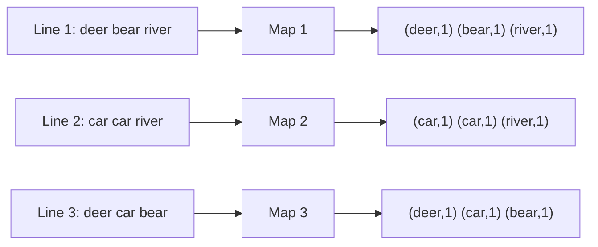

**In simple words:** the Map phase reads the input one record at a time and turns each record into (key, value) pairs. We use word count: the key is a word and the value is 1. <Cite id="hadoop-ecosystem-mmds" loc="§2.2.1" /> <Cite id="hadoop-ecosystem-dean2004" />

**Dataset:** a small text file of three lines, split so that each line goes to one map task.

| Map task | Input line |
|---|---|
| Map 1 | `deer bear river` |
| Map 2 | `car car river` |
| Map 3 | `deer car bear` |

**How the Map phase works:**

1. **Split the input.** The file is cut into splits, usually one per HDFS block, and one map task works on one split. **Example:** each line above is one split here.
2. **Read records.** A RecordReader gives the map function one record at a time as (offset, line). **Example:** (0, `deer bear river`).
3. **Run the map function.** It is called once per record and may emit zero, one or many pairs.
4. **Emit (key, value).** Keys need not be unique. **Example:** `car car river` gives (car,1), (car,1), (river,1).
5. **Save locally.** Map output goes to the local disk of the node, not to HDFS, because it is only temporary.

```text
map(offset, line):
    for each word w in line:
        emit(w, 1)
```

**Exact output of each map task:**

| Map task | Pairs emitted |
|---|---|
| Map 1 | (deer,1) (bear,1) (river,1) |
| Map 2 | (car,1) (car,1) (river,1) |
| Map 3 | (deer,1) (car,1) (bear,1) |

Total pairs = 3 + 3 + 3 = 9, equal to the 9 words in the input. Nothing is added up yet; that is the job of the reduce phase.



<Cite id="mapreduce-gfg-wordcount" loc="diagram" /> <Cite id="mapreduce-av" loc="diagram" />

**Extend in the exam (add these to reach 10 marks):**

- **Why map is parallel.** Map sees one record at a time and needs nothing from other records, so many map tasks run together on the nodes that hold the blocks (data locality). <Cite id="hadoop-ecosystem-apache-mr-tutorial" />
- **Number of map tasks.** One per input split. A 1,300 MB file with 128 MB blocks gives $\lceil 1300 \div 128 \rceil = 11$ map tasks.
- **Another dataset.** For a web log line `10.0.0.1 /home`, map can emit (`/home`, 1) to count page visits.
- **Combiner (optional).** A mini reduce on the map node. Map 2 above would send (car,2) and (river,1) instead of three pairs.

**Conclusion:** the Map phase breaks the input into independent pieces and produces (key, value) pairs, here 9 pairs from 9 words, ready for shuffle and reduce.
