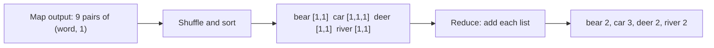

**In simple words:** after the map phase, shuffle and sort bring all pairs with the same key together and sort them. Then reduce adds the values of each key. We continue the word count from the previous question. <Cite id="hadoop-ecosystem-mmds" loc="§2.2" />

**Input to this stage (the 9 map pairs):** (deer,1) (bear,1) (river,1) (car,1) (car,1) (river,1) (deer,1) (car,1) (bear,1).

**Steps:**

1. **Partition.** Each pair is given to a reducer by hash(key) mod R, so the same key always goes to the same reducer. **Example:** both (car,1) pairs reach the same reducer.
2. **Shuffle.** Each reducer copies its pairs from every map task over the network.
3. **Sort and group.** The pairs are sorted by key and equal keys are merged into (key, list of values). <Cite id="mapreduce-gfg-mr" />
4. **Reduce.** The reduce function is called once per key and adds the list.
5. **Write output.** The final pairs go to HDFS, one file per reducer.

**Grouped lists after shuffle and sort:**

| Key | List of values |
|---|---|
| bear | [1, 1] |
| car | [1, 1, 1] |
| deer | [1, 1] |
| river | [1, 1] |

```text
reduce(word, counts):
    total = 0
    for c in counts:
        total = total + c
    emit(word, total)
```

**Final counts:** (bear, 2) (car, 3) (deer, 2) (river, 2). Check: $2 + 3 + 2 + 2 = 9$, the same as the 9 words in the input.



<Cite id="mapreduce-gfg-wordcount" loc="diagram" /> <Cite id="mapreduce-av" loc="diagram" />

**Extend in the exam (add these to reach 10 marks):**

- **Combiner.** A mini reducer on the map node. Map 1 sends 3 pairs, Map 2 sends (car,2) and (river,1) so 2 pairs, Map 3 sends 3 pairs; total 8 pairs instead of 9, and the final counts are the same. It works only for associative and commutative operations such as sum, and the answer must not depend on it. <Cite id="hadoop-ecosystem-dean2004" loc="§4.3" />
- **Partitioner.** The default is hash(key) mod R. With 2 reducers, one may get bear and deer and the other car and river (an assumed split); one key is never split between reducers.
- **Timing.** Reduce starts only after all maps finish. Keys reach the reducer in sorted order. <Cite id="hadoop-ecosystem-apache-mr-tutorial" />
- **Cost.** Shuffle is the only big network movement in the job, which is why the combiner helps.

**Conclusion:** shuffle and sort turn 9 loose pairs into 4 grouped lists, and reduce turns each list into one count.
