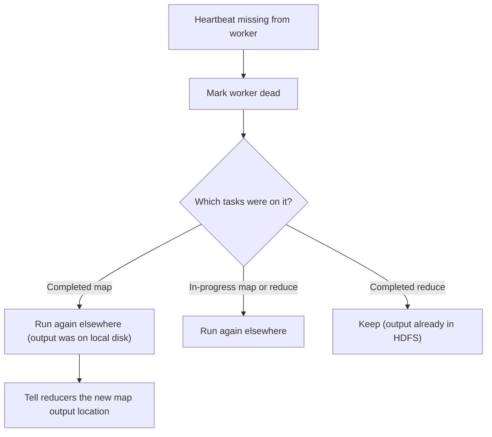

**In simple words:** a big cluster has thousands of cheap machines, so some machine is always failing. MapReduce detects failures and repairs them by itself, so the job still finishes. <Cite id="hadoop-ecosystem-mmds" loc="§2.2.6" /> <Cite id="hadoop-ecosystem-dean2004" loc="§3.3" />

**How MapReduce survives failures:**

1. **Heartbeats.** Each worker sends a small "I am alive" message every few seconds. When they stop, the master marks the worker dead. **Example:** a node loses power and its heartbeats stop.
2. **Re-execution of map tasks.** All map tasks of the dead node, finished or not, are run again on other nodes, because map output sits on its local disk. <Cite id="hadoop-ecosystem-dean2004" loc="§3.3" />
3. **Re-execution of reduce tasks.** Only unfinished reduce tasks are re-run; finished ones are kept, since their output is already in HDFS.
4. **HDFS replication.** Every block has 3 copies on different nodes (and racks), so the re-run task reads another copy. <Cite id="hadoop-ecosystem-apache-hdfs-design" />
5. **Retry limit.** A failed task is retried, 4 attempts by default, and then the job fails. <Cite id="mapreduce-apache-mapred-default" />
6. **Speculative execution.** A slow task (straggler) gets a backup copy on another node; the first to finish wins and the other is killed.
7. **Atomic commit of output.** A task writes to a temporary file and it is renamed to the final name only on success, so a failed or duplicate task never leaves half-written output.
8. **Master failure.** In Hadoop 2 and later YARN restarts the job's ApplicationMaster (2 attempts by default). <Cite id="hadoop-ecosystem-apache-yarn" />

<Cite id="mapreduce-gfg-mr" loc="diagram" />

| Failure | Detected by | Action |
|---|---|---|
| Task fails | Error or exit code | Retry on another node, up to 4 attempts |
| Task hangs | No progress for 10 minutes (default) | Kill and retry |
| Worker dies | Missing heartbeats | Re-run its map tasks and unfinished reduce tasks |
| Straggler | Much slower than others | Speculative backup copy |
| Master dies | YARN | Restart the ApplicationMaster |

**Extend in the exam (add these to reach 10 marks):**

- **Worked count.** A worker held 2 finished maps, 1 running map, 1 finished reduce and 1 running reduce. Re-run: $2 + 1 + 1 = 4$ tasks; the finished reduce is kept. Check: 5 tasks ran there and 1 is saved, $5 - 1 = 4$.
- **HDFS side.** If a DataNode dies, the NameNode makes new copies of its blocks until each block again has 3 replicas. A corrupt block is found by checksum and read from another replica. <Cite id="hdfs-apache-design" />
- **Why it matters.** The programmer writes no failure code; the framework hides it.
- **Limit.** The original Google design had one master, so master failure aborted the job; Hadoop 2 improved this.

**Conclusion:** heartbeats detect failure, re-execution and speculative copies repair the work, replication protects the data, and atomic commit keeps the output clean, so a node failure does not stop the job.
