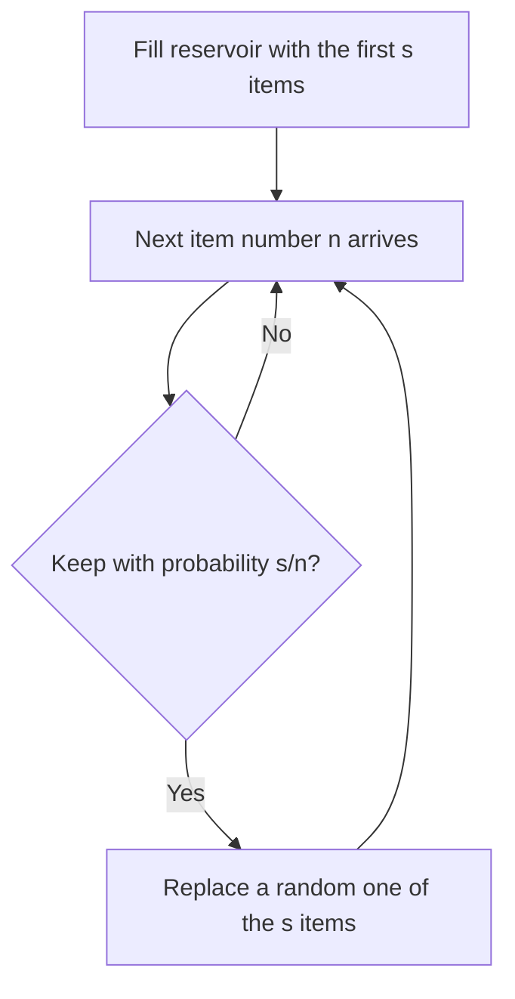

**In simple words:** a data stream arrives too fast and too long to store, so sampling keeps only a small, fair part of it. Every question about the stream is then answered from that part.

1. **What sampling is.** We keep a small piece of the stream chosen fairly, so that at any time $n$ each of the $n$ elements seen so far has the same chance of being in the sample. <Cite id="stream-data-model-cs246-slides" loc="slides 17-21" />
   **Example:** a search engine gets millions of queries a day and keeps 1 in 10 to study.
2. **Technique 1: fixed-proportion sampling by hashing the key.** To keep an $a/b$ fraction, hash the key (the part the question is about, such as the user id) into $b$ buckets and keep the tuple only if its bucket number is one of the first $a$. <Cite id="stream-counting-mmds-home" loc="§4.2" />
   **Example:** keep 3/10 of users. Buckets: u1 gives 7, u2 gives 2, u3 gives 0, u4 gives 9, u5 gives 4, u6 gives 1, u7 gives 5, u8 gives 3. Keep buckets 0, 1, 2, so users u2, u3, u6 are kept (3 of 8).
3. **Why hash the key and not pick random tuples.** The same key always gives the same bucket, so a kept user has all of their tuples in the sample. Picking random tuples would break a user's queries into pieces and give wrong answers about users, such as "what fraction of a user's queries are repeats".
4. **Technique 2: fixed-size sampling (reservoir sampling).** The memory holds exactly $s$ items and the stream length is unknown. Store the first $s$ items. For the $n$-th item ($n > s$), keep it with probability $s/n$; if kept, it replaces one of the $s$ old items chosen at random. <Cite id="stream-data-model-wiki-reservoir" /> <Cite id="stream-data-model-gfg-reservoir" />
   **Example:** $s = 2$, stream a, b, c, d, e. Reservoir [a, b]. c is kept in slot 2, giving [a, c]. d is discarded. e is kept in slot 1, giving [e, c].
5. **Why reservoir sampling is fair.** After $n$ items every item is in the sample with probability $s/n$. A new item enters with $s/(n+1)$, and an old item survives with $n/(n+1)$, so its chance becomes $\frac{s}{n}\cdot\frac{n}{n+1} = \frac{s}{n+1}$.

| Point | Hash of the key | Reservoir |
|---|---|---|
| Sample size | A fixed fraction $a/b$, grows with the stream | A fixed number $s$ |
| Decision | Bucket of the key is in the first $a$ | Keep with probability $s/n$ |
| Needs to know the length | No | No |
| Best for | Questions about keys (users) | A uniform sample of all items |

**Extend in the exam (add these to reach 10 marks):**

- **Why sampling is needed.** Memory is limited and the stream cannot be stored, so we accept approximate answers with a known error.
- **Worked check of reservoir fairness.** With $s = 2$ and 5 items, element a is in the final sample with probability $2/5$, the same as every other element.
- **Limitation.** A sample can miss rare events, and a bigger sample costs more memory.
- **Applications.** Search-query logs, network traffic monitoring and sensor data, where one small sample answers many questions.

**Conclusion:** hashing the key gives a fixed-fraction sample that keeps whole users, and reservoir sampling gives a fixed-size sample in which every item is equally likely.
