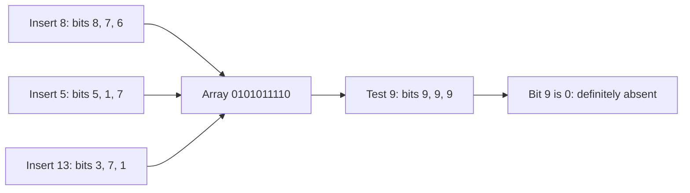

**In simple words:** a Bloom filter is a row of bits, all 0 at the start. To insert an element, apply every hash function and set those bits to 1. To test an element, apply the same hashes: any 0 bit means definitely absent, all 1 bits mean possibly present. <Cite id="stream-counting-wiki-bloom" /> <Cite id="stream-counting-gfg-bloom" />

<Sum>

<Given>

Bit array of size $m = 10$ (positions 0 to 9), all 0. $h_1(x) = x \bmod 10$, $h_2(x) = (2x+1) \bmod 10$, $h_3(x) = (3x+2) \bmod 10$. Insert 8, 5, 13. Test 9.

</Given>

<Find>

the final bit array and whether 9 is possibly present or definitely absent.

</Find>

<Steps>

1. **Hash 8.** $h_1 = 8 \bmod 10 = 8$. $h_2 = 17 \bmod 10 = 7$. $h_3 = 26 \bmod 10 = 6$. Set bits 8, 7, 6. *Reason: these are the positions 8 owns.*
2. **Hash 5.** $h_1 = 5$. $h_2 = 11 \bmod 10 = 1$. $h_3 = 17 \bmod 10 = 7$. Set bits 5, 1, 7 (bit 7 is already 1).
3. **Hash 13.** $h_1 = 13 \bmod 10 = 3$. $h_2 = 27 \bmod 10 = 7$. $h_3 = 41 \bmod 10 = 1$. Set bits 3, 7, 1 (bits 7 and 1 are already 1).

   | After inserting | Bits set to 1 | Array (positions 0 to 9) |
   |---|---|---|
   | start | none | 0 0 0 0 0 0 0 0 0 0 |
   | 8 | 6, 7, 8 | 0 0 0 0 0 0 1 1 1 0 |
   | 5 | 1, 5, 7 | 0 1 0 0 0 1 1 1 1 0 |
   | 13 | 1, 3, 7 | 0 1 0 1 0 1 1 1 1 0 |

4. **Test 9.** $h_1 = 9 \bmod 10 = 9$. $h_2 = 19 \bmod 10 = 9$. $h_3 = 29 \bmod 10 = 9$. All three hashes point to bit 9, and bit 9 is 0. *Reason: one 0 bit proves 9 was never inserted.*

</Steps>

<Answer>

Final array (positions 0 to 9): **0 1 0 1 0 1 1 1 1 0**, with bits 1, 3, 5, 6, 7, 8 set. The element **9 is definitely absent**.

</Answer>

<Box kind="verify">

The union of the inserted positions $\{8,7,6\} \cup \{5,1,7\} \cup \{3,7,1\} = \{1,3,5,6,7,8\}$ matches the array, which has 6 ones. Bit 9 is the only checked bit and it is 0, so there is no false positive here.

</Box>

</Sum>

**Extend in the exam (add these to reach 10 marks):**

- **Rule of answers.** Any 0 bit means definitely absent (no false negatives). All 1 bits mean possibly present, which can be a false positive when other elements set those bits. <Cite id="stream-counting-mmds-home" loc="§4.3" />
- **Example of a false positive.** Testing 11 gives $h_1 = 1$, $h_2 = 23 \bmod 10 = 3$, $h_3 = 35 \bmod 10 = 5$. Bits 1, 3, 5 are all 1, so the filter says "possibly present" although 11 was never inserted.
- **Advantages.** It uses very little memory and both insert and test take constant time. <Cite id="web-bda-2-bloom-networks" />
- **Limitations.** False positives rise as more bits become 1 (here 6 of 10 bits are set), and elements cannot be deleted.
- **Applications.** Spam and URL filters, and checking a cache before a slow disk lookup.

**Conclusion:** the final array is 0101011110 and 9 is definitely absent, because its bit 9 is 0.
