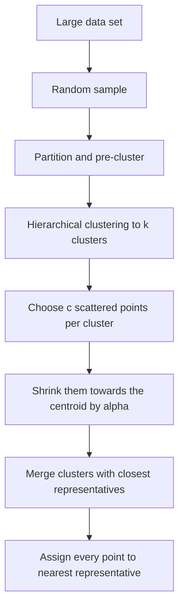

**In simple words:** CURE (Clustering Using REpresentatives) is a clustering method for large data. It describes each cluster by a few well-scattered points, moved a little towards the centre, instead of by one centre or by all points. <Cite id="cure-stream-clustering-guha1998" loc="§1.2" /> <Cite id="cure-stream-clustering-wiki-cure" />

1. **Sample.** Draw a random sample of the data so it fits in memory.
   **Example:** from 1 million points, take 10,000.
2. **Partition and pre-cluster.** Split the sample into parts and cluster each part partly, so the work is smaller and faster. <Cite id="cure-stream-clustering-basile-slides" loc="slides 26-30" />
3. **Hierarchical clustering.** Start with every point as its own cluster and repeatedly merge the closest two, until $k$ clusters are left.
4. **Pick well-scattered representatives.** In each cluster choose $c$ points: the first is farthest from the centroid, each next is farthest from those already chosen. They capture the shape of the cluster.
5. **Shrink towards the centroid** by a fraction $\alpha$: $p_{\text{new}} = p + \alpha(\text{centroid} - p)$. This reduces the pull of outliers.
   **Example:** centroid $(5,5)$, representative $(9,9)$, $\alpha = 0.2$: new point $= 9 + 0.2(5-9) = 8.2$, so $(8.2, 8.2)$.
6. **Merge the closest pair.** The distance of two clusters is the distance between their closest pair of representatives. Merge if they are close and choose new representatives from the old ones. Tiny, slow-growing clusters are dropped as outliers.
7. **Assign the remaining points.** Every point of the full data goes to the cluster of its nearest representative.

<Cite id="cure-stream-clustering-gfg-cure" loc="diagram" />

| Point | k-means | CURE |
|---|---|---|
| Cluster shape | Round only | Non-spherical shapes too |
| Outliers | Pull the centre | Shrinking and removal reduce their effect |
| Description | One centre | Several representatives |

**Extend in the exam (add these to reach 10 marks):**

- **How representatives form clusters.** Two clusters merge when their closest representatives are near each other, so a long or curved cluster is followed along its shape and not cut into round pieces. 
- **Advantages.** Finds non-spherical shapes and different sizes, resists outliers, and scales by sampling. <Cite id="cure-stream-clustering-tp-cure" />
- **Limitations.** Needs the parameters $c$, $\alpha$, the sample size and $k$; works in Euclidean space; a small cluster can be missed by a small sample.
- **Role of alpha.** $\alpha$ near 1 makes CURE act like k-means (one centre); $\alpha$ near 0 keeps the raw scattered points, which are sensitive to outliers.

**Conclusion:** by using shrunken representative points and sampling, CURE clusters large data of any shape and ignores outliers.
