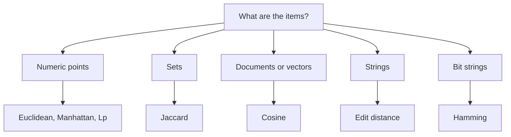

**In simple words:** a distance measure gives one number for how far apart two items are. Zero means identical and a bigger number means more different. Clustering, nearest-neighbour search and recommendation all need one. <Cite id="distance-measures-mmds" loc="§3.5" /> <Cite id="distance-measures-av" />

**Axioms (rules of a distance $d$):** <Cite id="distance-measures-wiki-metric" />

1. $d(x,y) \ge 0$, never negative.
2. $d(x,y) = 0$ only when $x = y$.
3. $d(x,y) = d(y,x)$, symmetric.
4. $d(x,z) \le d(x,y) + d(y,z)$, the triangle inequality (a direct route is never longer than a detour).

**Types of distance measure:**

1. **Euclidean ($L_2$).** Straight-line distance, $\sqrt{\sum (x_i-y_i)^2}$. <Cite id="distance-measures-gfg-euclid" />
   **Example:** $(1,2)$ to $(4,6)$: $\sqrt{9+16} = 5$.
2. **Manhattan ($L_1$).** Sum of the gaps, $\sum \lvert x_i - y_i \rvert$. <Cite id="distance-measures-gfg-manhattan" />
   **Example:** $(1,2)$ to $(4,6)$: $3 + 4 = 7$.
3. **$L_p$ norm.** $\left(\sum \lvert x_i - y_i \rvert^p\right)^{1/p}$; $p=1$ is Manhattan, $p=2$ is Euclidean, and $p=\infty$ takes the largest gap. <Cite id="distance-measures-gfg-minkowski" />
   **Example:** $p=3$: $(27+64)^{1/3} = 91^{1/3} \approx 4.50$; $p=\infty$: $\max(3,4) = 4$.
4. **Cosine.** The angle between two vectors, $\cos\theta = \dfrac{x\cdot y}{\lVert x\rVert\lVert y\rVert}$; cosine distance is $1-\cos\theta$ (or the angle itself). Used for documents. <Cite id="distance-measures-gfg-cosine" />
   **Example:** $(1,2)$ and $(2,1)$: $\cos\theta = 4/5 = 0.8$, angle $36.9^\circ$, distance $0.2$.
5. **Jaccard.** For sets, $1 - \dfrac{\lvert A\cap B\rvert}{\lvert A\cup B\rvert}$. <Cite id="distance-measures-gfg-jaccard" />
   **Example:** $A=\{1,2,3,4\}$, $B=\{3,4,5\}$: $1 - 2/5 = 0.6$.
6. **Edit.** The fewest insertions and deletions that turn one string into another. <Cite id="distance-measures-gfg-edit" />
   **Example:** abcde to acfdeg: common subsequence acde has length 4, so $(5-4)+(6-4) = 3$.
7. **Hamming.** The number of positions where two equal-length strings differ. <Cite id="distance-measures-gfg-hamming" />
   **Example:** 10101 and 11001 differ in 2 positions, so 2.

| Class | Items | Measures | Cluster centre |
|---|---|---|---|
| Euclidean | Points with coordinates | $L_2$, $L_1$, $L_\infty$ | Centroid (average, a new point) |
| Non-Euclidean | Sets, strings, bits, documents | Jaccard, cosine, edit, Hamming | Clustroid (an existing item) |

**Extend in the exam (add these to reach 10 marks):**

- **Why the choice matters.** The wrong measure gives wrong clusters: Jaccard suits sets of words, Hamming suits fixed-length codes.
- **Euclidean versus Manhattan.** Manhattan follows grid paths (like city blocks); Euclidean is the straight line, so $L_1 \ge L_2$. 
- **A caution on cosine.** The value $1-\cos\theta$ can break the triangle inequality, but the angle itself obeys it.
- **Applications.** Finding similar documents (Jaccard, cosine), spell checking (edit), error detection in codes (Hamming), k-means and k-NN (Euclidean).

**Conclusion:** a distance measure turns "how different are these two items" into a number, and Jaccard, cosine, edit, Hamming, $L_1$ and $L_2$ cover sets, text, strings, bits and points.
