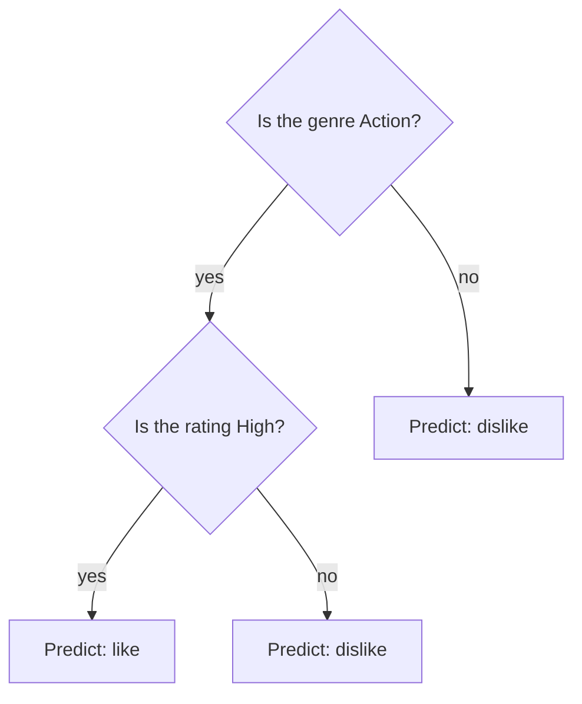

**In simple words:** we can treat recommendation as classification. For one user, the items they already rated are the training examples: the item features are the input and "like" or "dislike" is the label. A trained classifier then predicts the label for a new item. <Cite id="recommendation-systems-wiki-recsys" /> <Cite id="recommendation-systems-mmds-book" loc="Ch. 9" />

1. **Features from the item profile.** Each item is a row of features, such as genre and rating band.
   **Example:** Action, rating above 7.
2. **Label per user.** Each rated item is marked like or dislike by that user.
3. **Train one classifier per user.** Decision tree, Naive Bayes or k-nearest neighbours learn the pattern from that user's labelled items. <Cite id="recommendation-systems-ibm" />
4. **Predict for a new item.** Give its features to the classifier and read off like or dislike.
5. **Recommend** the items predicted "like".

**Worked example.** One user has rated six movies (rating above 7 is called High):

| Movie | Genre | Rating | Label |
|---|---|---|---|
| M1 | Action | High | Like |
| M2 | Action | High | Like |
| M3 | Action | Low | Dislike |
| M4 | Romance | High | Dislike |
| M5 | Romance | Low | Dislike |
| M6 | Action | High | Like |

New movie M7: Action, High.

<Cite id="recommendation-systems-gfg-cb" loc="diagram" />

<Sum>

<Given>

The six rated movies above and the new movie M7 (Action, High).

</Given>

<Find>

whether the user will like M7, by decision tree and by Naive Bayes.

</Find>

<Steps>

1. **Decision tree.** The tree above fits all six training movies. M7 is Action (yes) and High (yes), so the prediction is **like**.
2. **Naive Bayes priors.** $P(\text{like}) = 3/6 = 0.5$ and $P(\text{dislike}) = 3/6 = 0.5$.
3. **Likelihoods for like.** $P(\text{Action}\mid\text{like}) = 3/3 = 1$ and $P(\text{High}\mid\text{like}) = 3/3 = 1$. Score $= 0.5 \times 1 \times 1 = 0.5$.
4. **Likelihoods for dislike.** $P(\text{Action}\mid\text{dislike}) = 1/3$ (only M3) and $P(\text{High}\mid\text{dislike}) = 1/3$ (only M4). Score $= 0.5 \times \frac13 \times \frac13 = 0.0556$.
5. **Normalise.** $P(\text{like}\mid M7) = 0.5/(0.5 + 0.0556) = 0.9$.

</Steps>

<Answer>

Both methods predict that the user will **like** M7; Naive Bayes gives a 90 percent chance.

</Answer>

<Box kind="verify">

k-NN agrees: the three nearest movies (M1, M2, M6) have exactly M7's features and are all liked. Also $0.9 + 0.1 = 1$, where dislike gets $0.0556/0.5556 = 0.1$.

</Box>

</Sum>

**Extend in the exam (add these to reach 10 marks):**

- **Why it is useful.** It learns which features matter to each user, for example that this user likes Action only when the rating is high.
- **Choosing the classifier.** A decision tree is easy to explain, Naive Bayes is fast with few examples, and k-NN needs no training but is slow on large data. If a feature value never occurs with a label, Naive Bayes needs smoothing (add 1 to the counts) to avoid a zero.
- **Limitation.** Every user needs enough rated items and a separate classifier, and a new user has no training data (cold start).
- **Other uses.** Predicting whether a user will click or buy, and splitting items into "recommend" and "do not recommend". <Cite id="recommendation-systems-ibm" />

**Conclusion:** classification turns recommendation into predicting like or dislike from item features, learned separately for each user.
