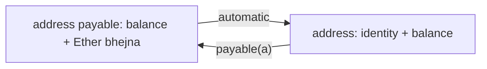
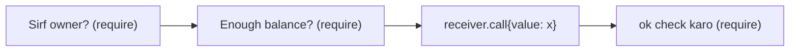

**Ek line mein:** <mark>Address ek 20-byte value hai jo account ko identify karti hai; address payable aisa address hai jo Ether receive bhi kar sakta hai</mark>. <Cite id="solidity-docs-types" loc="Address" />

<Box kind="key">

**Har address question mein ye points likho:**

- `address`: <mark>20-byte account identifier</mark> (user wallet ya contract). Isme `.balance` hota hai.
- `address payable`: wahi, plus <mark>Ether receive kar sakta hai</mark> (`transfer`, `send`, `call{value: ...}`).
- Do types kyun: <mark>programmer ko batana padta hai ki kin addresses ko paisa mil sakta hai</mark>, taaki galti se Ether na chala jaye.
- Conversion: <mark>`payable(a)`</mark> se `address` ko `address payable` banate hain; ulta apne aap ho jata hai.
- `msg.sender` caller hai; `address(this).balance` contract ka apna Ether hai.
- `call{value: x}("")` use karo aur **uska result check karo**; `transfer` aur `send` sirf 2300 gas dete hain.

</Box>

## Core answer (5 marks, yahan ke har question ke liye)

<Box kind="definition">

An **address** is a 20-byte value that identifies an account (a user's wallet or a contract). An **address payable** is an address that can also **receive Ether**. <Cite id="solidity-docs-types" loc="Address" />

</Box>

**Do types kyun:** Solidity tumse mark karwata hai ki kaunse addresses ko paisa mil sakta hai. Owners aur approvers plain `address` rehte hain; paisa paane wale `address payable` hote hain. Isse galti se aise address pe Ether nahi jata jo use le nahi sakta.

| | `address` | `address payable` |
|---|---|---|
| Kya rakhta hai | 20-byte account address | Wahi |
| `.balance` padhna | Haan | Haan |
| Ether bhejna (`transfer`, `send`, `call{value:}`) | Nahi | Haan |
| Kis ke liye | Owners, approvers, ids | Paisa paane wale |
| Convert | Payable address apne aap `address` ban jata hai | `payable(a)` se `address` payable banta hai |



```solidity
address public owner;            // plain address: identity only
address payable public charity;  // can receive Ether
```

**Conclusion:** `address` identify karta hai, `address payable` paisa bhi le sakta hai. `payable(a)` se convert karo. <Cite id="solidity-gfg-intro" />

## Extended answer (10 marks): ye add karo

### 1. Poora example

```solidity
// SPDX-License-Identifier: MIT
pragma solidity ^0.8.0;

contract AddressDemo {
    address public owner;             // plain address: identity only
    address payable public charity;   // payable address: can receive Ether

    constructor(address payable _charity) {
        owner = msg.sender;
        charity = _charity;
    }

    // payable function: accepts Ether sent with the call
    function deposit() public payable {}

    function contractBalance() public view returns (uint) {
        return address(this).balance;
    }

    function balanceOf(address a) public view returns (uint) {
        return a.balance;             // reading a balance works for any address
    }

    function donate(uint amount) public {
        require(msg.sender == owner, "Only owner");
        require(amount <= address(this).balance, "Not enough balance");
        (bool ok, ) = charity.call{value: amount}("");
        require(ok, "Transfer failed");
    }

    function refund(address user, uint amount) public {
        require(msg.sender == owner, "Only owner");
        address payable receiver = payable(user);   // convert before sending
        (bool ok, ) = receiver.call{value: amount}("");
        require(ok, "Refund failed");
    }
}
```

- `constructor` ek baar chalta hai; `msg.sender` (deploy karne wala) `owner` ban jata hai.
- `deposit()` `payable` hai aur body khali hai, isliye call ke saath bheja gaya Ether contract mein rehta hai.
- `donate` do `require` checks (sirf owner, enough balance) lagata hai, phir `call` se bhejta hai aur `ok` check karta hai.
- `refund` ko plain `address` milta hai, isliye pehle `payable(user)` se convert karte hain. Warna compiler bhejne se mana kar deta hai.

<Box kind="verify">

A `_charity` = B ke saath deploy karta hai. A 3 ether ke saath `deposit()` call karta hai: `contractBalance()` 3 ether. A `donate(1 ether)` karta hai: B ko 1 ether milta hai, balance 2 ether. C `donate(1)` karta hai: "Only owner" se fail. A `donate(5 ether)` karta hai: "Not enough balance" se fail. A `refund(C, 1 ether)` karta hai: C ko 1 ether, contract ke paas 1 ether bachta hai.

</Box>

### 2. Address ke members

| Member | Matlab |
|---|---|
| `.balance` | Rakha hua Ether, wei mein |
| `.transfer(x)` | x wei bhejta hai, failure pe **revert** (sirf payable) |
| `.send(x)` | x wei bhejta hai, failure pe **false** return (sirf payable) |
| `.call{value: x}("")` | x wei bhejta hai, `(bool ok, bytes data)` return karta hai |

`transfer` aur `send` sirf 2300 gas bhejte hain, jo receive karne wale contract ke liye kam ho sakta hai. Mastering Ethereum `call` ki salah deta hai, aur uska result hamesha check karna chahiye. <Cite id="solidity-mastering-ethereum-ch7" />

### 3. Related global values

`msg.sender` woh address hai jisne function call kiya; `msg.value` call ke saath bheja gaya wei hai; `address(this)` contract ka apna address hai. <Cite id="solidity-tp-tutorial" />



## Har question mein kaise fit karein

- **"Explain the role of address and address payable in solidity with example."** (10 marks) <PYQ id="2023-12-ce/q5b" />: core answer (definition, table, diagram), phir poora example, members table aur safe-sending flow.

## Exam tips

- `address` vs `address payable` ki **table banao**; comparison ke marks milte hain.
- Keywords: <mark>20-byte, payable(a), receive Ether, msg.sender, call, balance</mark>.
- `call` ka result hamesha check karo, aur likho ki `transfer` 2300 gas tak limited hai.

Exam mein English mein likho.
