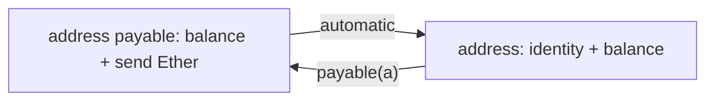

**In one line:** <mark>An address is a 20-byte value that identifies an account; an address payable is an address that can also receive Ether</mark>. <Cite id="solidity-docs-types" loc="Address" />

<Box kind="key">

**Key points to write (any address question):**

- `address`: <mark>20-byte account identifier</mark> (user wallet or contract). It has `.balance`.
- `address payable`: the same, plus <mark>can receive Ether</mark> (`transfer`, `send`, `call{value: ...}`).
- Why two types: <mark>the programmer must say which addresses may be paid</mark>, so Ether is not sent by mistake.
- Conversion: <mark>`payable(a)`</mark> turns an `address` into `address payable`; the reverse is automatic.
- `msg.sender` is the caller; `address(this).balance` is the contract's own Ether.
- Prefer `call{value: x}("")` and **check its result**; `transfer` and `send` forward only 2300 gas.

</Box>

## Core answer (5 marks, fits every question here)

<Box kind="definition">

An **address** is a 20-byte value that identifies an account (a user's wallet or a contract). An **address payable** is an address that can also **receive Ether**. <Cite id="solidity-docs-types" loc="Address" />

</Box>

**Why two types:** Solidity forces you to mark the addresses that may be paid. Owners and approvers stay plain `address`; receivers of money are `address payable`. This stops Ether being sent by mistake to a place that cannot take it.

| | `address` | `address payable` |
|---|---|---|
| Holds | 20-byte account address | The same |
| Read `.balance` | Yes | Yes |
| Send Ether (`transfer`, `send`, `call{value:}`) | No | Yes |
| Use for | Owners, approvers, ids | Receivers of money |
| Convert | A payable address becomes `address` automatically | `payable(a)` makes an `address` payable |



```solidity
address public owner;            // plain address: identity only
address payable public charity;  // can receive Ether
```

**Conclusion:** `address` identifies, `address payable` can also be paid. Convert with `payable(a)`. <Cite id="solidity-gfg-intro" />

## Extended answer (10 marks): add these

### 1. Full example

```solidity
// SPDX-License-Identifier: MIT
pragma solidity ^0.8.0;

contract AddressDemo {
    address public owner;             // plain address: identity only
    address payable public charity;   // payable address: can receive Ether

    constructor(address payable _charity) {
        owner = msg.sender;
        charity = _charity;
    }

    // payable function: accepts Ether sent with the call
    function deposit() public payable {}

    function contractBalance() public view returns (uint) {
        return address(this).balance;
    }

    function balanceOf(address a) public view returns (uint) {
        return a.balance;             // reading a balance works for any address
    }

    function donate(uint amount) public {
        require(msg.sender == owner, "Only owner");
        require(amount <= address(this).balance, "Not enough balance");
        (bool ok, ) = charity.call{value: amount}("");
        require(ok, "Transfer failed");
    }

    function refund(address user, uint amount) public {
        require(msg.sender == owner, "Only owner");
        address payable receiver = payable(user);   // convert before sending
        (bool ok, ) = receiver.call{value: amount}("");
        require(ok, "Refund failed");
    }
}
```

- The `constructor` runs once; `msg.sender` (the deployer) becomes `owner`.
- `deposit()` is `payable` with an empty body, so Ether sent with the call stays in the contract.
- `donate` uses two `require` checks (only owner, enough balance), then sends with `call` and checks `ok`.
- `refund` gets a plain `address`, so `payable(user)` converts it first. Without it the compiler refuses to send.

<Box kind="verify">

A deploys with `_charity` = B. A calls `deposit()` with 3 ether: `contractBalance()` is 3 ether. A calls `donate(1 ether)`: B gains 1 ether, balance is 2 ether. C calls `donate(1)`: fails "Only owner". A calls `donate(5 ether)`: fails "Not enough balance". A calls `refund(C, 1 ether)`: C gains 1 ether, the contract keeps 1 ether.

</Box>

### 2. Members of address

| Member | Meaning |
|---|---|
| `.balance` | Ether held, in wei |
| `.transfer(x)` | Sends x wei, **reverts** on failure (payable only) |
| `.send(x)` | Sends x wei, returns **false** on failure (payable only) |
| `.call{value: x}("")` | Sends x wei, returns `(bool ok, bytes data)` |

`transfer` and `send` forward only 2300 gas, which may be too little for a receiving contract. Mastering Ethereum advises `call`, and its result must always be checked. <Cite id="solidity-mastering-ethereum-ch7" />

### 3. Related global values

`msg.sender` is the address that called the function; `msg.value` is the wei sent with the call; `address(this)` is the contract's own address. <Cite id="solidity-tp-tutorial" />


## Fit it to each question

- **"Explain the role of address and address payable in solidity with example."** (10 marks) <PYQ id="2023-12-ce/q5b" />: core answer (definition, table, diagram), then the full example, the members table and the safe-sending flow.

## Exam tips

- **Draw** the table of `address` versus `address payable`; it earns the comparison marks.
- Keywords: <mark>20-byte, payable(a), receive Ether, msg.sender, call, balance</mark>.
- Always check the result of `call`, and mention that `transfer` is limited to 2300 gas.
