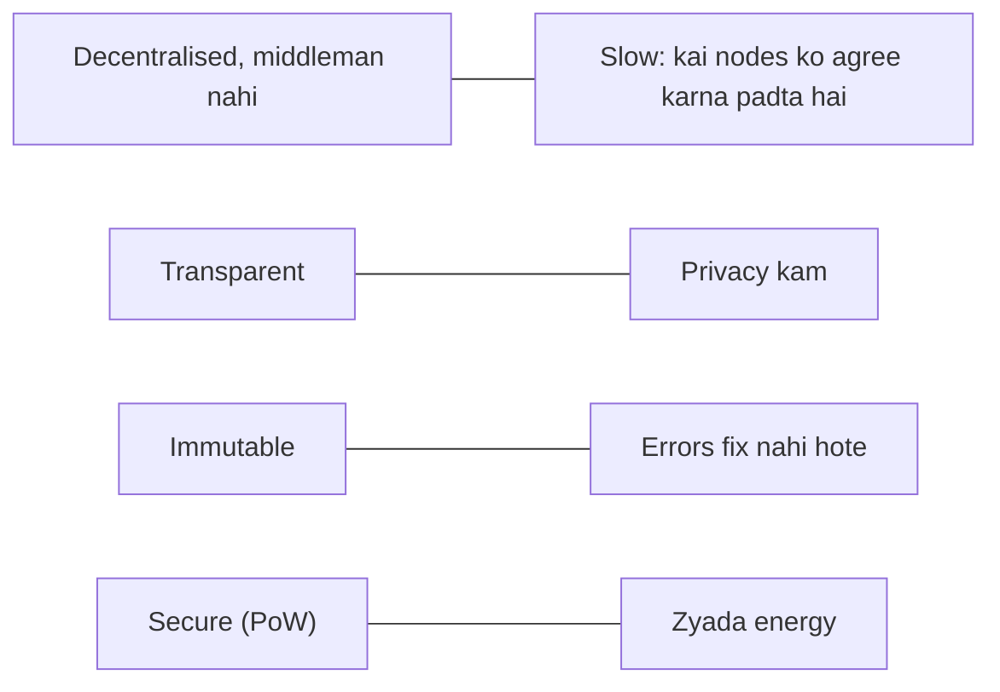
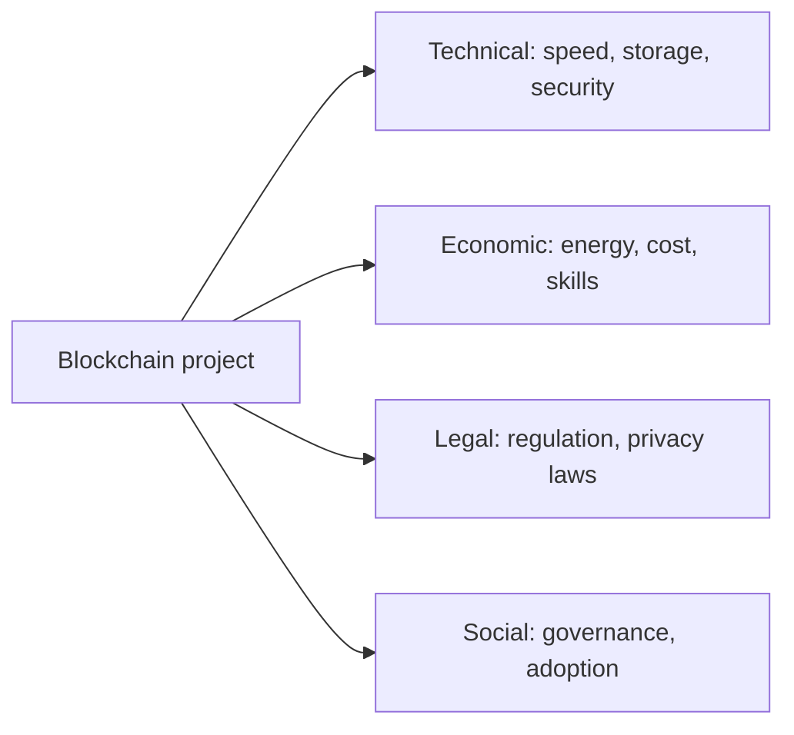

**Ek line mein:** <mark>Blockchain bina middleman ke decentralisation, transparency, immutability aur security deta hai, lekin kam speed, zyada energy, storage growth, privacy aur legal problems se limited hai</mark>. <Cite id="blockchain-fundamentals-ibm-blockchain" />

<Box kind="key">

**Benefits, limitations ya challenges ke question mein ye points likho:**

- Benefits: <mark>decentralised, transparent, immutable, secure, traceable</mark>, kam cost aur faster settlement, smart-contract automation.
- Limit 1: <mark>scalability</mark>: Bitcoin lagbhag 7 transactions per second, Ethereum lagbhag 15 se 30, Visa hazaaron.
- Limit 2: Proof of Work mein <mark>zyada energy use</mark>.
- Limit 3: <mark>storage hamesha badhta hai</mark>, har full node poora ledger rakhta hai.
- Limit 4: <mark>immutability dono taraf kaam karti hai</mark>: errors aur bugs undo nahi hote; private key kho gayi to coins gaye.
- Challenges: <mark>privacy vs transparency, regulation, interoperability, skills aur cost, governance, 51% attack</mark>.

</Box>

## Core answer (5 marks, yahan ke har question ke liye)

<Box kind="definition">

A **blockchain** is a shared, append-only ledger kept by many computers, with blocks linked by hashes. Because of this design it gives strong **benefits** and also real **limitations and implementation challenges**. <Cite id="blockchain-fundamentals-ibm-blockchain" />

</Box>

**Benefits:**

1. **Decentralisation:** data pe kisi ek bank ya company ka control nahi, isliye single point of failure nahi.
2. **Transparency:** saare permitted participants wahi records dekhte hain.
3. **Immutability:** har block pichhle block ka hash rakhta hai, isliye purana record badalne se baad ke saare blocks toot jaate hain. <Cite id="blockchain-fundamentals-nakamoto" />
4. **Security:** hashes aur digital signatures data aur ownership ko protect karte hain.
5. **Traceability aur kam cost:** har transaction time-stamped hai; middleman nahi, isliye fees kam.

**Limitations aur challenges:**

1. **Scalability:** har node sab store aur check karta hai; transactions per second kam. <Cite id="blockchain-fundamentals-nist-8202" />
2. **Energy:** Proof of Work bahut bijli use karta hai. <Cite id="blockchain-fundamentals-ccaf-cbeci" />
3. **Storage growth, privacy, regulation, security risks aur skills.**

**Conclusion:** <mark>blockchain wahan best hai jahan trust, transparency aur traceability raw speed aur privacy se zyada important hain; ye har problem ka sahi tool nahi hai</mark>. <Cite id="blockchain-fundamentals-gfg-advantages" />

## Extended answer (10 marks): ye add karo

### 1. Benefits detail mein

| Benefit | Kyun |
|---|---|
| Decentralisation | Data kai nodes pe copy hota hai |
| Transparency | Saare participants wahi history verify karte hain |
| Immutability | Hash-linked blocks; ek block badalne ke liye baad ka saara work dobara karna padega |
| Security | Cryptography aur consensus |
| Traceability | Time-stamped, linked records supply chains aur audits mein kaam aate hain |
| Cost aur speed | Middleman nahi, reconciliation steps kam |
| Automation | Smart contracts agreements automatically chalate hain |
| Ajnabiyon ke beech trust | Network rules enforce karta hai |

### 2. Limitations aur challenges detail mein

1. **Scalability aur speed.** Blocks ki size limit hai aur har node saara kaam dohraata hai. <Cite id="web-bt-1-eth-scaling" />
2. **Energy use.** PoW costly hai; PoS aur permissioned chains ise kam karte hain.
3. **Storage growth.** Ledger sirf badhta hai.
4. **Security.** Chhoti chain pe 51% attack, chori ya khoyi keys, smart-contract bugs (DAO hack).
5. **Privacy vs transparency.** Public ledger saare transactions dikhata hai; immutability GDPR ke "right to erasure" se takrati hai.
6. **Regulation.** Crypto, tax aur liability ke rules kai deshon mein clear nahi.
7. **Interoperability.** Chains ek dusre se ya purane systems se aasaani se baat nahi karti.
8. **Cost aur skills.** Solidity ya Fabric jaanne wale developers kam; integration costly.
9. **Governance aur adoption.** Members ko rules aur upgrades pe agree karna padta hai; wallets aur keys users ke liye mushkil.
10. **Oracle problem.** Contract khud real-world data nahi padh sakta. <Cite id="blockchain-applications-gfg-industries" />

### 3. Har challenge kaise kam hota hai

| Challenge | Kam karne ka aam tareeka |
|---|---|
| Scalability | Layer 2, sharding, bade blocks |
| Energy | Proof of Stake, permissioned chain |
| Privacy | Private channels, zero-knowledge proofs |
| Smart-contract bugs | Audits, testing, formal checks |
| Interoperability | Bridges, standards |

## Har question mein kaise fit karein

- **"Explain the benefits and limitations of blockchain."** (10 marks) <PYQ id="2023-12/q4a" />: core answer, section 1 table aur limitations list, end mein benefit-cost diagram.

## Exam tips

- **Har point number karo** aur har ek ke saath ek number ya example do (7 tps, DAO hack, GDPR).
- <mark>"immutability cuts both ways"</mark> likho: ye ek achhi one-line point hai jo trade-off ki samajh dikhati hai.
- Har limitation ke saath uska fix likho; isse samajh dikhti hai aur marks poore hote hain.

Exam mein English mein likho.
