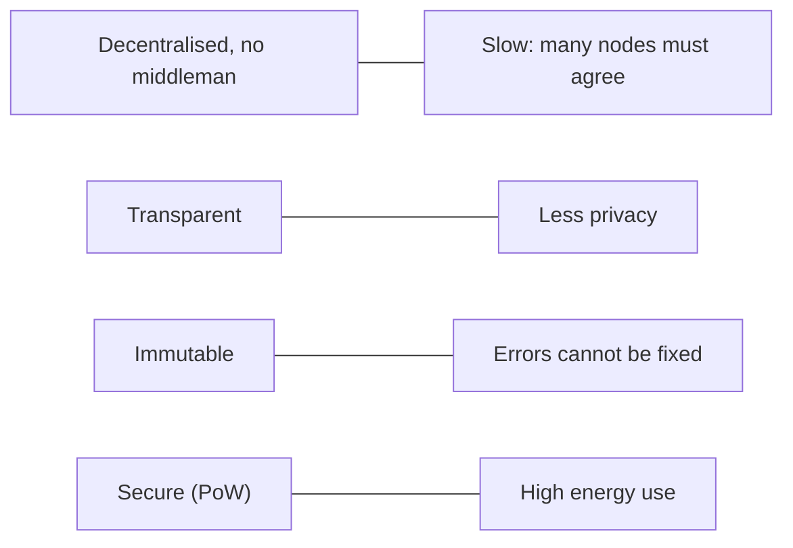
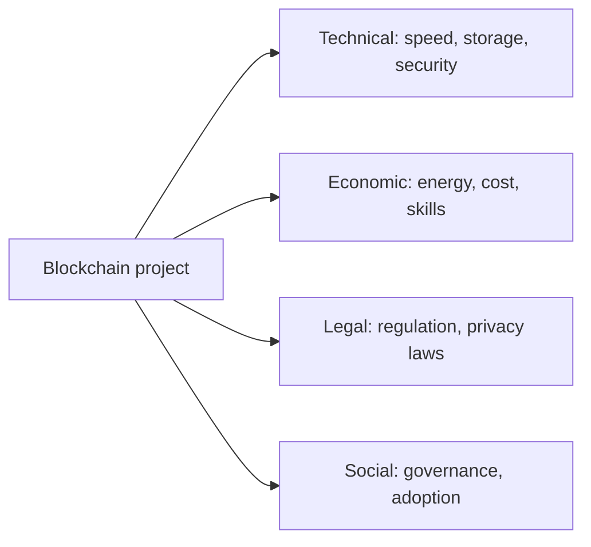

**In one line:** <mark>Blockchain gives decentralisation, transparency, immutability and security without a middleman, but it is limited by low speed, high energy use, storage growth, privacy and legal problems</mark>. <Cite id="blockchain-fundamentals-ibm-blockchain" />

<Box kind="key">

**Key points to write (benefits, limitations or challenges):**

- Benefits: <mark>decentralised, transparent, immutable, secure, traceable</mark>, lower cost and faster settlement, smart-contract automation.
- Limit 1: <mark>scalability</mark>: Bitcoin about 7 transactions per second, Ethereum about 15 to 30, Visa thousands.
- Limit 2: <mark>high energy use</mark> in Proof of Work.
- Limit 3: <mark>storage grows forever</mark>, every full node keeps the whole ledger.
- Limit 4: <mark>immutability cuts both ways</mark>: errors and bugs cannot be undone; lost private keys mean lost coins.
- Challenges: <mark>privacy vs transparency, regulation, interoperability, skills and cost, governance, 51% attack</mark>.

</Box>

## Core answer (5 marks, fits every question here)

<Box kind="definition">

A **blockchain** is a shared, append-only ledger kept by many computers, with blocks linked by hashes. Because of this design it gives strong **benefits** and also real **limitations and implementation challenges**. <Cite id="blockchain-fundamentals-ibm-blockchain" />

</Box>

**Benefits:**

1. **Decentralisation:** no single bank or company controls the data, so no single point of failure.
2. **Transparency:** all permitted participants see the same records.
3. **Immutability:** each block holds the hash of the previous one, so changing an old record breaks all later blocks. <Cite id="blockchain-fundamentals-nakamoto" />
4. **Security:** hashes and digital signatures protect data and ownership.
5. **Traceability and lower cost:** every transaction is time-stamped; no middlemen, so fewer fees.

**Limitations and challenges:**

1. **Scalability:** every node stores and checks everything; low transactions per second. <Cite id="blockchain-fundamentals-nist-8202" />
2. **Energy:** Proof of Work uses a huge amount of electricity. <Cite id="blockchain-fundamentals-ccaf-cbeci" />
3. **Storage growth, privacy, regulation, security risks and skills.**

**Conclusion:** <mark>blockchain is best where trust, transparency and traceability matter more than raw speed and privacy; it is not the right tool for every problem</mark>. <Cite id="blockchain-fundamentals-gfg-advantages" />

## Extended answer (10 marks): add these

### 1. Benefits in detail

| Benefit | Why |
|---|---|
| Decentralisation | Data is copied on many nodes |
| Transparency | All participants verify the same history |
| Immutability | Hash-linked blocks; changing one block needs redoing all later work |
| Security | Cryptography and consensus |
| Traceability | Time-stamped, linked records help supply chains and audits |
| Cost and speed | No middleman, fewer reconciliation steps |
| Automation | Smart contracts run agreements automatically |
| Trust between strangers | Network enforces the rules |

### 2. Limitations and challenges in detail

1. **Scalability and speed.** Blocks have a size limit and every node repeats all work. <Cite id="web-bt-1-eth-scaling" />
2. **Energy use.** PoW is costly; PoS and permissioned chains reduce it.
3. **Storage growth.** The ledger only grows.
4. **Security.** 51% attack on a small chain, stolen or lost keys, smart-contract bugs (the DAO hack).
5. **Privacy vs transparency.** Public ledgers show all transactions; immutability clashes with laws like the GDPR "right to erasure".
6. **Regulation.** Rules on crypto, tax and liability are unclear in many countries.
7. **Interoperability.** Chains cannot easily talk to each other or to old systems.
8. **Cost and skills.** Few developers know Solidity or Fabric; integration is costly.
9. **Governance and adoption.** Members must agree on rules and upgrades; wallets and keys are hard for users.
10. **Oracle problem.** A contract cannot read real-world data by itself. <Cite id="blockchain-applications-gfg-industries" />

### 3. How each challenge is reduced

| Challenge | Common way to reduce it |
|---|---|
| Scalability | Layer 2, sharding, bigger blocks |
| Energy | Proof of Stake, permissioned chain |
| Privacy | Private channels, zero-knowledge proofs |
| Smart-contract bugs | Audits, testing, formal checks |
| Interoperability | Bridges, standards |

## Fit it to each question

- **"State and explain various challenges that occur while implementing blockchain."** (10 marks) <PYQ id="2022-12-ce/q2a" />: short core answer, then section 2 (all ten), section 3 table and the four-area diagram.
- **"Explain the benefits and limitations of blockchain."** (10 marks) <PYQ id="2023-12/q4a" />: core answer, section 1 table and the limitations list, ending with the benefit-cost diagram.
- **"Explain five challenges of Blockchain Implementation."** (5 marks) <PYQ id="2024-12-ce/q1e" />: pick five from section 2 (scalability, energy, security and privacy, regulation, integration and skills), two lines each, with Bitcoin 7 tps.

## Exam tips

- **Number every point** and give one number or example each (7 tps, DAO hack, GDPR).
- Write <mark>"immutability cuts both ways"</mark>: it is a good one-line point that shows you understand the trade-off.
- Pair every limitation with a fix; it shows understanding and fills the marks.
