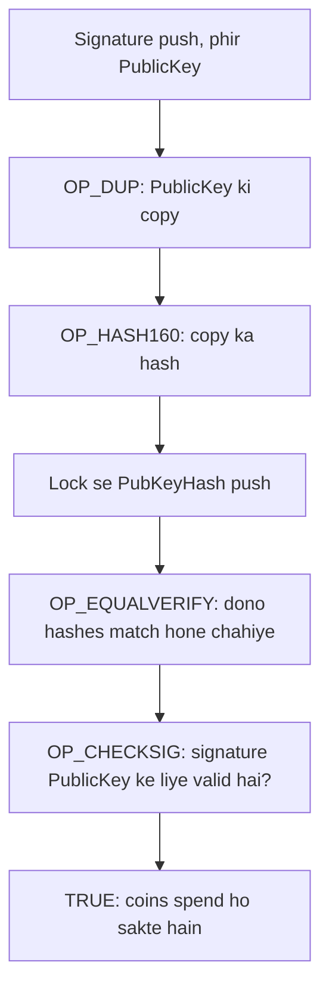

**Ek line mein:** <mark>Bitcoin Script ek simple, stack-based language hai jisme loops nahi hote; har output mein locking script aur har input mein unlocking script hoti hai, aur dono chalane ke baad TRUE bache to spend valid hai</mark>. <Cite id="bitcoin-btcwiki-script" />

<Box kind="key">

**Bitcoin Script aur P2PKH ke question mein ye points likho:**

- Script <mark>stack-based hai, Turing complete nahi, loops nahi</mark>, isliye har script khatam hoti hai.
- <mark>Locking script (scriptPubKey)</mark> output mein hoti hai; <mark>unlocking script (scriptSig)</mark> input mein.
- Dono saath chalti hain; <mark>stack pe TRUE = coins spend ho sakte hain</mark>.
- <mark>P2PKH = Pay to Public Key Hash</mark>: coins public key ke hash (address) se locked hote hain.
- Lock: <mark>OP_DUP OP_HASH160 PubKeyHash OP_EQUALVERIFY OP_CHECKSIG</mark>. Unlock: <mark>Signature PublicKey</mark>.
- Hash kyun: spend hone tak public key chhupi rehti hai aur address chhota hota hai.

</Box>

## Core answer (5 marks, yahan ke har question ke liye)

<Box kind="definition">

**Bitcoin Script** is a tiny stack-based programming language inside every transaction that says **what you must show to be allowed to spend the coins**: a lock (the rule) and a key (the proof). <Cite id="bitcoin-btcwiki-script" />

</Box>

**Kaise kaam karta hai:** har output mein **locking script** (scriptPubKey) hoti hai; har input mein **unlocking script** (scriptSig). Nodes pehle unlocking script phir locking script ek hi stack pe chalate hain. Result TRUE ho to spend valid hai. Language mein loops nahi hain, isliye ye hamesha khatam hoti hai. <Cite id="bitcoin-mb-ch07-scripts" />

**P2PKH (Pay to Public Key Hash):** sabse common script. Coins **public key ke hash** (aapka address) se locked hote hain, key se seedha nahi.

- Locking script: `OP_DUP OP_HASH160 <PubKeyHash> OP_EQUALVERIFY OP_CHECKSIG`
- Unlocking script: `<Signature> <PublicKey>`

**Example:** Ravi Sita ko 0.5 BTC deta hai, to Ravi ka output coins ko Sita ki public key ke hash se lock karta hai. Baad mein Sita apna signature aur public key dekar spend karti hai. Node uski public key ko hash karta hai, dekhta hai ki stored hash ke barabar hai, phir signature check karta hai. Uski private key ke bina koi valid signature nahi bana sakta. <Cite id="bitcoin-lmab-p2pkh" />

**Conclusion:** <mark>P2PKH coins ko public-key hash se lock karta hai aur signature aur public key se unlock karta hai</mark>.

## Extended answer (10 marks): ye add karo

### 1. Stack run, step by step

| Step | Operation | Stack ke baad (top right mein) |
|---|---|---|
| 1 | Signature push | Sig |
| 2 | PublicKey push | Sig, PubKey |
| 3 | OP_DUP | Sig, PubKey, PubKey |
| 4 | OP_HASH160 | Sig, PubKey, Hash(PubKey) |
| 5 | PubKeyHash push | Sig, PubKey, Hash(PubKey), PubKeyHash |
| 6 | OP_EQUALVERIFY | Sig, PubKey (hashes alag hon to fail) |
| 7 | OP_CHECKSIG | TRUE (signature valid ho to) |

### 2. P2PKH kyun use hota hai

- **Public key chhupi rehti hai** jab tak coins spend na ho.
- Address (checksum wala hash) **chhota** aur copy karne mein safe hai. <Cite id="bitcoin-btcwiki-address" />
- Sirf private key ka owner spend kar sakta hai, kyunki signature public key se match karna chahiye. <Cite id="bitcoin-og-p2pkh" />

### 3. Dusre script types (ek-ek line)

- **P2PK:** seedha public key se locked (purana).
- **P2SH:** script ke hash se locked; multi-signature ke liye.
- **P2WPKH:** P2PKH ka SegWit version.

### 4. Script ki features

| Feature | Matlab |
|---|---|
| Stack based | Values push aur pop hoti hain; commands top pe kaam karte hain |
| Not Turing complete | Loops nahi, isliye infinite run nahi |
| Stateless | Result sirf script aur transaction pe depend karta hai |
| Opcodes | OP_DUP, OP_HASH160, OP_EQUALVERIFY, OP_CHECKSIG aur aur |

## Har question mein kaise fit karein

- **"What is Bitcoin Script? Explain pay to public key hash(P2PKH) with suitable example"** (5 marks) <PYQ id="2025-05/q1b" />: core answer: Script definition, lock aur unlock, flow diagram aur Ravi se Sita example. Time ho to section 1 (table) add karo.

## Exam tips

- **Dono scripts exactly likho:** `OP_DUP OP_HASH160 <PubKeyHash> OP_EQUALVERIFY OP_CHECKSIG` aur `<Signature> <PublicKey>`.
- Stack run ko table ya numbered flow mein draw karo.
- <mark>"no loops, so no infinite loops"</mark> likho taaki dikhe ki Script jaan-boojhkar simple hai.

Exam mein English mein likho.
