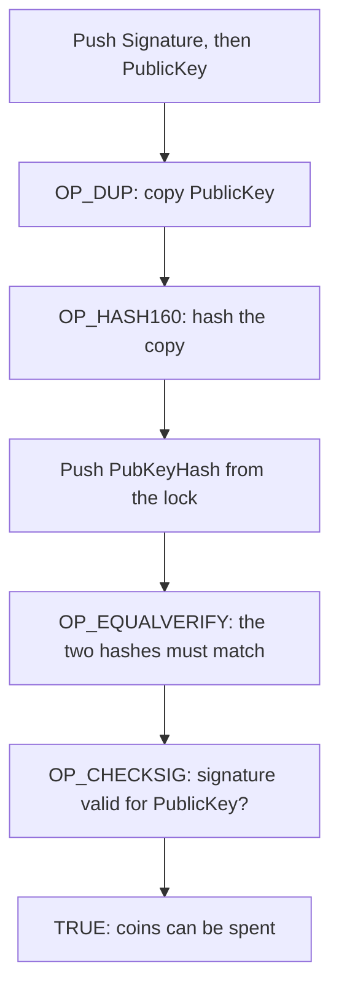

**In one line:** <mark>Bitcoin Script is a simple, stack-based language with no loops; each output has a locking script and each input has an unlocking script, and a spend is valid if running both leaves TRUE</mark>. <Cite id="bitcoin-btcwiki-script" />

<Box kind="key">

**Key points to write (Bitcoin Script and P2PKH):**

- Script is <mark>stack-based, not Turing complete, no loops</mark>, so every script ends.
- <mark>Locking script (scriptPubKey)</mark> sits in the output; <mark>unlocking script (scriptSig)</mark> sits in the input.
- Both run together; <mark>TRUE on the stack = the coins can be spent</mark>.
- <mark>P2PKH = Pay to Public Key Hash</mark>: coins are locked to the hash of a public key (the address).
- Lock: <mark>OP_DUP OP_HASH160 PubKeyHash OP_EQUALVERIFY OP_CHECKSIG</mark>. Unlock: <mark>Signature PublicKey</mark>.
- Why hash: the public key stays hidden until spending and the address is shorter.

</Box>

## Core answer (5 marks, fits every question here)

<Box kind="definition">

**Bitcoin Script** is a tiny stack-based programming language inside every transaction that says **what you must show to be allowed to spend the coins**: a lock (the rule) and a key (the proof). <Cite id="bitcoin-btcwiki-script" />

</Box>

**How it works:** each output carries a **locking script** (scriptPubKey); each input carries an **unlocking script** (scriptSig). Nodes run the unlocking script and then the locking script on one stack. If the result is TRUE, the spend is valid. The language has no loops, so it always ends. <Cite id="bitcoin-mb-ch07-scripts" />

**P2PKH (Pay to Public Key Hash):** the most common script. The coins are locked to the **hash of a public key** (your address), not to the key itself.

- Locking script: `OP_DUP OP_HASH160 <PubKeyHash> OP_EQUALVERIFY OP_CHECKSIG`
- Unlocking script: `<Signature> <PublicKey>`

**Example:** Ravi pays Sita 0.5 BTC, so Ravi's output locks the coins to the hash of Sita's public key. Later Sita spends them by giving her signature and public key. The node hashes her public key, sees it equals the stored hash, then checks her signature. Anyone without her private key cannot make a valid signature. <Cite id="bitcoin-lmab-p2pkh" />

**Conclusion:** <mark>P2PKH locks coins to a public-key hash and unlocks them with a signature and the public key</mark>.

## Extended answer (10 marks): add these

### 1. Stack run, step by step

| Step | Operation | Stack after (top on the right) |
|---|---|---|
| 1 | Push Signature | Sig |
| 2 | Push PublicKey | Sig, PubKey |
| 3 | OP_DUP | Sig, PubKey, PubKey |
| 4 | OP_HASH160 | Sig, PubKey, Hash(PubKey) |
| 5 | Push PubKeyHash | Sig, PubKey, Hash(PubKey), PubKeyHash |
| 6 | OP_EQUALVERIFY | Sig, PubKey (fails if the hashes differ) |
| 7 | OP_CHECKSIG | TRUE (if the signature is valid) |

### 2. Why P2PKH is used

- The **public key is hidden** until the coins are spent.
- The address (a hash with a checksum) is **shorter** and safer to copy. <Cite id="bitcoin-btcwiki-address" />
- Only the owner of the private key can spend, because the signature must match the public key. <Cite id="bitcoin-og-p2pkh" />

### 3. Other script types (one line each)

- **P2PK:** locked to the public key directly (old).
- **P2SH:** locked to the hash of a script; used for multi-signature.
- **P2WPKH:** SegWit version of P2PKH.

### 4. Features of Script

| Feature | Meaning |
|---|---|
| Stack based | Values are pushed and popped; commands work on the top |
| Not Turing complete | No loops, so no infinite run |
| Stateless | The result depends only on the script and the transaction |
| Opcodes | OP_DUP, OP_HASH160, OP_EQUALVERIFY, OP_CHECKSIG and others |

## Fit it to each question

- **"What is Bitcoin Script? Explain pay to public key hash(P2PKH) with suitable example"** (5 marks) <PYQ id="2025-05/q1b" />: core answer: Script definition, lock and unlock, the flow diagram and the Ravi to Sita example. Add section 1 (table) if you have time.

## Exam tips

- **Write both scripts** exactly: `OP_DUP OP_HASH160 <PubKeyHash> OP_EQUALVERIFY OP_CHECKSIG` and `<Signature> <PublicKey>`.
- Draw the stack run as a table or a numbered flow.
- Say <mark>"no loops, so no infinite loops"</mark> to show why Script is simple on purpose.
