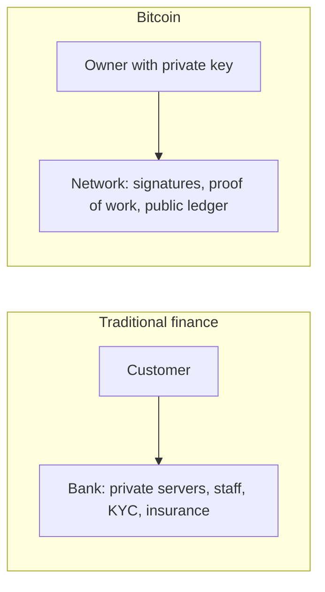
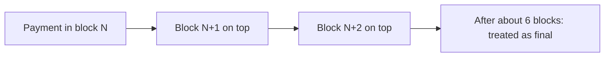

**In one line:** <mark>Bitcoin is secured by cryptography, proof of work and thousands of nodes instead of by a bank's trusted staff and private servers; this removes a single point of attack but moves the risk of key loss and irreversible mistakes onto the user</mark>. <Cite id="blockchain-fundamentals-nakamoto" />

<Box kind="key">

**Key points to write:**

- Bitcoin security rests on <mark>hashing (SHA-256), digital signatures (ECDSA), proof of work and a distributed ledger</mark>.
- Traditional finance rests on <mark>a trusted institution, private central databases, regulation, KYC and insurance</mark>.
- Bitcoin: <mark>no single point of failure</mark>, ledger public and hard to alter, <mark>transactions hard to reverse</mark>, no chargeback fraud.
- Traditional: <mark>one breached server can expose millions of accounts</mark>, but fraud can be reversed and customers get support and deposit insurance.
- Bitcoin risks: <mark>lost or stolen private keys, exchange hacks, 51% attack, phishing</mark>; no one to refund you.
- Fair answer: <mark>neither is simply "more secure"; they protect against different threats</mark>.

</Box>

## Core answer (5 marks, fits every question here)

<Box kind="definition">

**Bitcoin security** means protecting ownership and history of coins using cryptography and agreement among many nodes, with no bank in charge. **Traditional financial security** means protecting accounts through a trusted institution, its private systems, rules and legal protection. <Cite id="bitcoin-wiki-bitcoin" />

</Box>

**Security features of Bitcoin:**

1. **Cryptographic keys.** Only the private key can sign a spend, and the network checks it with the public key. <Cite id="class-bt-m2" loc="slide 117" /> <Cite id="bitcoin-mb-ch04-keys" />
2. **Hash-linked blocks.** Changing an old block changes its hash and breaks every later block. <Cite id="class-bt-m1" loc="slide 105" />
3. **Proof of work.** Rewriting history needs more than half of all mining power, which is very costly. <Cite id="class-bt-m2" loc="slide 41" /> <Cite id="consensus-mining-btcwiki-majority" />
4. **Decentralization.** Thousands of nodes keep and check the ledger, so there is no single server to hack. <Cite id="class-bt-m2" loc="slide 122" />
5. **Public ledger and no double spending.** Every transaction is visible and hard to reverse or fake. <Cite id="class-bt-m2" loc="slide 109" />

| Point | Bitcoin | Traditional financial system |
|---|---|---|
| Who is trusted | Code and the network | The bank or institution |
| Single point of failure | None | Central servers |
| Records | Public, hash-linked | Private, can be edited by staff |
| Reversal of payment | Almost impossible | Possible (chargeback, bank reversal) |
| Identity | Pseudonymous address | Verified identity (KYC) |
| If you lose access | Lost for ever without key | Reset password, bank helps |
| Legal protection | Little or none | Regulation, deposit insurance |
| Main threat | Key theft, 51% attack, scams | Data breach, insider fraud, card fraud |

<Cite id="web-bt-sol-a-btcwiki-irrev" /> <Cite id="wallets-utxo-double-spending-btcwiki-weaknesses" />

**Conclusion:** <mark>Bitcoin is very hard to forge or shut down, but the user alone is responsible for the key; banks add recovery and legal protection but are a single target</mark>.

## Extended answer (10 marks): add these

### 1. How each threat is handled

| Threat | In Bitcoin | In a bank |
|---|---|---|
| Forged payment | Signature check by every node | Authentication, fraud team |
| Double spending | Consensus and UTXO spent once | Central database check |
| Hacked database | No central database; ledger on many nodes | Central breach can leak accounts |
| Insider fraud | Rules enforced by code | Staff can misuse access; audits |
| Stolen credentials | Funds gone, no refund | Bank can freeze and refund |

### 2. Weak spots of Bitcoin (write these for balance)

- **Private key loss or theft:** the biggest risk; use hardware wallets and backups. <Cite id="web-bt-sol-a-btcorg-secure" />
- **Exchanges and online wallets** are centralized and have been hacked.
- **51% attack** is possible on small chains, but is extremely costly on Bitcoin. <Cite id="consensus-mining-btcwiki-majority" />
- **Energy and mining concentration** in pools. <Cite id="blockchain-fundamentals-ccaf-cbeci" />
- **Irreversibility:** a wrong address or a scam cannot be undone. <Cite id="web-bt-sol-a-btcwiki-irrev" />

### 3. Attack difficulty, in numbers

A rival chain must outpace the honest network, and the chance of catching up drops sharply with each confirmation, which is why about 6 confirmations are treated as final. <Cite id="blockchain-fundamentals-nakamoto" loc="§11" />

### 4. Verdict

Use Bitcoin for censorship resistance and no single point of failure; use banks for convenience, recovery and legal protection. Many users mix both. <Cite id="class-bt-m2" loc="slide 108" />

## Fit it to each question

- **"Compare Bitcoin's security features with traditional financial systems."** (10 marks) <PYQ id="assignment-1/q2f" />: core answer (five features, diagram, comparison table), then extended sections 1, 2 and 4.

## Exam tips

- **Table first**: at least eight rows; end with the "neither is simply more secure" verdict.
- Keywords: <mark>private key, digital signature, hash, proof of work, 51% attack, single point of failure, irreversible, KYC</mark>.
- Never say Bitcoin cannot be hacked; say the protocol has not been broken but users and exchanges are attacked.
