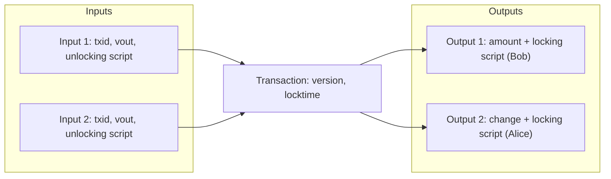
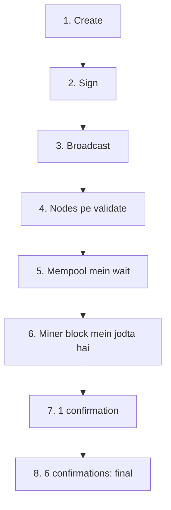

**Ek line mein:** <mark>Bitcoin transaction pehle ke outputs ko spend karta hai (inputs) aur naye outputs banata hai; jo output abhi kharch nahi hua use UTXO kehte hain</mark>. Bitcoin mein accounts ya ledger mein stored balance nahi hota. <Cite id="bitcoin-btcwiki-transaction" />

<Box kind="key">

**Transaction structure aur life cycle ke question mein ye points likho:**

- Structure: <mark>version, inputs, outputs, (witness), locktime</mark>.
- <mark>Input</mark> = pehle ke output ka reference (txid aur output number) plus **unlocking script** (signature aur public key).
- <mark>Output</mark> = satoshis mein amount plus **locking script** jo batata hai kaun spend kar sakta hai.
- <mark>Fee = inputs ka sum minus outputs ka sum</mark>; ye alag field nahi hai.
- Block ka pehla transaction <mark>coinbase transaction</mark> hai: real input nahi, ye block reward banata hai.
- Life cycle: <mark>create, sign, broadcast, validate, mempool, mine, confirm (6 confirmations = final)</mark>.

</Box>

## Core answer (5 marks, yahan ke har question ke liye)

<Box kind="definition">

A **Bitcoin transaction** is a signed message that spends one or more earlier outputs (inputs) and creates new outputs. The unspent outputs that can still be spent are called **UTXOs**. <Cite id="bitcoin-btcwiki-transaction" />

</Box>

**Transaction ka structure:** <Cite id="bitcoin-mb-ch06-transactions" />

| Field | Matlab |
|---|---|
| Version | Kaunse transaction rules lagu hain |
| Inputs | Har ek pehle ke output (txid aur vout) ko point karta hai aur unlocking script (signature aur public key) rakhta hai |
| Outputs | Har ek mein amount (satoshis) aur locking script jo batati hai kaun spend kar sakta hai |
| Witness (SegWit) | Signatures alag section mein |
| Locktime | Sabse pehla time ya block jab transaction mine ho sakta hai (0 matlab kabhi bhi) |

**Life cycle short mein:** create, sign, broadcast, validate, mempool mein wait, block mein mine, confirm. <Cite id="bitcoin-og-tx-lifecycle" />

**Conclusion:** <mark>transaction inputs aur outputs ka signed set hai, jise har node check karta hai aur mining aur confirmations final banate hain</mark>.

## Extended answer (10 marks): ye add karo

### 1. Life cycle step by step

1. **Create.** Alice ka wallet spend karne ke liye UTXOs chunta hai, outputs (payment aur change) likhta hai aur fee set karta hai.
2. **Sign.** Har input ke liye wallet us private key se sign karta hai jo use unlock karti hai. Baad mein amount badlo to signature toot jaata hai.
3. **Broadcast.** Wallet transaction ko ek node ko bhejta hai.
4. **Validate.** Har node format check karta hai, inputs maujood aur unspent hain, scripts true return karein, aur inputs kam se kam outputs ke barabar hain. <Cite id="bitcoin-mb-ch12-mining" loc="Independent Verification of Transactions" />
5. **Propagate.** Valid transactions peers ko jaate hain aur har node ke **mempool** mein wait karte hain. <Cite id="bitcoin-mb-ch10-network" loc="Mempools and Orphan Pools" />
6. **Mine.** Miner use candidate block mein daalta hai, aam taur pe zyada fee per size wale ko pehle.
7. **Confirm.** Block accept hone pe transaction ko 1 confirmation milta hai; har agla block ek aur jodta hai.
8. **Final.** Lagbhag 6 confirmations (kareeb ek ghanta) ke baad reverse karna practically impossible hai.

### 2. Worked example (fee aur change)

<Sum>

<Given>

Alice ke paas 0.5 BTC aur 0.3 BTC ke UTXOs hain. Wo Bob ko 0.6 BTC deti hai, fee 0.0001 BTC.

</Given>

<Find>

Alice ko wapas mila change.

</Find>

<Steps>

1. Inputs $= 0.5 + 0.3 = 0.8$ BTC. *Reason: dono UTXOs poore spend karne padte hain.*
2. Change $= 0.8 - 0.6 - 0.0001 = 0.1999$ BTC. *Reason: inputs minus payment minus fee.*

</Steps>

<Answer>

Outputs: Bob ko 0.6 BTC aur Alice ko 0.1999 BTC change; fee 0.0001 BTC.

</Answer>

<Box kind="verify">

$0.6 + 0.1999 + 0.0001 = 0.8$, inputs ke barabar, isliye koi coin na khoya na bana.

</Box>

</Sum>

### 3. Coinbase transaction

Har block ke pehle transaction ka **koi real input nahi** hota. Ye block subsidy plus fees banata hai aur miner ko deta hai. <Cite id="web-bt-1-protocol" />

## Har question mein kaise fit karein

- **"What is transaction structure? Explain transaction life cycle in detail."** (10 marks) <PYQ id="2023-12-ce/q5a" />: core answer (table aur structure diagram), phir section 1 (aath life-cycle steps flow diagram ke saath), section 2 (worked example) aur coinbase note.

## Exam tips

- **Do diagrams draw karo:** structure (inputs, outputs, locktime) aur 8 numbered boxes wala life-cycle flow.
- <mark>"fee = inputs - outputs"</mark> aur <mark>"6 confirmations"</mark> likho.
- Input aur output ek-ek line mein samjhao: unlocking script prove karti hai, locking script protect karti hai.

Exam mein English mein likho.
