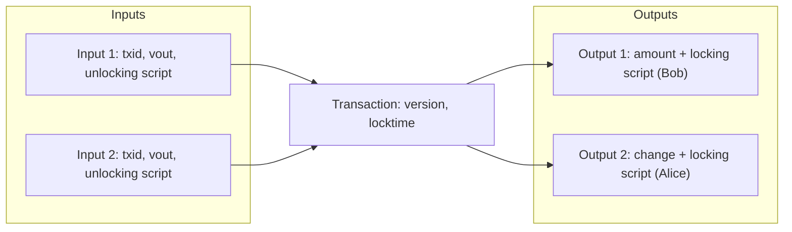
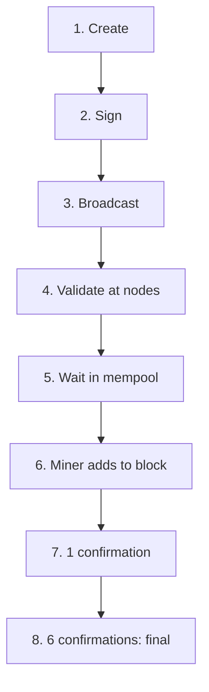

**In one line:** <mark>A Bitcoin transaction spends earlier outputs (inputs) and creates new outputs; an unspent output is a UTXO</mark>. Bitcoin has no accounts and no balances stored in the ledger. <Cite id="bitcoin-btcwiki-transaction" />

<Box kind="key">

**Key points to write (transaction structure and life cycle):**

- Structure: <mark>version, inputs, outputs, (witness), locktime</mark>.
- <mark>Input</mark> = reference to an earlier output (txid and output number) plus the **unlocking script** (signature and public key).
- <mark>Output</mark> = amount in satoshis plus a **locking script** that says who can spend it.
- <mark>Fee = sum of inputs minus sum of outputs</mark>; it is not a separate field.
- The first transaction of a block is the <mark>coinbase transaction</mark>: no real input, it creates the block reward.
- Life cycle: <mark>create, sign, broadcast, validate, mempool, mine, confirm (6 confirmations = final)</mark>.

</Box>

## Core answer (5 marks, fits every question here)

<Box kind="definition">

A **Bitcoin transaction** is a signed message that spends one or more earlier outputs (inputs) and creates new outputs. The unspent outputs that can still be spent are called **UTXOs**. <Cite id="bitcoin-btcwiki-transaction" />

</Box>

**Structure of a transaction:** <Cite id="bitcoin-mb-ch06-transactions" />

| Field | Meaning |
|---|---|
| Version | Which transaction rules apply |
| Inputs | Each points to an earlier output (txid and vout) and carries the unlocking script (signature and public key) |
| Outputs | Each has an amount (satoshis) and a locking script saying who can spend it |
| Witness (SegWit) | Signatures kept in a separate section |
| Locktime | Earliest time or block when the transaction may be mined (0 means any time) |

**Life cycle in short:** create, sign, broadcast, validate, wait in mempool, mine into a block, confirm. <Cite id="bitcoin-og-tx-lifecycle" />

**Conclusion:** <mark>a transaction is a signed set of inputs and outputs, checked by every node and made final by mining and confirmations</mark>.

## Extended answer (10 marks): add these

### 1. Life cycle step by step

1. **Create.** Alice's wallet picks UTXOs to spend, writes the outputs (payment and change) and sets the fee.
2. **Sign.** For each input the wallet signs with the private key that unlocks it. Changing the amount later breaks the signature.
3. **Broadcast.** The wallet sends the transaction to a node.
4. **Validate.** Each node checks format, that inputs exist and are unspent, that scripts return true, and that inputs are at least outputs. <Cite id="bitcoin-mb-ch12-mining" loc="Independent Verification of Transactions" />
5. **Propagate.** Valid transactions go to peers and wait in each node's **mempool**. <Cite id="bitcoin-mb-ch10-network" loc="Mempools and Orphan Pools" />
6. **Mine.** A miner puts it in a candidate block, usually preferring a higher fee per size.
7. **Confirm.** When the block is accepted the transaction has 1 confirmation; each later block adds one.
8. **Final.** About 6 confirmations (roughly an hour) make reversal practically impossible.

### 2. Worked example (fee and change)

<Sum>

<Given>

Alice has UTXOs of 0.5 BTC and 0.3 BTC. She pays Bob 0.6 BTC with a fee of 0.0001 BTC.

</Given>

<Find>

the change returned to Alice.

</Find>

<Steps>

1. Inputs $= 0.5 + 0.3 = 0.8$ BTC. *Reason: both UTXOs must be spent whole.*
2. Change $= 0.8 - 0.6 - 0.0001 = 0.1999$ BTC. *Reason: inputs minus payment minus fee.*

</Steps>

<Answer>

Outputs: 0.6 BTC to Bob and 0.1999 BTC change to Alice; fee 0.0001 BTC.

</Answer>

<Box kind="verify">

$0.6 + 0.1999 + 0.0001 = 0.8$, equal to the inputs, so no coin is lost or created.

</Box>

</Sum>

### 3. Coinbase transaction

The first transaction in each block has **no real input**. It creates the block subsidy plus the fees and pays them to the miner. <Cite id="web-bt-1-protocol" />

## Fit it to each question

- **"What is transaction structure? Explain transaction life cycle in detail."** (10 marks) <PYQ id="2023-12-ce/q5a" />: core answer (table and structure diagram), then section 1 (eight life-cycle steps with the flow diagram), section 2 (worked example) and the coinbase note.

## Exam tips

- **Draw** two diagrams: the structure (inputs, outputs, locktime) and the life-cycle flow with 8 numbered boxes.
- Write <mark>"fee = inputs - outputs"</mark> and <mark>"6 confirmations"</mark>.
- Explain input and output in one line each: unlocking script proves, locking script protects.
