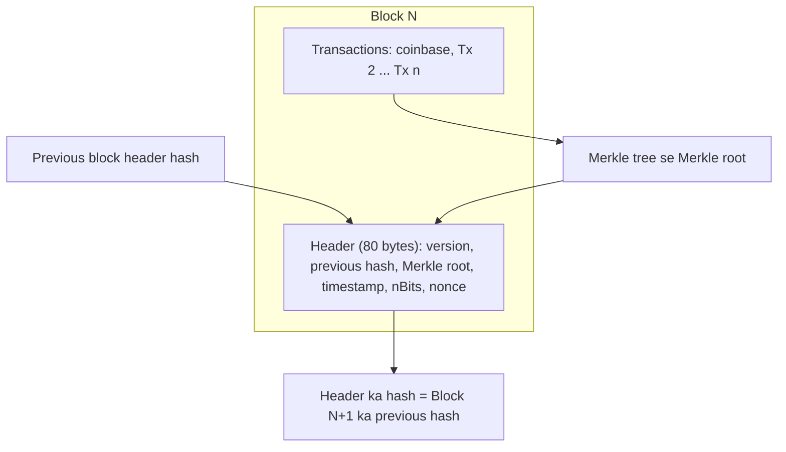
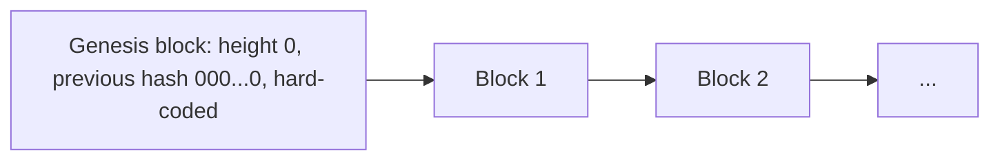

**Ek line mein:** <mark>Block transactions ka package hai plus ek 80-byte header; header usse previous block se hash ke through jodta hai, aur genesis block pehla block hai jiska previous hash all zeros hota hai</mark>. <Cite id="block-structure-merkle-btcwiki-block" />

<Box kind="key">

**Block, header ya genesis question mein ye points likho:**

- Block ke do parts: <mark>block header (80 bytes)</mark> aur <mark>transaction list (body)</mark>, jiska pehla transaction **coinbase** hota hai.
- Header ke chhe fields: <mark>version, previous block hash, Merkle root, timestamp, difficulty target (nBits), nonce</mark>.
- <mark>Block hash = header pe SHA-256 do baar</mark>; agla block ise apna "previous block hash" banake store karta hai, isse chain banti hai.
- Purane block mein change karo to uska hash badalta hai aur aage ka har link toot jaata hai: **tamper evidence**.
- <mark>Genesis block = pehla block, height 0, previous hash all zeros, software mein hard-coded</mark>.
- Bitcoin genesis: 3 January 2009, ek coinbase 50 BTC ka, headline "The Times 03/Jan/2009 Chancellor on brink of second bailout for banks".

</Box>

## Core answer (5 marks, yahan ke har question ke liye)

<Box kind="definition">

A **block** is a container of transactions with a small **header**. The header holds the hash of the previous block, so blocks form a chain. The **genesis block** is the very first block of a chain, with no real parent. <Cite id="block-structure-merkle-btcwiki-block" /> <Cite id="block-structure-merkle-btcwiki-genesis" />

</Box>

**Bitcoin block ke parts:**

1. **Block header (80 bytes):** version, previous block hash, Merkle root, timestamp, nBits (difficulty target), nonce. <Cite id="block-structure-merkle-devref" />
2. **Transaction counter aur transaction list:** pehla transaction **coinbase** hai (miner ko reward deta hai); phir baaki transactions.

**Genesis block (chhota):** pehla block, height 0, Satoshi Nakamoto ne 3 January 2009 ko banaya. Iska previous hash all zeros hai. Ye har node ke code mein likha hota hai, isliye saare nodes same pehle block se shuru hote hain. <Cite id="block-structure-merkle-btcwiki-genesis" />

**Conclusion:** <mark>header blocks ko link karta hai, Merkle root transactions ko protect karta hai aur nonce work prove karta hai</mark>; genesis block poori chain ko anchor karta hai.

## Extended answer (10 marks): ye add karo

### 1. Header fields detail mein

| Field | Size | Matlab |
|---|---|---|
| Version | 4 bytes | Kaunse validation rules lagu hain |
| Previous block hash | 32 bytes | Pichhle block ke header ka hash; chain banata hai |
| Merkle root | 32 bytes | Saare transactions ka ek hash |
| Timestamp | 4 bytes | Block banne ka lagbhag time |
| nBits (difficulty target) | 4 bytes | Header hash is target se chhota hona chahiye |
| Nonce | 4 bytes | Miners valid hash dhoondhne ke liye ye number badalte hain |

<Cite id="block-structure-merkle-devref" /> <Cite id="web-bt-1-protocol" />

### 2. Block body, hash aur size

- **Body:** transaction counter, phir list; coinbase transaction ka koi real input nahi hota.
- **Block hash:** 80-byte header pe SHA-256 do baar. Ye header mein store nahi hota; agla block ise carry karta hai. <Cite id="web-bt-1-block-hashing" />
- **Size:** 1 MB base limit, SegWit ke saath lagbhag 4 MB weight tak; lagbhag 2,000 se 3,000 transactions aate hain. <Cite id="block-structure-merkle-mb-ch11" />
- **Merkle root:** transaction hashes ke pairs level by level hash hote hain, ek root tak. <Cite id="block-structure-merkle-gfg-merkle-intro" />

### 3. Blocks chain kyun hote hain

Purane block ka ek transaction badlo: uska Merkle root badalta hai, isliye header hash badalta hai, isliye agle block ka "previous hash" match nahi karta, aur aise hi aage tak. Attacker ko aage ke har block ka proof of work dobara karna padega.

### 4. Genesis block detail mein

- **Facts:** height 0, 3 January 2009, ek transaction (coinbase, 50 BTC, jo spend nahi ho sakta), previous hash all zeros. <Cite id="block-structure-merkle-core-chainparams" />
- **Embedded message:** "The Times 03/Jan/2009 Chancellor on brink of second bailout for banks". Ye prove karta hai ki block pehle nahi bana, aur Bitcoin kyun bana uska hint deta hai.
- **Kyun chahiye:** (1) chain ko ek starting point chahiye jispe sab nodes agree karein, (2) block 1 ko kisi previous hash ko point karna hai, (3) node chain ko genesis block tak peeche jaake validate karta hai; alag pehla block matlab alag network.
- **Dusri chains:** Ethereum aur private chains ka apna genesis block hota hai, genesis file mein define, jo pehle accounts, balances aur settings set karti hai. <Cite id="block-structure-merkle-gfg-genesis" />

## Har question mein kaise fit karein

- **"With suitable diagram explain block structure of bitcoin"** (10 marks) <PYQ id="2025-05/q3b" />: upar jaisa, section 3 (chain kyun) aur block-data picture add karo.
- **"Explain Genesis block in detail."** (5 marks) <PYQ id="2024-12/q1b" />: definition, section 4 (facts, message, kyun chahiye) aur chhota chain diagram.

## Exam tips

- **Draw karo:** header aur transaction list mein split block, chhe header fields ke naam ke saath, aur previous block ke hash se aata arrow.
- <mark>"SHA-256 twice"</mark> aur <mark>"coinbase transaction"</mark> likho; dono easy marks hain.
- Genesis ke liye <mark>"previous hash is all zeros"</mark>, date (3 January 2009) aur Times headline likho.

Exam mein English mein likho.
