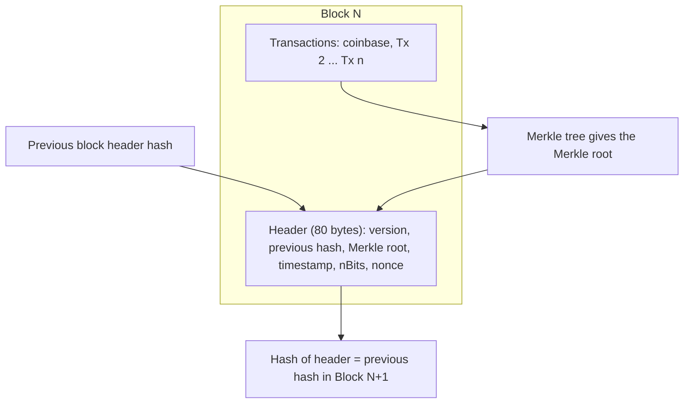
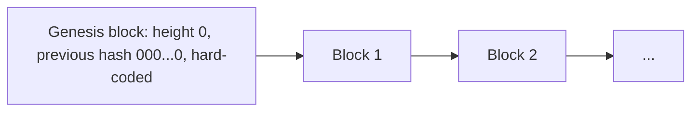

**In one line:** <mark>A block is a package of transactions plus an 80-byte header; the header links it to the previous block by hash, and the genesis block is the first block, whose previous hash is all zeros</mark>. <Cite id="block-structure-merkle-btcwiki-block" />

<Box kind="key">

**Key points to write (block, header or genesis question):**

- A block has two parts: <mark>block header (80 bytes)</mark> and <mark>transaction list (body)</mark>, whose first transaction is the **coinbase**.
- Header has six fields: <mark>version, previous block hash, Merkle root, timestamp, difficulty target (nBits), nonce</mark>.
- <mark>Block hash = SHA-256 applied twice to the header</mark>; the next block stores it as its "previous block hash", which forms the chain.
- Changing an old block changes its hash and breaks every later link: **tamper evidence**.
- <mark>Genesis block = first block, height 0, previous hash all zeros, hard-coded in the software</mark>.
- Bitcoin genesis: 3 January 2009, one coinbase of 50 BTC, headline "The Times 03/Jan/2009 Chancellor on brink of second bailout for banks".

</Box>

## Core answer (5 marks, fits every question here)

<Box kind="definition">

A **block** is a container of transactions with a small **header**. The header holds the hash of the previous block, so blocks form a chain. The **genesis block** is the very first block of a chain, with no real parent. <Cite id="block-structure-merkle-btcwiki-block" /> <Cite id="block-structure-merkle-btcwiki-genesis" />

</Box>

**Parts of a Bitcoin block:**

1. **Block header (80 bytes):** version, previous block hash, Merkle root, timestamp, nBits (difficulty target), nonce. <Cite id="block-structure-merkle-devref" />
2. **Transaction counter and transaction list:** the first transaction is the **coinbase** (pays the miner the reward); then the other transactions.

**Genesis block (short):** the first block, height 0, created by Satoshi Nakamoto on 3 January 2009. Its previous hash is all zeros. It is written into the code of every node, so all nodes start from the same first block. <Cite id="block-structure-merkle-btcwiki-genesis" />

**Conclusion:** <mark>the header links the blocks, the Merkle root protects the transactions and the nonce proves the work</mark>; the genesis block anchors the whole chain.

## Extended answer (10 marks): add these

### 1. Header fields in detail

| Field | Size | Meaning |
|---|---|---|
| Version | 4 bytes | Which validation rules apply |
| Previous block hash | 32 bytes | Hash of the last block's header; creates the chain |
| Merkle root | 32 bytes | One hash that summarises all transactions |
| Timestamp | 4 bytes | Approximate time the block was made |
| nBits (difficulty target) | 4 bytes | The header hash must be below this target |
| Nonce | 4 bytes | Number miners change to find a valid hash |

<Cite id="block-structure-merkle-devref" /> <Cite id="web-bt-1-protocol" />

### 2. Block body, hash and size

- **Body:** a transaction counter, then the list; the coinbase transaction has no real input.
- **Block hash:** SHA-256 twice over the 80-byte header. It is not stored in the header; the next block carries it. <Cite id="web-bt-1-block-hashing" />
- **Size:** 1 MB base limit, up to about 4 MB weight with SegWit; roughly 2,000 to 3,000 transactions fit. <Cite id="block-structure-merkle-mb-ch11" />
- **Merkle root:** pairs of transaction hashes are hashed level by level up to one root. <Cite id="block-structure-merkle-gfg-merkle-intro" />

### 3. Why blocks are chained

Change a transaction in an old block: its Merkle root changes, so its header hash changes, so the next block's "previous hash" no longer matches, and so on up the chain. An attacker would have to redo the proof of work for every later block.

### 4. Genesis block in detail

- **Facts:** height 0, 3 January 2009, one transaction (coinbase, 50 BTC, which cannot be spent), previous hash all zeros. <Cite id="block-structure-merkle-core-chainparams" />
- **Embedded message:** "The Times 03/Jan/2009 Chancellor on brink of second bailout for banks". It proves the block was not made earlier and hints at why Bitcoin was built.
- **Why it is needed:** (1) the chain needs a starting point all nodes agree on, (2) block 1 must point to some previous hash, (3) a node validates a chain by walking back to the genesis block; a different first block means a different network.
- **Other chains:** Ethereum and private chains have their own genesis block, defined in a genesis file that sets first accounts, balances and settings. <Cite id="block-structure-merkle-gfg-genesis" />

## Fit it to each question

- **"With suitable diagram explain block structure of bitcoin"** (10 marks) <PYQ id="2025-05/q3b" />: same as above, add section 3 (why chained) and the block-data picture.
- **"Explain Genesis block in detail."** (5 marks) <PYQ id="2024-12/q1b" />: definition, section 4 (facts, message, why needed) and the small chain diagram.

## Exam tips

- **Draw** a block split into header and transaction list, with the six header fields named, and an arrow from the previous block's hash.
- Say <mark>"SHA-256 twice"</mark> and <mark>"coinbase transaction"</mark>; both are easy marks.
- For genesis, mention <mark>"previous hash is all zeros"</mark>, the date (3 January 2009) and the Times headline.
