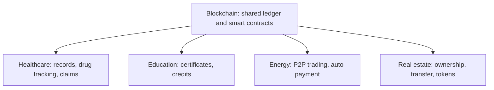
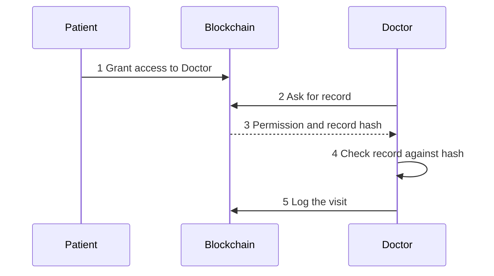
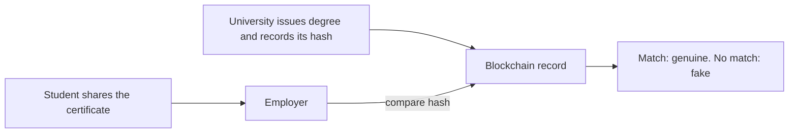

**In one line:** <mark>In every industry, blockchain gives a shared, tamper-resistant record plus smart contracts: it secures medical records, verifies certificates, lets homes trade energy and digitises property ownership</mark>. <Cite id="class-bt-m6" loc="slide 2" />

<Box kind="key">

**Key points to write (any industry question):**

- **Healthcare:** <mark>electronic health records, secure sharing, patient data ownership, record integrity, drug supply chain, counterfeit prevention, insurance claims, clinical trials</mark>. <Cite id="class-bt-m6" loc="slide 11" />
- **Education:** <mark>digital certificates, verification, fake-certificate prevention, academic records, credit transfer, student identity, scholarships, IP protection</mark>. <Cite id="class-bt-m6" loc="slide 3" />
- **Energy:** <mark>peer-to-peer trading, renewable energy trading, smart-contract payments, usage tracking, EV charging, renewable certificates, microgrids</mark>. <Cite id="class-bt-m6" loc="slide 7" />
- **Real estate:** <mark>ownership records, property transfer, smart contracts, less paperwork, property history, fraud prevention, digital payments, tokenisation</mark>. <Cite id="class-bt-m6" loc="slide 15" />
- Each answer: <mark>applications, one example, advantages, conclusion</mark>.

</Box>

## Core answer (5 marks, fits every question here)

<Box kind="definition">

**Blockchain** is a shared ledger whose records are hard to change. In an industry it is used to store, verify and share records among parties who do not fully trust each other, and smart contracts run agreements automatically. <Cite id="blockchain-applications-gfg-industries" />

</Box>

### Healthcare

1. **Electronic health records (EHR).** Patient records are stored and shared safely. <Cite id="class-bt-m6" loc="slide 11" />
2. **Patient data ownership.** The patient controls who can see the record. <Cite id="class-bt-m6" loc="slide 12" />
3. **Record integrity.** A saved record cannot be quietly changed.
4. **Drug supply chain and fake medicines.** A medicine is tracked from maker to distributor, pharmacy and patient, so suspicious products are found.
5. **Insurance claims and clinical trials.** Claims and trial records are kept with proof, which cuts duplicate or false claims. <Cite id="class-bt-m6" loc="slide 13" />

*Example:* a patient visits different hospitals; each authorised hospital reads one verified record instead of keeping its own copy. **Advantages:** secure records, better integrity, controlled sharing, drug traceability, faster insurance, better coordination. <Cite id="class-bt-m6" loc="slide 14" />

### Education

1. **Digital certificates and verification.** A university issues a degree as a unique blockchain record; an employer checks it directly. <Cite id="class-bt-m6" loc="slide 3" />
2. **Prevents fake certificates.** Records are hard to alter.
3. **Academic records and credit transfer.** Marks, courses and degrees are kept securely and moved between universities. <Cite id="class-bt-m6" loc="slide 4" />
4. **Student identity, scholarships and IP.** Smart contracts release scholarship money when conditions are met; research is time-stamped to show ownership. <Cite id="class-bt-m6" loc="slide 5" />

*Example:* B.E. degree issued on blockchain, verified by the employer from its record. **Advantages:** no fake certificates, quick verification, less paperwork, transparency. <Cite id="class-bt-m6" loc="slide 6" /> <Cite id="blockchain-applications-blockcerts" />

### Energy

1. **Peer-to-peer (P2P) energy trading.** A home with extra solar power sells it to a neighbour without a central middleman. <Cite id="class-bt-m6" loc="slide 7" />
2. **Smart-contract payments.** Payment happens automatically when energy is supplied. <Cite id="class-bt-m6" loc="slide 8" />
3. **Usage tracking and EV charging.** Production, consumption and charging sessions are recorded.
4. **Renewable energy certificates and microgrids.** Certificates are issued and tracked; local communities coordinate energy exchange. <Cite id="class-bt-m6" loc="slide 9" />

**Advantages:** decentralised trading, transparency, automated payment, better tracking, support for renewables, fewer intermediaries. <Cite id="class-bt-m6" loc="slide 10" />

### Real estate

1. **Property ownership records and transfer.** Ownership is stored in a tamper-resistant record and a sale is recorded digitally. <Cite id="class-bt-m6" loc="slide 15" />
2. **Smart contracts.** Ownership transfer starts when the agreed conditions are met. <Cite id="class-bt-m6" loc="slide 16" />
3. **Property history and fraud prevention.** Past owners and deals are easy to verify.
4. **Digital payments and tokenisation.** A property is split into tokens so ownership can be divided into smaller units, subject to law. <Cite id="class-bt-m6" loc="slide 17" />

**Advantages:** secure records, faster transactions, less paperwork, less fraud, automated agreements, easier verification, fewer intermediaries. <Cite id="class-bt-m6" loc="slide 18" />

**Conclusion:** <mark>blockchain makes these sectors more secure, transparent and efficient by giving trusted records and automatic agreements</mark>.

## Extended answer (10 marks): add these

### 1. Healthcare: how a record is shared

### 2. Education: how a certificate is verified

### 3. Energy: P2P trade with a smart contract

1. House A has extra solar power; House B needs power.
2. A smart meter records units supplied. <Cite id="class-bt-m6" loc="slide 9" />
3. The contract calculates the price and moves payment from B to A.
4. Both records are saved on the ledger.

### 4. Real estate: property sale

1. The ownership record, agreement, payment status and transfer details are saved on the chain.
2. When the conditions are fulfilled (payment received, documents verified), the smart contract starts the ownership transfer. <Cite id="class-bt-m6" loc="slide 17" />

### 5. Challenges to mention

| Sector | Challenge |
|---|---|
| Healthcare | Privacy laws; store only hashes on the chain, not the full record |
| Education | All institutions must adopt the same standard |
| Energy | Needs smart meters and grid rules |
| Real estate | Land laws must accept digital records; tokenisation is subject to law |

<Cite id="web-bt-sol-b-gfg-applications" /> <Cite id="blockchain-applications-tp-use-cases" /> <Cite id="web-bt-sol-b-gfg-usecases" />

## Fit it to each question

- **"Explain the applications of Blockchain Technology in Healthcare and Education."** (10 marks) <PYQ id="assignment-4/q6b" />: the Healthcare and Education parts of the core answer (two lists, two examples, advantages), then extended sections 1 and 2 as the diagrams.
- **"Explain the applications of Blockchain Technology in Energy and Real Estate."** (10 marks) <PYQ id="assignment-4/q6c" />: the Energy and Real estate parts of the core answer, then extended sections 3 and 4.

## Exam tips

- **Structure** each sector the same way: applications, example, advantages, conclusion; the teacher's slides follow that order.
- Keywords: <mark>EHR, drug traceability, digital certificates, P2P trading, microgrid, smart contract, tokenisation</mark>.
- Never say the full medical record is stored on a public chain; use "hash on chain, data off chain".
