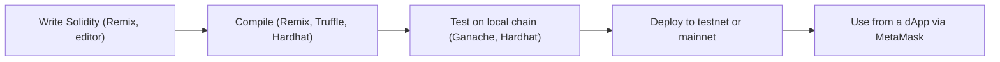
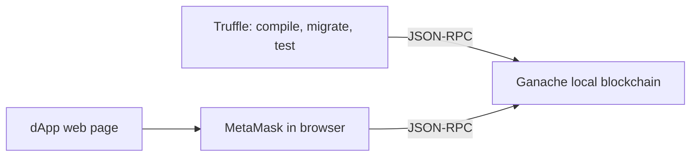

**In one line:** <mark>Blockchain development tools help a developer write, compile, test, deploy and use smart contracts: Remix (online IDE), Ganache (personal test blockchain), Truffle (framework), MetaMask (wallet), and now Hardhat and Foundry</mark>. <Cite id="solidity-ethereum-org-remix" />

<Box kind="key">

**Key points to write (development tools):**

- Workflow: <mark>write, compile, test, deploy, interact</mark>.
- <mark>Remix IDE</mark>: browser-based Solidity IDE; no setup. <Cite id="solidity-remix-docs" />
- <mark>Ganache</mark>: personal local blockchain for rapid dApp development and testing. <Cite id="ethereum-ganache-docs" />
- <mark>Truffle</mark>: framework to compile, test and deploy contracts (migrations, Mocha/Chai tests). <Cite id="web-bt-sol-b-gfg-truffle-dapps" />
- <mark>MetaMask</mark>: wallet that connects the browser to Ethereum. <Cite id="class-bt-m3a" loc="slide 15" />
- <mark>Note:</mark> Consensys announced in September 2023 that Truffle and Ganache are being sunset; Hardhat is the suggested replacement. <Cite id="web-bt-sol-b-consensys-sunset" />
- Others: <mark>Hardhat, Foundry, web3.js, ethers.js, OpenZeppelin, Etherscan, IPFS</mark>.

</Box>

## Core answer (5 marks, fits every question here)

<Box kind="definition">

**Blockchain development tools** are software that a developer uses to build a decentralised application (dApp). Smart contracts are written in Solidity and **compiled into bytecode that the EVM can run**. <Cite id="class-bt-m3a" loc="slide 16" />

</Box>

**Main tools:**

1. **Remix IDE.** A browser-based Ethereum IDE for Solidity. It needs no setup and has plugins for compiling, deploying and debugging. *Use:* a student writes a contract and tests it at once. <Cite id="solidity-remix-docs" /> <Cite id="web-bt-sol-b-gfg-remix-hello" />
2. **Ganache.** "A personal blockchain for rapid Ethereum and Filecoin distributed application development": a local, safe and repeatable test chain with ready test accounts. It has a desktop UI and a command-line (CLI) version. <Cite id="ethereum-ganache-docs" />
3. **Truffle.** A development framework to compile, test and migrate (deploy) contracts from the command line; it works with Ganache. <Cite id="web-bt-sol-b-gfg-ganache-truffle" />
4. **MetaMask.** A wallet in the browser that holds the user's keys and signs transactions for dApps. <Cite id="class-bt-m3a" loc="slide 8" />
5. **Hardhat and Foundry.** Modern frameworks used instead of Truffle. <Cite id="web-bt-sol-b-hardhat-docs" />

**Conclusion:** <mark>tools take a contract from code to a running dApp; Remix to learn, Ganache and Truffle (or Hardhat) to build and test</mark>.

## Extended answer (10 marks): add these

### 1. Comparison of the three tools asked

| Point | Remix | Ganache | Truffle |
|---|---|---|---|
| Type | Browser IDE | Local test blockchain | Framework (command line) |
| Main job | Write, compile, deploy, debug | Give a safe, repeatable chain with test accounts | Compile, test, migrate |
| Needs install | No (web) or desktop app | Yes (UI or CLI) | Yes (npm) |
| Best for | Learning, quick tries | Testing without real money | Larger projects |
| Status | Active | Sunset 2023 | Sunset 2023 |

<Cite id="web-bt-sol-b-gfg-eth-tools" />

### 2. Typical Truffle plus Ganache flow

1. Start Ganache; it shows a local blockchain and test accounts.
2. Write `MyContract.sol` and run the compile command.
3. Write a migration script that deploys the contract to the Ganache network.
4. Run the tests (JavaScript tests using Mocha and Chai).
5. Open MetaMask, connect it to Ganache, and call the contract from a web page. <Cite id="ethereum-tp-ganache" />

### 3. Other useful tools

- **Hardhat and Foundry:** frameworks that spin up a local chain, compile, test and deploy. <Cite id="web-bt-sol-b-hardhat-docs" />
- **Testnets:** public test networks with free test ether, used before the real network. <Cite id="ethereum-alchemy-testnets" />
- **Etherscan:** a block explorer to look at transactions and contracts. <Cite id="ethereum-etherscan-about" />
- **IPFS:** decentralised file storage for NFT images and big data. <Cite id="ethereum-ipfs-docs" />
- **Web3 libraries (web3.js, ethers.js):** let a web page talk to the chain.

### 4. Important update

Consensys announced the sunset of Truffle and Ganache in late 2023 and partnered with Hardhat for the move. The archived tools still work for learning, and exams still ask about them, but new projects use Hardhat or Foundry. <Cite id="web-bt-sol-b-consensys-sunset" />

## Fit it to each question

- **"What are the tools used in blockchain development (e.g., Truffle, Remix, Ganache)?"** (10 marks) <PYQ id="assignment-2/q6d" />: core answer, then extended sections 1, 2 and 4 with the workflow diagram.

## Exam tips

- **Draw** the workflow: write, compile, test, deploy, interact, and name a tool for each step.
- Keywords: <mark>IDE, compile, bytecode, local blockchain, migration, test accounts, wallet, testnet</mark>.
- Mention the 2023 sunset in one line; it shows current knowledge.
