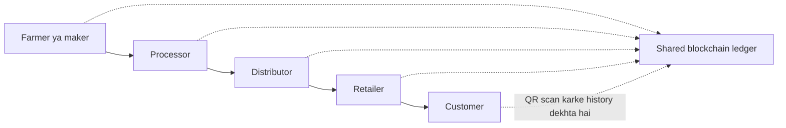
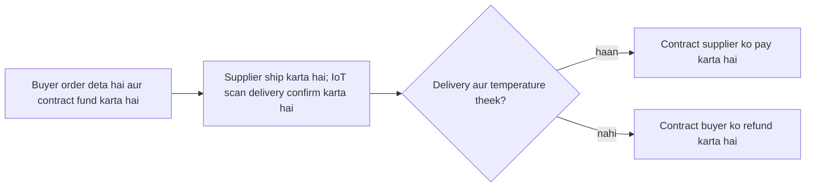

**Ek line mein:** <mark>Blockchain product ke farm ya factory se dukaan tak har step ka ek shared, tamper-proof record rakhta hai, taaki sab bharosa kar sakein ki product kahan se aaya</mark>. <Cite id="blockchain-applications-gfg-supply-revolution" />

<Box kind="key">

**Supply chain question mein ye points likho:**

- **Supply chain** = product ka safar: <mark>maker, processor, distributor, retailer, customer</mark>. <Cite id="web-bt-2-wiki-scm" />
- **Aaj ki problems:** kagaz aur <mark>alag-alag databases</mark>, kam visibility, fakes aur fraud, slow paperwork, slow recalls.
- **Blockchain kaise madad karta hai:** har step shared ledger pe <mark>transaction</mark> hai; <mark>IoT, RFID aur QR codes</mark> data jodte hain; purani entries badli nahi ja sakti; <mark>smart contracts delivery pe payment dete hain</mark>.
- **Benefits:** <mark>traceability, kam fakes, tez recalls</mark>, kam paperwork, tez payments, trust.
- **Challenges:** cost, saare partners ko judna padta hai, <mark>galat data daalo to galat hi rehta hai</mark>, business data ki privacy, standards.
- **Examples:** <mark>IBM Food Trust (Walmart mango trace 2.2 seconds)</mark>, De Beers Tracr, Maersk TradeLens.

</Box>

## Core answer (5 marks, yahan ke har question ke liye)

<Box kind="definition">

A **supply chain** is the journey of a product from the farm or factory to the customer. **Blockchain in supply chain management** means recording each step on a shared, unchangeable ledger so all partners see the same history. <Cite id="blockchain-applications-wiki-supply" />

</Box>

**Traditional supply chains ki problems:** records kagaz pe ya alag company databases mein hote hain; visibility kam; fakes aur fraud; slow paperwork; aur recalls mein der lagti hai kyunki source dhoondhna mushkil hota hai.

**Blockchain kaise madad karta hai:**

1. Har step (harvest, packing, shipping, storage, sale) us party ki transaction ke roop mein record hota hai jisne woh kiya.
2. Sensors (IoT, RFID, QR codes) temperature aur location jaisa data jodte hain.
3. Saare partners same ledger dekhte hain aur koi purani entries badal nahi sakta.
4. **Smart contracts** delivery pe payment apne aap release kar sakte hain.

**Benefits:** traceability, kam fakes, tez recalls, kam paperwork, tez payments, partners ke beech trust. **Challenges:** cost aur integration, saare partners ko judna padta hai, shuru mein galat daala data galat hi rehta hai, business data ki privacy.

**Conclusion:** <mark>blockchain brings visibility and trust to supply chains</mark>. <Cite id="blockchain-applications-gfg-industries" />

## Extended answer (10 marks): ye add karo

### 1. Supply chain ke stages

### 2. Real examples

- **IBM Food Trust (Hyperledger Fabric):** pilot mein Walmart ne mangoes ka origin lagbhag 7 din se ghatakar lagbhag 2.2 seconds mein trace kiya. <Cite id="hyperledger-fabric-ibm-fabric" />
- **Maersk aur IBM TradeLens:** shared platform pe shipping documents (2023 mein band).
- **De Beers Tracr:** diamonds ko khaan se dukaan tak track karta hai.

### 3. Traditional vs blockchain supply chain

| Point | Traditional | Blockchain ke saath |
|---|---|---|
| Records | Alag, kagaz ya local databases | Ek shared ledger |
| Visibility | Kam | End to end |
| Fraud aur fakes | Aasaan | Mushkil (signed, unchangeable records) |
| Recall | Din | Seconds se minutes |
| Payment | Manual, slow | Smart contract, delivery pe |
| Trust | Har partner pe | Shared record pe |

### 4. Smart contract example

### 5. Challenges detail mein

- **Cost aur integration** purane ERP systems ke saath.
- **Saare partners ko judna padta hai**; chain utni hi achhi hai jitna uska sabse kamzor participant.
- **Garbage in, garbage out:** blockchain yeh prove karta hai ki record badla nahi, yeh nahi ki daalte samay sahi tha. Sensors aur audits madad karte hain.
- **Privacy:** business prices chhupe rehne chahiye, isliye private ya consortium chains use hoti hain.
- **Standards:** companies ke beech alag formats. <Cite id="blockchain-applications-tp-use-cases" />

## Har question mein kaise fit karein

- **"Explain applications of blockchain in supplychain."** (5 marks) <PYQ id="2024-12/q1f" />: core answer: definition, problems, blockchain kaise madad karta hai, flow diagram aur ek example.
- **"Application of Blockchain in Supply chain management"** (10 marks) <PYQ id="2025-05/q6c" />: core answer plus extended sections 2, 3 aur 5 (examples, comparison table, challenges).

## Exam tips

- Chain (farmer se customer) **draw karo** aur neeche shared ledger dikhao.
- Keywords: <mark>traceability, provenance, IoT, smart contract, tamper-proof, recall, shared ledger</mark>.
- Ek real example number ke saath likho (Walmart mango: 7 din se 2.2 seconds).

Exam mein English mein likho.
