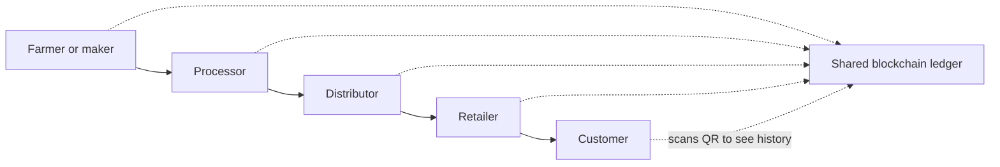
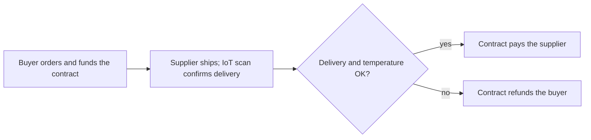

**In one line:** <mark>Blockchain keeps one shared, tamper-proof record of every step a product takes from the farm or factory to the shop, so everyone can trust where it came from</mark>. <Cite id="blockchain-applications-gfg-supply-revolution" />

<Box kind="key">

**Key points to write (supply chain question):**

- **Supply chain** = the journey of a product: <mark>maker, processor, distributor, retailer, customer</mark>. <Cite id="web-bt-2-wiki-scm" />
- **Problems today:** paper and <mark>separate databases</mark>, little visibility, fakes and fraud, slow paperwork, slow recalls.
- **How blockchain helps:** each step is a <mark>transaction on a shared ledger</mark>; <mark>IoT, RFID and QR codes</mark> add data; old entries cannot be changed; <mark>smart contracts pay on delivery</mark>.
- **Benefits:** <mark>traceability, fewer fakes, fast recalls</mark>, less paperwork, faster payments, trust.
- **Challenges:** cost, all partners must join, <mark>wrong data in stays wrong</mark>, privacy of business data, standards.
- **Examples:** <mark>IBM Food Trust (Walmart mango trace 2.2 seconds)</mark>, De Beers Tracr, Maersk TradeLens.

</Box>

## Core answer (5 marks, fits every question here)

<Box kind="definition">

A **supply chain** is the journey of a product from the farm or factory to the customer. **Blockchain in supply chain management** means recording each step on a shared, unchangeable ledger so all partners see the same history. <Cite id="blockchain-applications-wiki-supply" />

</Box>

**Problems in traditional supply chains:** records are on paper or in separate company databases; there is little visibility; fakes and fraud; slow paperwork; and recalls take long because the source is hard to find.

**How blockchain helps:**

1. Each step (harvest, packing, shipping, storage, sale) is recorded as a transaction by the party who did it.
2. Sensors (IoT, RFID, QR codes) add data such as temperature and location.
3. All partners see the same ledger and nobody can change old entries.
4. **Smart contracts** can release payment automatically on delivery.

**Benefits:** traceability, fewer fakes, fast recalls, less paperwork, faster payments, trust between partners. **Challenges:** cost and integration, all partners must join, wrong data entered at the start stays wrong, privacy of business data.

**Conclusion:** <mark>blockchain brings visibility and trust to supply chains</mark>. <Cite id="blockchain-applications-gfg-industries" />

## Extended answer (10 marks): add these

### 1. Stages of a supply chain

### 2. Real examples

- **IBM Food Trust (Hyperledger Fabric):** Walmart traced the origin of mangoes from nearly 7 days to about 2.2 seconds in a pilot. <Cite id="hyperledger-fabric-ibm-fabric" />
- **Maersk and IBM TradeLens:** shipping documents on a shared platform (wound down in 2023).
- **De Beers Tracr:** tracks diamonds from mine to shop.

### 3. Traditional versus blockchain supply chain

| Point | Traditional | With blockchain |
|---|---|---|
| Records | Separate, paper or local databases | One shared ledger |
| Visibility | Low | End to end |
| Fraud and fakes | Easy | Hard (signed, unchangeable records) |
| Recall | Days | Seconds to minutes |
| Payment | Manual, slow | Smart contract, on delivery |
| Trust | In each partner | In the shared record |

### 4. Smart contract example

### 5. Challenges in more detail

- **Cost and integration** with old ERP systems.
- **All partners must join**; a chain is only as good as its weakest participant.
- **Garbage in, garbage out:** the blockchain proves a record was not changed, not that it was true when entered. Sensors and audits help.
- **Privacy:** business prices must stay hidden, so private or consortium chains are used.
- **Standards:** different formats between companies. <Cite id="blockchain-applications-tp-use-cases" />

## Fit it to each question

- **"Explain applications of blockchain in supplychain."** (5 marks) <PYQ id="2024-12/q1f" />: the core answer: definition, problems, how blockchain helps, the flow diagram and one example.
- **"Application of Blockchain in Supply chain management"** (10 marks) <PYQ id="2025-05/q6c" />: the core answer plus extended sections 2, 3 and 5 (examples, comparison table, challenges).

## Exam tips

- **Draw** the chain (farmer to customer) with the shared ledger underneath.
- Keywords: <mark>traceability, provenance, IoT, smart contract, tamper-proof, recall, shared ledger</mark>.
- Name one real example with a number (Walmart mango: 7 days to 2.2 seconds).
