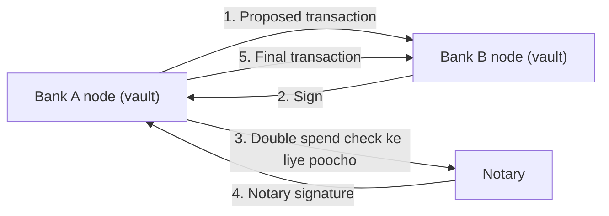
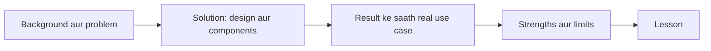

**Ek line mein:** <mark>Case study mein ek platform chuno, batao woh kaunsi problem solve karta hai, design se kaise, ek real use case, aur uski strengths aur limits; R3 Corda safe choice hai kyunki woh syllabus mein hai aur achhi tarah documented hai</mark>. <Cite id="corda-ripple-quorum-corda-intro-wp" />

<Box kind="key">

**Blockchain platform ke case study mein ye points likho:**

- Structure use karo: <mark>background aur problem, solution (design), use case, strengths aur limits, lesson</mark>.
- Chuna hua platform: <mark>R3 Corda</mark> (open-source, banks aur regulated businesses ke liye).
- **Problem:** har bank apni books rakhta hai, isliye deals <mark>haath se reconcile</mark> hoti hain; sensitive deals public chain pe nahi ja sakti.
- **Solution:** <mark>states, contracts, flows, point-to-point sharing (vaults), notary, identity certificates</mark>.
- **Use case:** trade finance, insurance claims, syndicated loans.
- **Lesson:** <mark>blockchain ko Bitcoin ki copy hona zaroori nahi</mark>; Corda global broadcast ki jagah privacy aur legal fit leta hai.
- Doosra case maange to backup: <mark>IBM Food Trust (Fabric), Ripple (cross-border payments)</mark>.

</Box>

## Core answer (5 marks, yahan ke har question ke liye)

<Box kind="definition">

A **case study** on a blockchain platform describes one real platform: why it was built, how it works, where it is used and how well it works. Here the platform is **R3 Corda**, an open-source blockchain platform for banks and regulated businesses. <Cite id="corda-ripple-quorum-corda-intro-wp" />

</Box>

**Background aur problem:** har bank apni books rakhta hai, isliye ek hi deal kai jagah record hoti hai aur haath se match karni padti hai (reconciliation). Yeh slow, mehnga aur galti-prone hai. Banks sensitive deals public chain pe bhi nahi daal sakte jahan sab dekh sakte hain.

**Solution (Corda ka design):**

1. **States:** ledger pe koi fact, jaise 1 crore ka loan, immutable state hai; deal purani state consume karke nayi banane se badalti hai.
2. **Contracts:** code (Java/Kotlin) jo batata hai transaction kab valid hai, legal agreement se juda.
3. **Flows:** code jisse parties seedhe baat karke step by step agree karti hain.
4. **Point-to-point sharing:** global broadcast nahi; sirf parties state ko **vault** mein rakhti hain, isse privacy milti hai.
5. **Notary:** confirm karta hai ki state pehle spent nahi hui, isliye double spending rukti hai.
6. **Identity:** har node ke paas network operator ka certificate hota hai. <Cite id="corda-ripple-quorum-xoriant-corda" />

**Use case:** trade finance, insurance claims aur syndicated loans, jahan kuch known parties ek agreement share karti hain. <Cite id="corda-ripple-quorum-corda-github" />

**Conclusion:** <mark>Corda shows how the blockchain idea can be reshaped for business, trading global broadcast for privacy and legal fit</mark>.

## Extended answer (10 marks): ye add karo

### 1. Strengths aur limits

| Strengths | Limits |
|---|---|
| Design se hi privacy | Ethereum se chhoti community |
| Contracts se legal link | Trusted network aur notary chahiye |
| Mining nahi, fast finality | Public, open coins ke liye nahi |

### 2. Corda vs Bitcoin aur Ethereum

| Point | Bitcoin | Ethereum | Corda |
|---|---|---|---|
| Access | Public | Public | Permissioned |
| Transaction kaun dekhta hai | Sab | Sab | Sirf parties |
| Consensus | PoW | PoS | Notary (uniqueness) |
| Smart contracts | Limited script | Solidity | Java/Kotlin, legal text se juda |
| Aim | Digital cash | General apps | Finance aur legal agreements |

<Cite id="corda-ripple-quorum-corda-tech-wp" />

### 3. Dusre platform pe yahi structure kaise lagayein

- **IBM Food Trust (Hyperledger Fabric):** problem hai food ki slow tracing; solution hai har handover ka shared ledger; result: Walmart ne mangoes ko farm tak 2.2 seconds mein trace kiya, pehle lagbhag 7 din lagte the. <Cite id="hyperledger-fabric-ibm-fabric" />
- **Ripple:** problem hai slow, mehnge cross-border payments; solution hai XRP Ledger jisme consensus 3 se 5 seconds mein hota hai aur XRP bridge currency hai. <Cite id="corda-ripple-quorum-gfg-ripple" />

## Har question mein kaise fit karein

- **"Case study on any Blockchain platform"** (10 marks) <PYQ id="2023-12/q6a" />: poora answer **ek** platform (Corda) pe likho: core answer (background, solution, diagram, use case), phir extended sections 1 aur 2. Shuru mein platform ka naam saaf likho.

## Exam tips

- **Ek platform chuno aur usi pe raho**; paanch-part structure use karo taaki answer case study jaisa lage.
- Keywords: <mark>problem, solution, use case, strengths, limits, lesson</mark>.
- Ek number ya real example do (Fabric ke liye Walmart mango trace).

Exam mein English mein likho.
