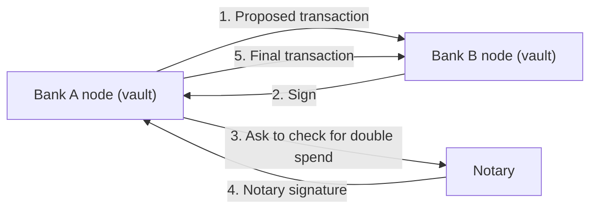
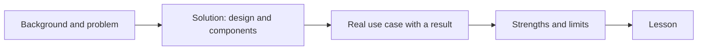

**In one line:** <mark>A case study picks one platform, states the problem it solves, how its design solves it, a real use case, and its strengths and limits; R3 Corda is a safe choice because it is in the syllabus and well documented</mark>. <Cite id="corda-ripple-quorum-corda-intro-wp" />

<Box kind="key">

**Key points to write (case study on a blockchain platform):**

- Use the structure: <mark>background and problem, solution (design), use case, strengths and limits, lesson</mark>.
- Platform chosen: <mark>R3 Corda</mark> (open-source, for banks and regulated businesses).
- **Problem:** every bank keeps its own books, so deals are <mark>reconciled by hand</mark>; sensitive deals cannot go on a public chain.
- **Solution:** <mark>states, contracts, flows, point-to-point sharing (vaults), notary, identity certificates</mark>.
- **Use case:** trade finance, insurance claims, syndicated loans.
- **Lesson:** <mark>a blockchain need not copy Bitcoin</mark>; Corda trades global broadcast for privacy and legal fit.
- Backup cases if asked for another: <mark>IBM Food Trust (Fabric), Ripple (cross-border payments)</mark>.

</Box>

## Core answer (5 marks, fits every question here)

<Box kind="definition">

A **case study** on a blockchain platform describes one real platform: why it was built, how it works, where it is used and how well it works. Here the platform is **R3 Corda**, an open-source blockchain platform for banks and regulated businesses. <Cite id="corda-ripple-quorum-corda-intro-wp" />

</Box>

**Background and problem:** every bank keeps its own books, so the same deal is recorded in many places and must be matched by hand (reconciliation). This is slow, costly and error-prone. Banks also cannot put sensitive deals on a public chain where all can see them.

**Solution (Corda's design):**

1. **States:** a fact on the ledger, such as a loan of 1 crore, is an immutable state; a deal changes by consuming the old state and creating a new one.
2. **Contracts:** code (Java/Kotlin) that says when a transaction is valid, tied to the legal agreement in words.
3. **Flows:** code that lets parties talk directly and agree step by step.
4. **Point-to-point sharing:** no global broadcast; only the parties hold the state in a **vault**, which gives privacy.
5. **Notary:** confirms a state has not been spent already, so double spending is stopped.
6. **Identity:** every node has a certificate from a network operator. <Cite id="corda-ripple-quorum-xoriant-corda" />

**Use case:** trade finance, insurance claims and syndicated loans, where a few known parties share an agreement. <Cite id="corda-ripple-quorum-corda-github" />

**Conclusion:** <mark>Corda shows how the blockchain idea can be reshaped for business, trading global broadcast for privacy and legal fit</mark>.

## Extended answer (10 marks): add these

### 1. Strengths and limits

| Strengths | Limits |
|---|---|
| Privacy by design | Smaller community than Ethereum |
| Legal link to contracts | Needs a trusted network and notary |
| No mining, fast finality | Not for public, open coins |

### 2. Corda compared with Bitcoin and Ethereum

| Point | Bitcoin | Ethereum | Corda |
|---|---|---|---|
| Access | Public | Public | Permissioned |
| Who sees a transaction | Everyone | Everyone | Only the parties |
| Consensus | PoW | PoS | Notary (uniqueness) |
| Smart contracts | Limited script | Solidity | Java/Kotlin, tied to legal text |
| Aim | Digital cash | General apps | Finance and legal agreements |

<Cite id="corda-ripple-quorum-corda-tech-wp" />

### 3. How to apply the same structure to another platform

- **IBM Food Trust (Hyperledger Fabric):** problem is slow food tracing; solution is a shared ledger of every handover; result: Walmart traced mangoes to the farm in 2.2 seconds versus nearly 7 days. <Cite id="hyperledger-fabric-ibm-fabric" />
- **Ripple:** problem is slow, costly cross-border payments; solution is the XRP Ledger with consensus in 3 to 5 seconds and XRP as a bridge currency. <Cite id="corda-ripple-quorum-gfg-ripple" />

## Fit it to each question

- **"Case study on any Blockchain platform"** (10 marks) <PYQ id="2023-12/q6a" />: write the whole answer on **one** platform (Corda): core answer (background, solution, diagram, use case), then extended sections 1 and 2. Name the platform clearly at the start.

## Exam tips

- **Pick one platform and stay on it**; use the five-part structure so the answer reads like a case study.
- Keywords: <mark>problem, solution, use case, strengths, limits, lesson</mark>.
- Give one number or real example (for Fabric, the Walmart mango trace).
