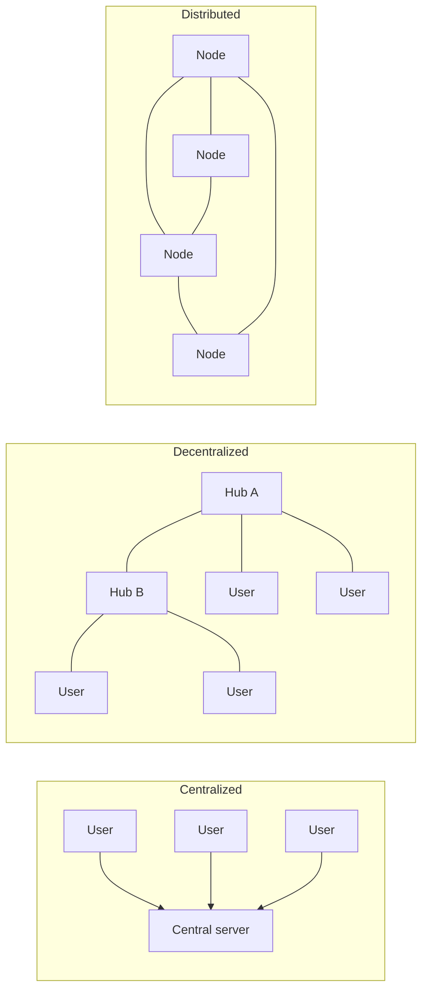
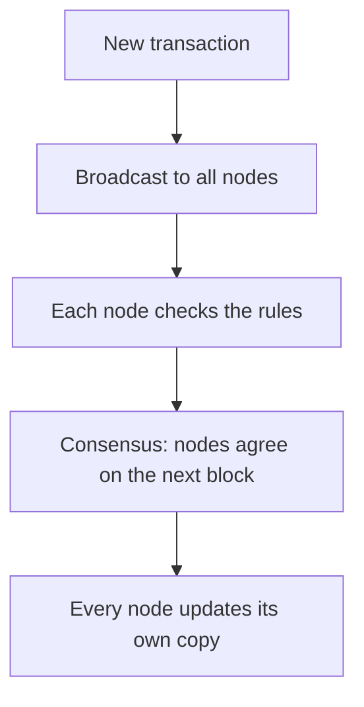

**In one line:** <mark>A centralized system has one central authority that controls everything, a decentralized system spreads control over several independent nodes, and a distributed system spreads the work and the data over many machines that act as one system</mark>; blockchain is both distributed and decentralized. <Cite id="web-bt-sol-a-gfg-cdd" />

<Box kind="key">

**Key points to write:**

- **Centralized:** <mark>one server or authority</mark> stores data and takes decisions; clients only ask it. Example: a bank's database.
- **Decentralized:** <mark>control is shared by several nodes</mark>, no single owner of the whole system. Example: a public blockchain.
- **Distributed:** <mark>data and processing are spread over many computers</mark> in different places that cooperate. A distributed system can still have one boss (a company's cloud database).
- Centralized has a <mark>single point of failure</mark>; the other two survive node failures.
- Trade-off: <mark>centralized is simple and fast; decentralized and distributed are fault tolerant but need agreement (consensus)</mark>.
- <mark>Blockchain = distributed ledger + decentralized control</mark>: every node keeps a full copy and nobody owns the network.

</Box>

## Core answer (5 marks, fits every question here)

<Box kind="definition">

A **centralized system** keeps all data and decisions at one central point (server or authority). A **decentralized system** has no single owner: control is shared among many nodes. A **distributed system** is a group of computers in different places that share the work and data and appear to the user as one system. <Cite id="web-bt-sol-a-gfg-cdd" /> <Cite id="web-bt-sol-a-wiki-distcomp" />

</Box>

**Easy picture:** a school with one principal who decides everything (centralized); a college with several department heads, each deciding for their own department (decentralized); a class where every student keeps a copy of the same notebook and they all correct it together (distributed).

| Point | Centralized | Decentralized | Distributed |
|---|---|---|---|
| Control | One authority | Several independent nodes | Spread over all nodes (may or may not have one owner) |
| Data | One place | Spread over several hubs | Copied or split over many machines |
| Failure | Single point of failure | One hub failing hurts only its part | Survives many failures |
| Speed and management | Simple and fast | Medium | Harder: nodes must stay in step |
| Trust | Trust the owner | Trust no single party | Trust the rules and consensus |
| Example | Bank server, Facebook database | Public blockchain, federated e-mail | Bitcoin ledger, Google cloud storage |

<Cite id="web-bt-sol-a-gfg-cdd" /> <Cite id="web-bt-sol-a-gfg-dist-dec" />

**Why this matters for blockchain:** the teacher's slides start from the problem: <Cite id="class-bt-m1" loc="slide 4" /> data kept in one place can be hacked or can fail, and the answer is to store it in a distributed way on many computers. <Cite id="class-bt-m1" loc="slide 5" /> A blockchain network is not controlled by a central authority and every participant holds the same copy of the ledger. <Cite id="class-bt-m1" loc="slide 19" />

**Conclusion:** <mark>blockchain moves from a centralized trusted record keeper to a distributed, decentralized ledger that nobody alone controls</mark>.

## Extended answer (10 marks): add these

### 1. Centralized versus distributed ledger

| Point | Centralized ledger | Distributed ledger |
|---|---|---|
| Copies | One master copy | Full copy on every node |
| Tampering | Admin can edit | Must change most copies |
| Update speed | Fast | Slower (consensus) |
| Failure | Server down means no service | Other nodes keep running |

<Cite id="web-bt-sol-a-gfg-ledgers" /> <Cite id="blockchain-fundamentals-wiki-dlt" />

### 2. Advantages and disadvantages

- **Centralized:** + easy to manage, quick decisions, simple to build. - single point of failure, easy target for hackers, users must trust the owner, can censor.
- **Decentralized:** + no single owner, resists censorship, harder to shut down. - slow decisions, hard to upgrade, needs incentives.
- **Distributed:** + scalable, fault tolerant, no single point of failure. - complex, nodes must stay consistent, higher communication cost. <Cite id="web-bt-sol-a-gfg-dist-dec" />

### 3. Same idea for storage

The slides show it again for files: centralized storage depends on one provider and one server, decentralized storage on many participating nodes. <Cite id="class-bt-m3b" loc="slide 28" />

### 4. Distributed is not always decentralized

Distributed describes where the computers are; decentralized describes who is in charge. A company's cloud database is distributed but still controlled by one company. Bitcoin is both: its nodes are spread over the world and no one controls it. <Cite id="blockchain-fundamentals-nakamoto" /> <Cite id="web-bt-sol-a-gfg-dist-dec" />

## Fit it to each question

- **"Differentiate between centralized, decentralized, and distributed systems."** (10 marks) <PYQ id="assignment-1/q1e" />: easy picture, three-shape diagram, the comparison table, then extended sections 2 and 4 and the conclusion.

## Exam tips

- **Draw** the three shapes side by side; label the central server in the first.
- Keywords: <mark>single point of failure, central authority, nodes, consensus, peer-to-peer</mark>.
- Do not write that distributed and decentralized mean the same; add the "who is in charge" line.
